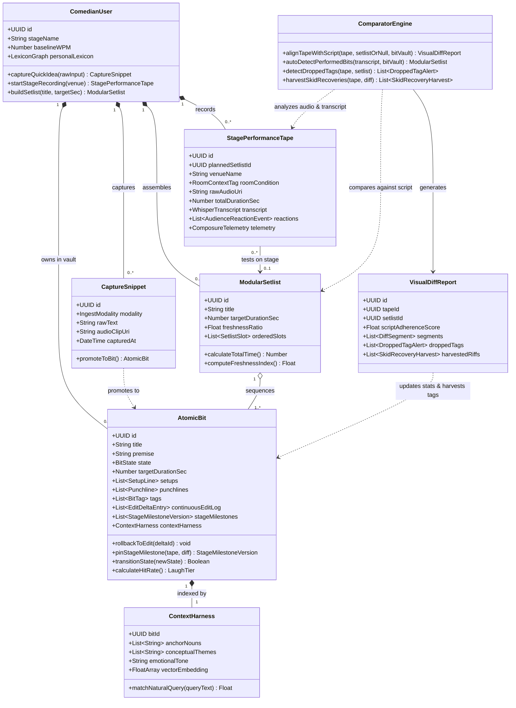

# 🏛️ Comedy OS: Master Domain Class Diagram (MVP)

> **Purpose:** High-level object-oriented domain model for the **Comedy OS MVP**. This diagram illustrates how the 4 core pillars—**Unified Ingestion**, **Audio Performance Tape**, **The Comparator Bridge**, and the **Atomic Bit Database & Lexicon**—interact as domain entities.

---

## 🗺️ Master Domain UML Class Diagram

---

## 📂 Detailed Subsystem Class Diagrams (MVP Modules)

1. **[[01_Unified_Ingestion_and_Capture_Classes|01: Unified Ingestion, Morphing CTA & Delivery Notation Classes]]**
   * Covers the single-CTA Morphing Input Bar (Typed vs. Quick Voice Memo), Ghost Mode Distraction Shield, and the Inline Delivery Notation AST (`💥`, `🥊`, `💤`, `🗣️`, `🤸`).
2. **[[02_Audio_DSP_and_Performance_Tape_Classes|02: Audio DSP, Whisper ASR & Composure Telemetry Classes]]**
   * Covers Dual-Band Acoustic Isolation (Voice vs. Crowd Roar), millisecond word timestamps, Laughter Energy scoring, Pacing Flares, and Rushed Recovery detection.
3. **[[03_Comparator_Bridge_and_Diff_Classes|03: Comparator Bridge, Visual Diff & Skid Recovery Classes]]**
   * Covers Semantic vs. Verbatim Diff segments (Green Ad-Libs, Red Omissions), Dropped Tag Alerts, and Automated Skid Recovery Harvesting.
4. **[[04_Atomic_Bit_Database_and_Lexicon_Classes|04: Atomic Bit Database, State Machine, Lexicon & Highlighter Classes]]**
   * Covers the Living Object State Machine (`Draft ➔ Testing ➔ Stage Ready ➔ Retired`), Setlist Timeline, Semantic Context Harness, and Editor Lens Word Highlighting.
5. **[[05_Class_Architecture.canvas|05: Interactive Class Architecture Canvas]]**
   * Visual Obsidian Canvas containing the complete UML class hierarchy.
