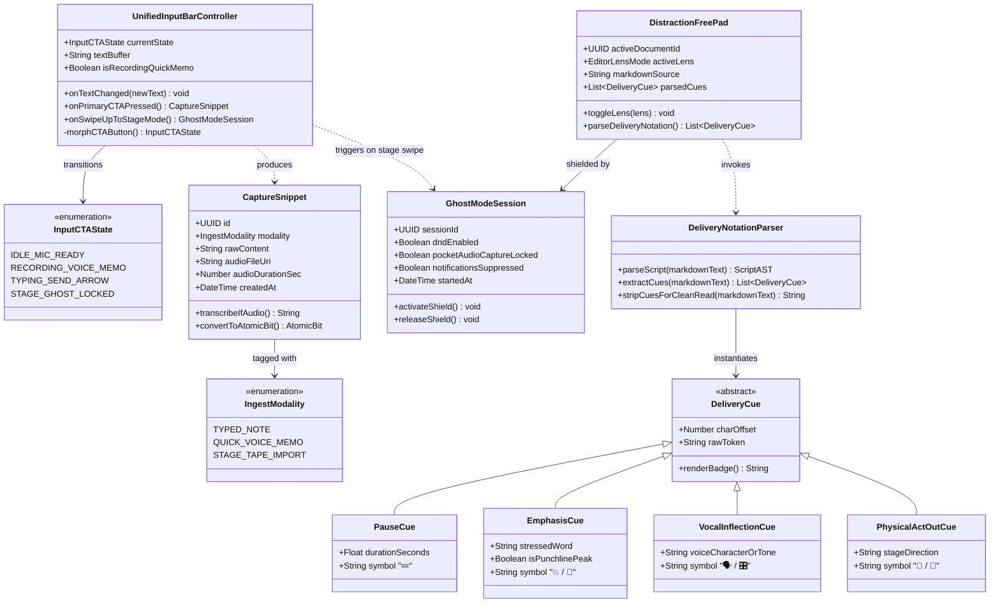

# ⚡ 01: Unified Ingestion, Morphing CTA & Delivery Notation Classes

> **Architectural Scope:** Models the unified input bar that harmonizes **Google Keep-style instant text capture** with **quick voice memo dictation** via a single morphing CTA, alongside **Ghost Mode** and the **Inline Delivery Notation Engine**.

---

## 🗺️ Subsystem Class Diagram

---

## 🔍 Key Design Notes

1. **Single Primary CTA (`UnifiedInputBarController`):**
   - When `textBuffer.isEmpty == true`, `currentState` is `IDLE_MIC_READY`. Tapping records a quick voice memo without navigating menus.
   - As soon as `onTextChanged()` receives characters, `morphCTAButton()` shifts state to `TYPING_SEND_ARROW`.
   - Both paths output a standardized `CaptureSnippet` into the inbox.
2. **Pocket / Off-Stage Recording Separation (`onSwipeUpToStageMode`):**
   - Swiping up on the `[🎙️ Record Set]` trigger bypasses short snippet creation and initializes a full `GhostModeSession` + `StagePerformanceTape`.
   - *Product Note:* "High-Contrast Stage Mode" (on-stage teleprompter) is **cancelled** and will only return if users request it. Comics do not carry phones onto the stage; the phone sits in the pocket, handbag, or green room recording the room audio.
3. **Polymorphic `DeliveryCue` Hierarchy:**
   - Allows the desk editor and post-set review to render pauses (`💤`), vocal emphasis (`💥`), and physical act-outs (`🤸`) without polluting the plain text used for word-count and WPM calculations.

---

## 🔗 Related Feature Notes
* [[Comedy_OS_Note_Taker_Vault/01_Ghost_Mode_Distraction_Shield|01: Ghost Mode Distraction Shield]]
* [[Comedy_OS_Note_Taker_Vault/20_Text_Forward_Capture_Layer|20: Text-Forward Capture Layer]]
* [[Comedy_OS_Note_Taker_Vault/21_Distraction_Free_Markdown_Pad|21: Distraction-Free Markdown Pad]]
* [[Comedy_OS_Note_Taker_Vault/23_Inline_Delivery_Notation_Engine|23: Inline Delivery Notation Engine]]
