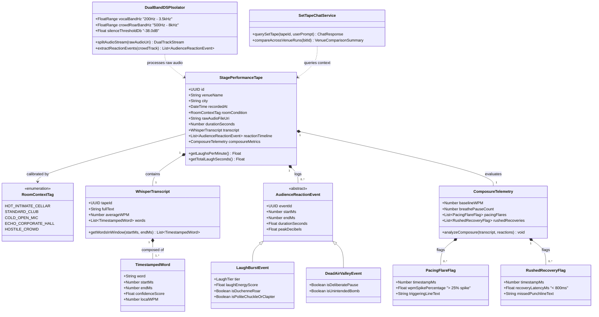

# 🔊 02: Audio DSP, Whisper ASR & Composure Telemetry Classes

> **Architectural Scope:** Models the Granola-style performance recording pipeline: **Dual-Band Acoustic Isolation** (separating comic speech from crowd roar), **Whisper ASR millisecond word transcription**, **Post-Set Composure Telemetry**, and **Conversational Set Tape Q&A**.

---

## 🗺️ Subsystem Class Diagram

---

## 🔍 Key Design Notes

1. **Eliminating the Cringe Barrier (`WhisperTranscript` + `SetTapeChatService`):**
   - Instead of forcing the comedian to listen to 15 minutes of raw audio, `WhisperTranscript` provides millisecond-aligned words so the comic can **read** the set or query `SetTapeChatService` (*"Where did I rush during the second bit?"*).
2. **Acoustic Truth vs. Clapter (`LaughBurstEvent`):**
   - Distinguishes genuine `isDuchenneRoar` (> -6dB, sustained > 2.5s) from `isPoliteChuckleOrClapter` (short decay or applause without vocal roar), preventing the destructive belief that *"every noise from the crowd means the joke is ready."*
3. **Post-Set Composure Diagnostics (`ComposureTelemetry`):**
   - Automatically flags **Pacing Flares** (speaking speed spiking by $\ge 25\%$ after dead air) and **Rushed Recoveries** (jumping into the next setup in $< 0.8\text{s}$), turning stage panic into neutral laboratory telemetry.

---

## 🔗 Related Feature Notes
* [[Comedy_OS_Note_Taker_Vault/10_Audio_Forward_Ingestion_Layer|10: Audio-Forward Ingestion Layer]]
* [[Comedy_OS_Note_Taker_Vault/11_Audience_Laughter_and_Silence_Isolation|11: Audience Laughter & Silence Isolation]]
* [[Comedy_OS_Note_Taker_Vault/13_Whisper_ASR_Speech_To_Text|13: Whisper ASR Speech-to-Text]]
* [[Comedy_OS_Note_Taker_Vault/14_Conversational_Chat_With_Set_Tape|14: Conversational Chat With Set Tape]]
* [[Comedy_OS_Note_Taker_Vault/33_Reaction_Waveform_Alignment|33: Reaction Waveform Alignment]]
