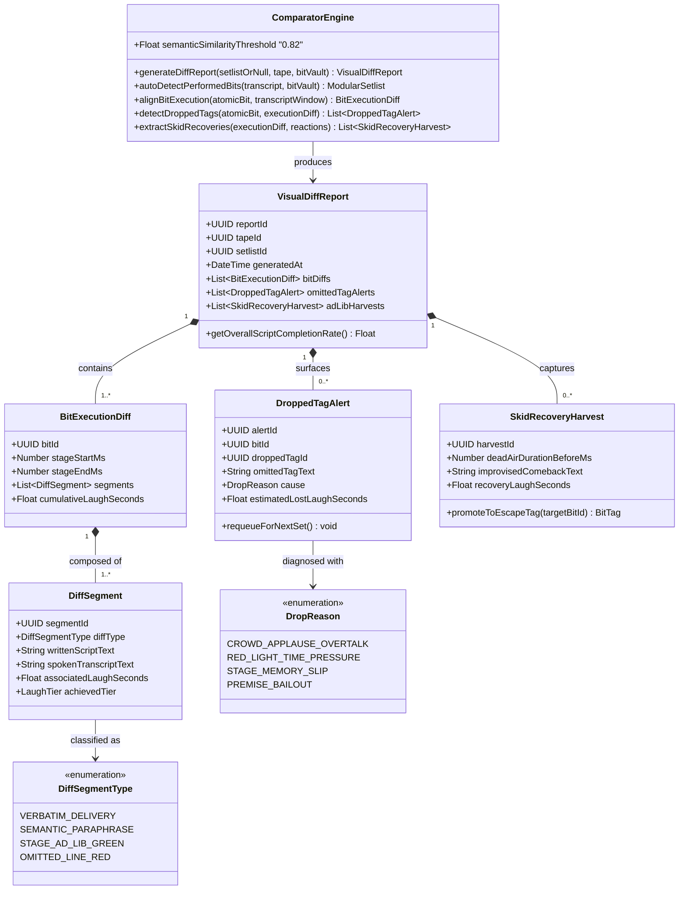

# ⚡ 03: Comparator Bridge, Visual Diff & Skid Recovery Classes

> **Architectural Scope:** Models the "Secret Sauce" of Comedy OS: aligning the **Written Script / Setlist** against the **Spoken Stage Performance Tape**, distinguishing semantic rephrasing from genuine omissions, alerting on **Dropped Tags**, and harvesting improvised **Skid Recovery Riffs**.

---

## 🗺️ Subsystem Class Diagram

---

## 🔍 Key Design Notes

1. **Solving the Verbatim vs. Organic Riffing Conflict (`SEMANTIC_PARAPHRASE`):**
   - Stand-up comics rarely recite lines word-for-word like stage actors.
   - `ComparatorEngine` uses `semanticSimilarityThreshold` (0.82) to classify natural conversational rephrasing as `SEMANTIC_PARAPHRASE` (rendered in calm plain text) rather than penalizing the comic with a false `OMITTED_LINE_RED`.
2. **One-Tap Ad-Lib Promotion (`STAGE_AD_LIB_GREEN` & `SkidRecoveryHarvest`):**
   - When a comic improvises a new line on stage (`STAGE_AD_LIB_GREEN`) or saves a flatline with a self-aware comeback (`SkidRecoveryHarvest`), they can promote it directly into the `AtomicBit` vault with a single tap.
3. **Diagnostic `DropReason` on `DroppedTagAlert`:**
   - Tells the comic *why* they forgot a tag: either the crowd cheered so loudly they transitioned too early (`CROWD_APPLAUSE_OVERTALK`), or they ran out of clock (`RED_LIGHT_TIME_PRESSURE`).
4. **Unplanned Setlist Auto-Detection (`autoDetectPerformedBits`):**
   - If a comic records a set without pre-selecting a `ModularSetlist`, `ComparatorEngine` scans the spoken `WhisperTranscript` against the `ContextHarness` of all `AtomicBit` objects in their vault, reconstructs the performed setlist order automatically, and still generates the full `VisualDiffReport`.

---

## 🔗 Related Feature Notes
* [[Comedy_OS_Note_Taker_Vault/30_The_Comparator_Bridge|30: The Comparator Bridge Overview]]
* [[Comedy_OS_Note_Taker_Vault/31_Visual_Diff_Report|31: Visual Diff Report]]
* [[Comedy_OS_Note_Taker_Vault/32_Dropped_Tag_Alerts|32: Dropped Tag Alerts]]
* [[Comedy_OS_Note_Taker_Vault/33_Reaction_Waveform_Alignment|33: Reaction Waveform Alignment]]
