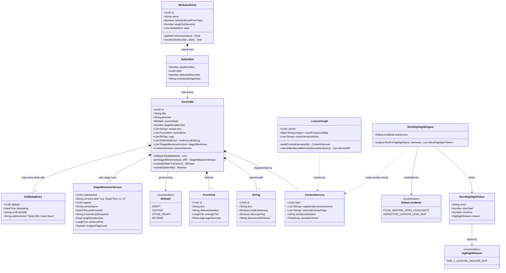

# 🧱 04: Atomic Bit Database, State Machine, Lexicon & Highlighter Classes

> **Architectural Scope:** Models jokes as living domain objects governed by a **Finite State Machine**, dual-tier **FigJam-style Edit Rollback + Stage Milestone Versioning**, **Modular Setlist Timelines**, the **Semantic Context Harness (Lexicon)**, and **MVP Tier-1 Word Highlighting**.

---

## 🗺️ Subsystem Class Diagram

---

## 🔍 Key Design Notes

1. **Dual-Tier Versioning (`EditDeltaEntry` vs. `StageMilestoneVersion`):**
   - **Continuous Desk Rollback (`EditDeltaEntry`):** Every text change in the editor is logged as a lightweight delta patch (just like FigJam's undo/activity history), allowing the comic to roll back accidental deletions without cluttering the UI.
   - **Visually Distinct Stage Milestones (`StageMilestoneVersion`):** When a bit is actually tested on a `StagePerformanceTape`, a high-status **Stage Milestone Version** (`Stage Run v1`, `Stage Run v2`) is pinned in the database and highlighted prominently in the version timeline with its venue badge and laugh score.
2. **MVP Scope Discipline for Word Highlighting (`TIER_1_LEXICON_ANCHOR_MVP`):**
   - To keep potential error sources to an absolute minimum in the MVP, `WordHighlightEngine` only highlights **Tier 1 Lexicon Anchor Words** (words registered in the joke's `ContextHarness`) when `INSPECTOR_LEXICON_LENS_MVP` is toggled.
   - Tiers 2–5 (Substitution candidates, overused filler crutches, clean-set profanity flags, and OCR gaps) are cleanly deferred to Post-MVP.
3. **Context-Free Memory Retrieval (`LexiconGraph` + `ContextHarness`):**
   - Calling `searchByNaturalMemory("feeling stripped of dignity at the airport")` matches the `ContextHarness` even if the joke text only contains words like *TSA, belt loops, and socks*.

---

## 🔗 Related Feature Notes
* [[Comedy_OS_Note_Taker_Vault/24_Lexicon_Harness_and_Word_Highlighter|24: Lexicon Context Harness & Word Highlighting]]
* [[Comedy_OS_Note_Taker_Vault/40_Atomic_Bit_Database|40: Atomic Bit Vault & Object Schema]]
* [[Comedy_OS_Note_Taker_Vault/41_Jokes_As_Living_Objects_State_Machine|41: Jokes as Living Objects State Machine]]
* [[Comedy_OS_Note_Taker_Vault/42_Drag_And_Drop_Modular_Setlist_Timeline|42: Drag-and-Drop Modular Setlist Timeline]]
* [[Comedy_OS_Note_Taker_Vault/43_Conversational_Semantic_Search_And_Vector_Embeddings|43: Conversational Semantic Search & Vector Embeddings]]
