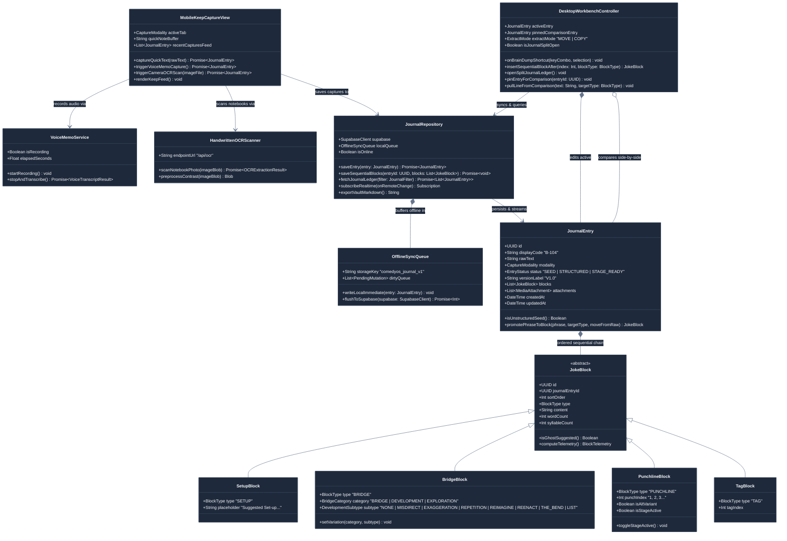

# 🏛️ 06: Mobile Keep Capture, Desktop Sequential Workbench & Supabase Sync Classes

> **Architectural Scope:** Models the decoupled **Mobile Keep Ingestion Client** (Quick Text, Voice Memo ASR, Handwritten Notebook OCR/OXR), the **Dual-Layer Supabase + Offline Repository**, and the **Desktop Two-Stage Sequential Joke Workbench** (Brain Dump $\rightarrow$ Ghost Suggested Setup/Punchline $\rightarrow$ Variable Sequential Bridge/Punch/Tag Chain + Obsidian/Antigravity Split Journal).

---

## 1. UML Class Diagram (`classDiagram`)

---

## 2. Class-by-Class Explanation & Architectural Design Choices

1. **`MobileKeepCaptureView` (Mobile-Only Ingestion Client):**
   - Provides three fast capture modes (`Quick Text`, `🎤 Voice Memo`, `📷 OCR Scan Handwritten Note`) and a chronological Google Keep-style list of captured seeds. Zero multi-block editing clutter on mobile.
2. **`VoiceMemoService` & `HandwrittenOCRScanner`:**
   - Handles mobile microphone dictation and camera photos of physical notebook pages, routing them to Cloudflare Pages Functions (`/api/transcribe` and `/api/ocr`) and attaching original media files to Supabase Storage.
3. **`JournalRepository` & `OfflineSyncQueue`:**
   - Dual-layer persistence: writes immediately to `localStorage` (`comedyos_journal_v1`) for zero-latency offline reliability in basement comedy clubs, then syncs to **Supabase PostgreSQL** (`journal_entries` & `joke_blocks`) and broadcasts live updates via **Supabase Realtime**.
4. **`JournalEntry` & Polymorphic `JokeBlock` Subclasses (`SetupBlock`, `BridgeBlock`, `PunchlineBlock`, `TagBlock`):**
   - Models the ordered sequential block chain (`sortOrder: 0..N`). Empty `SetupBlock` and `PunchlineBlock` instances return `isGhostSuggested() === true` (`opacity: 0.36`), while `BridgeBlock` supports `Bridge`, `Exploration`, and `Development` (`Misdirect`, `Exaggeration`, `Repetition`, `Reimagine`, `Reenact`, `The Bend`, `List`) anywhere in the chain.
5. **`DesktopWorkbenchController`:**
   - Powers the Desktop two-stage workflow (`Alt+S`/`Alt+P`/`Alt+B`/`Alt+T` extraction from Brain Dump into the sequential circuit) and the **Obsidian / Antigravity Split-View Journal** where `activeEntry` stays visible on the right while `pinnedComparisonEntry` or the Journal Ledger is open on the left.
