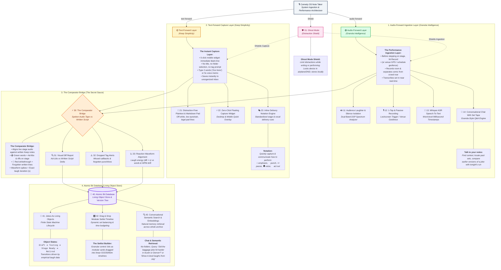

# 🎙️ Comedy OS Note Taker: Master Architecture

> **Design Goal:** Eliminate the friction of generic note-taking apps by combining **Google Keep's zero-click capture speed** with **Granola's conversational audio intelligence**, bridged by an **Audio-vs-Text Comparator Engine** and backed by an **Atomic Bit Database**.

---

## 🗺️ Master Visual Architecture (FigJam Flowchart)

---

## 🧭 Vault Navigation & System Modules

1. **Central Shield**:
   - [[01_Ghost_Mode_Distraction_Shield|🛡️ Ghost Mode (Offline Storage & Zero Popups)]]

2. **Audio-Forward Layer (Granola Style)**:
   - [[10_Audio_Forward_Ingestion_Layer|🟢 1.0 The Performance Ingestion Layer Overview]]
   - [[11_Audience_Laughter_and_Silence_Isolation|🔊 1.1 Audience Laughter & Silence Isolation]]
   - [[12_One_Tap_and_Passive_Recording|🎙️ 1.2 1-Tap & Passive Geofenced Recording]]
   - [[13_Whisper_ASR_Speech_To_Text|📝 1.3 Whisper ASR Speech-to-Text Pipeline]]
   - [[14_Conversational_Chat_With_Set_Tape|💬 1.4 Conversational Chat Query with Set Tape]]

3. **Text-Forward Capture Layer (Keep Style)**:
   - [[20_Text_Forward_Capture_Layer|🟡 2.0 The Instant Capture Layer Overview]]
   - [[21_Distraction_Free_Markdown_Pad|📄 2.1 Distraction-Free Plaintext & Markdown Pad]]
   - [[22_Zero_Click_Floating_Capture_Widget|⚡ 2.2 Zero-Click Floating Capture Widget]]
   - [[23_Inline_Delivery_Notation_Engine|🎭 2.3 Inline Delivery Notation Engine]]
   - [[25_Jimmy_Carr_Joke_Writing_Architecture|✍️ 2.5 Jimmy Carr Joke Writing Screen & Interaction Architecture]]
   - [[26_Desktop_Workbench_Mobile_Keep_Supabase_Architecture|🏛️ 2.6 Desktop Workbench, Mobile Keep Capture & Supabase Cloud Architecture]]

4. **The Comparator Bridge (The Secret Sauce)**:
   - [[30_The_Comparator_Bridge|⚡ 3.0 The Comparator Bridge Overview]]
   - [[31_Visual_Diff_Report|🔍 3.1 Visual Diff Report (Ad-Libs vs Written Script)]]
   - [[32_Dropped_Tag_Alerts|⚠️ 3.2 Dropped Tag Alerts & Missed Callback Detector]]
   - [[33_Reaction_Waveform_Alignment|📈 3.3 Reaction Alignment (Laugh Spikes vs Spoken Words)]]

5. **Atomic Bit Database (Object-Oriented Layer)**:
   - [[40_Atomic_Bit_Database|🧱 4.0 Atomic Bit Vault & Object Schema]]
   - [[41_Jokes_As_Living_Objects_State_Machine|🔄 4.1 Jokes as Living Objects (Lifecycle State Machine)]]
   - [[42_Drag_And_Drop_Modular_Setlist_Timeline|🎛️ 4.2 Drag-and-Drop Modular Setlist Timeline]]
   - [[43_Conversational_Semantic_Search_And_Vector_Embeddings|🧠 4.3 Semantic Vector Search & Contextual Zero-Tag Indexing]]

6. **UML Class Diagrams (MVP Domain Architecture)**:
   - [[Class_Diagrams/00_Master_Domain_Class_Diagram|🏛️ 00: Master Domain Class Diagram (MVP)]]
   - [[Class_Diagrams/01_Unified_Ingestion_and_Capture_Classes|⚡ 01: Unified Ingestion, Morphing CTA & Delivery Notation Classes]]
   - [[Class_Diagrams/02_Audio_DSP_and_Performance_Tape_Classes|🔊 02: Audio DSP, Whisper ASR & Composure Telemetry Classes]]
   - [[Class_Diagrams/03_Comparator_Bridge_and_Diff_Classes|⚡ 03: Comparator Bridge, Visual Diff & Skid Recovery Classes]]
   - [[Class_Diagrams/04_Atomic_Bit_Database_and_Lexicon_Classes|🧱 04: Atomic Bit Database, State Machine, Lexicon & Highlighter Classes]]
   - [[Class_Diagrams/05_Class_Architecture.canvas|🗺️ 05: Interactive Class Architecture Canvas]]
   - [[Class_Diagrams/06_Mobile_Keep_Desktop_Workbench_Supabase_Classes|🏛️ 06: Mobile Keep Capture, Desktop Sequential Workbench & Supabase Sync Classes]]

---

## 🎨 Interactive Obsidian Canvas
* Open the interactive visual canvas in Obsidian: **[[Comedy_OS_Architecture.canvas]]**.
