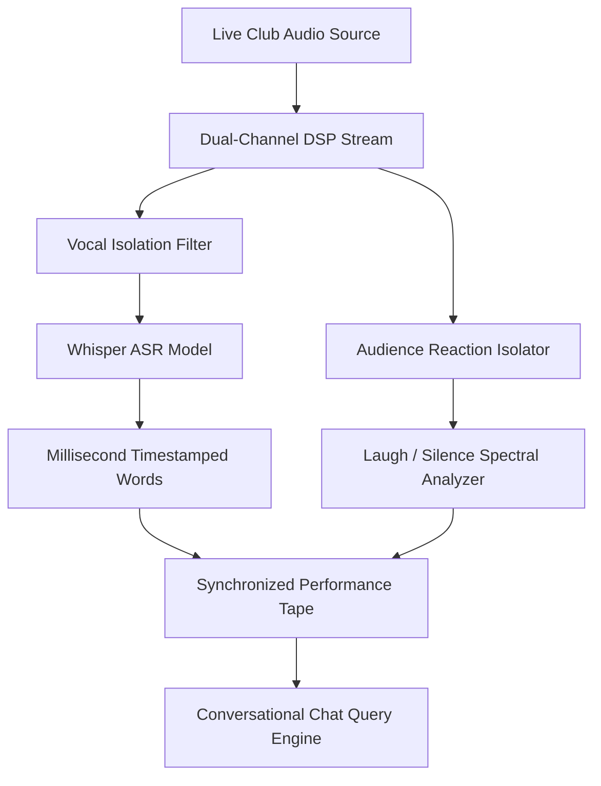

# 🟢 Audio-Forward Ingestion Layer (Granola Intelligence)

> **Inspiration:** Like Granola for business meetings, Comedy OS turns ambient, imperfect spoken audio into structured, interactive knowledge—specifically tailored to the high-noise, dynamic acoustics of comedy clubs.

## 1. Distinctive Capabilities
1. **Dual-Track Audio Decomposition:** Separates comic mic feed from crowd room reverberation.
2. **Context-Aware Speech-to-Text:** Specialized vocabulary lexicon for comedy slang, premise setups, callbacks, and conversational cadence.
3. **Set Tape Synthesis:** Synchronizes transcript tokens directly with acoustic decibel energy levels.

## 2. Sub-Components
- [[11_Audience_Laughter_and_Silence_Isolation|1.1 Audience Laughter & Silence Isolation]]
- [[12_One_Tap_and_Passive_Recording|1.2 1-Tap & Passive Geofenced Recording]]
- [[13_Whisper_ASR_Speech_To_Text|1.3 Whisper ASR Speech-to-Text Pipeline]]
- [[14_Conversational_Chat_With_Set_Tape|1.4 Conversational Chat Query with Set Tape]]
