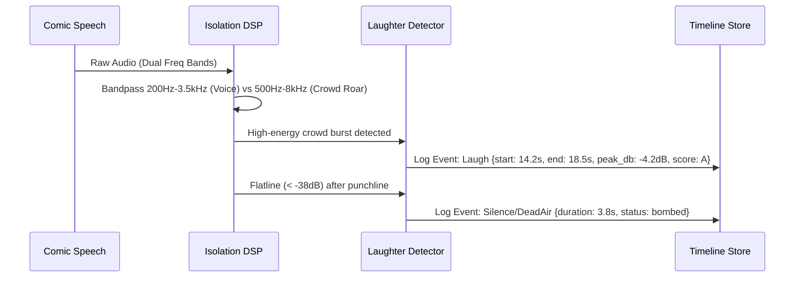

# 🔊 Audience Laughter & Silence Isolation
[[]]
> **The Metric that Matters:** A comedian doesn't just want words—they need to know **where the crowd erupted, where they chuckled, and where the room went stone dead.**



## 1. Laugh vs. Voice Spectral Gating
- **Speech Band:** Centered in 300 Hz – 3,400 Hz format frequencies with distinct harmonic formants.
- **Laughter Signature:** Non-harmonic, turbulent burst noise characterized by rhythmic 4–6 Hz pulse frequency envelope, spread across 800 Hz – 6,000 Hz.
- **Decibel Classification Tier:**
  - **A-Tier (Roar/Applause):** > 18 dB above room floor, duration > 4.0s.
  - **B-Tier (Solid Laugh):** 10–18 dB above room floor, duration 2.0s – 4.0s.
  - **C-Tier (Chuckle/Titter):** 4–10 dB above room floor, duration 0.8s – 2.0s.
  - **Crickets (Dead Air):** < 3 dB room ambient variation for > 3.0s following speech termination.

## 2. Audio Feature Output Schema
```json
{
  "tape_id": "tape_2026_austin_creek_01",
  "events": [
    {
      "type": "laughter",
      "timestamp_start_ms": 42100,
      "timestamp_end_ms": 46800,
      "duration_ms": 4700,
      "peak_db": -6.1,
      "tier": "A",
      "preceding_word_token_id": "token_airline_peanut_punch"
    },
    {
      "type": "silence",
      "timestamp_start_ms": 48200,
      "timestamp_end_ms": 52400,
      "duration_ms": 4200,
      "tier": "crickets",
      "preceding_word_token_id": "token_airline_pilot_tag"
    }
  ]
}
```

## 3. Integrations
- Feeds directly into [[33_Reaction_Waveform_Alignment|Reaction Waveform Alignment]].
- Triggers [[32_Dropped_Tag_Alerts|Dropped Tag Alerts]] when a silence follows a shortened setup.
