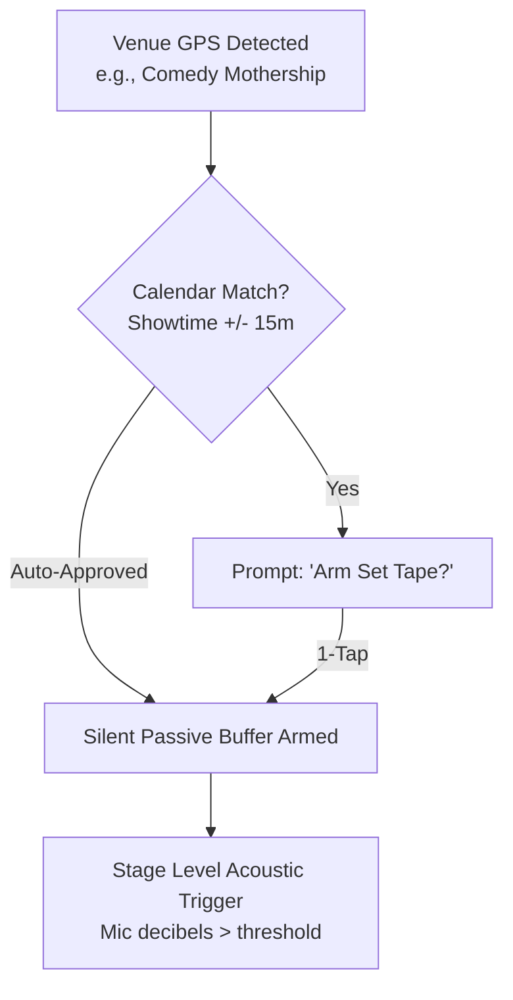

# 🎙️ 1-Tap & Passive Geofenced Recording

> **Friction Kills Archiving:** If a comic has to unlock their phone, enter a passcode, find an app, create a file, and hit record 30 seconds before going on stage, 60% of stage sets will never be captured.

## 1. Ingestion Triggers

### 1. Zero-Friction 1-Tap
- **Android Quick Settings Tile:** A persistent tile labeled `Record Set`. Tap once from the lock screen. Audio starts buffering in under 180ms.
- **Physical Button Remapping:** Double-press Volume Down when inside a known venue launches immediate background recording.

### 2. Geofence & Calendar Auto-Arming

## 2. Background Resilience
- **Rolling Memory Buffer:** Uses an uncompressed 30-second circular buffer in memory so comic never misses the opening line even if tapped late.
- **Crash Recovery:** Writes audio chunks directly to disk every 10 seconds via Android Foreground Service with `FOREGROUND_SERVICE_TYPE_MICROPHONE`.
- Integrates with [[01_Ghost_Mode_Distraction_Shield|Ghost Mode]] to lock out OS notifications during active capture.
