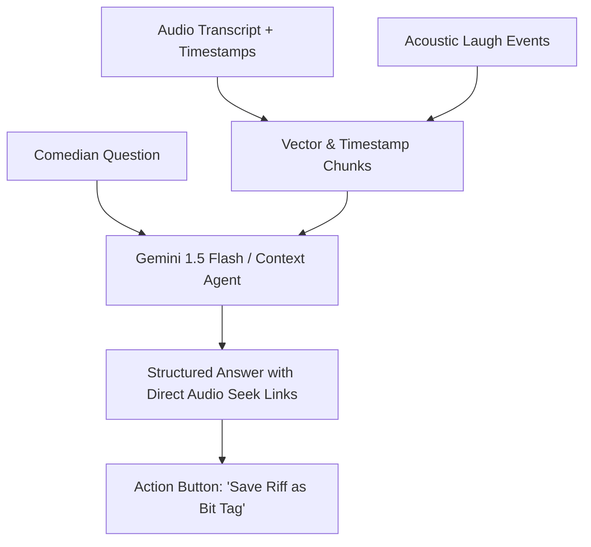

# 💬 Conversational Chat Query with Set Tape

> **"Talk to your tape":** Instead of listening to a 45-minute recording from Tuesday night to find out why a transition felt awkward, the comedian asks the tape in plain conversational English.

## 1. Sample Query Dialogues

### Scenario A: Finding Ad-Libs
> **Comic:** *"Did I come up with any new punchlines or riffs during the dentist story in Chicago?"*  
> **Comedy OS:** *"Yes. At 14:32, after the line 'my gums are bleeding', you ad-libbed: 'Looks like a crime scene in a peppermint factory'. That got a 3.4s B-tier laugh. You never wrote that in your notes. Would you like me to add it as a new Tag to [[Bit-Dentist-Gums]]?"*

### Scenario B: Comparative Audience Reaction
> **Comic:** *"How did the airline bit close tonight compared to the Helium set in Philly?"*  
> **Comedy OS:** *"Tonight in Austin, you delivered Tag 3 in 4.2 seconds and got an A-Tier roar (5.1s). In Philly, you paused for 2.8 seconds and crowd laugh was 1.8s. The tighter pause increased laugh duration by 180%."*

## 2. Architecture Spec
- Multi-modal retrieval linking the audio segment byte offset, Whisper token indices, and [[11_Audience_Laughter_and_Silence_Isolation|Laugh Score]].
- Quick-listen playback pills: `[▶ Play Clip 14:30 - 14:45]`.
