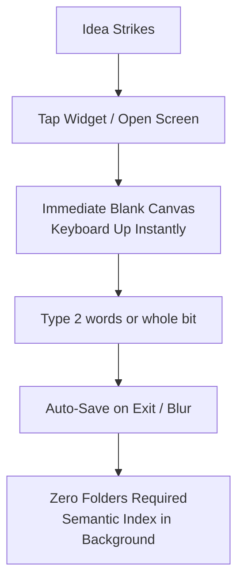

# 🟡 Text-Forward Capture Layer (Keep Simplicity)

> **Inspiration:** Google Keep's lightning speed. When a premise strikes in the subway, at 3 AM in bed, or while listening to a podcast, you have an 8-second cognitive window before the nuance evaporates.

## 1. Non-Negotiable Tenets
1. **Zero Categorization Friction:** No modal asking "Select Folder", "Choose Category", or "Add Tags".
2. **Instant Blank Line:** App opens directly to the input cursor.
3. **Draft Survival:** If the phone battery dies mid-sentence, every single character typed is persisted in local WAL (Write-Ahead Logging).

## 2. Sub-Components
- [[21_Distraction_Free_Markdown_Pad|2.1 Distraction-Free Plaintext & Markdown Pad]]
- [[22_Zero_Click_Floating_Capture_Widget|2.2 Zero-Click Floating Capture Widget]]
- [[23_Inline_Delivery_Notation_Engine|2.3 Inline Delivery Notation Engine]]
