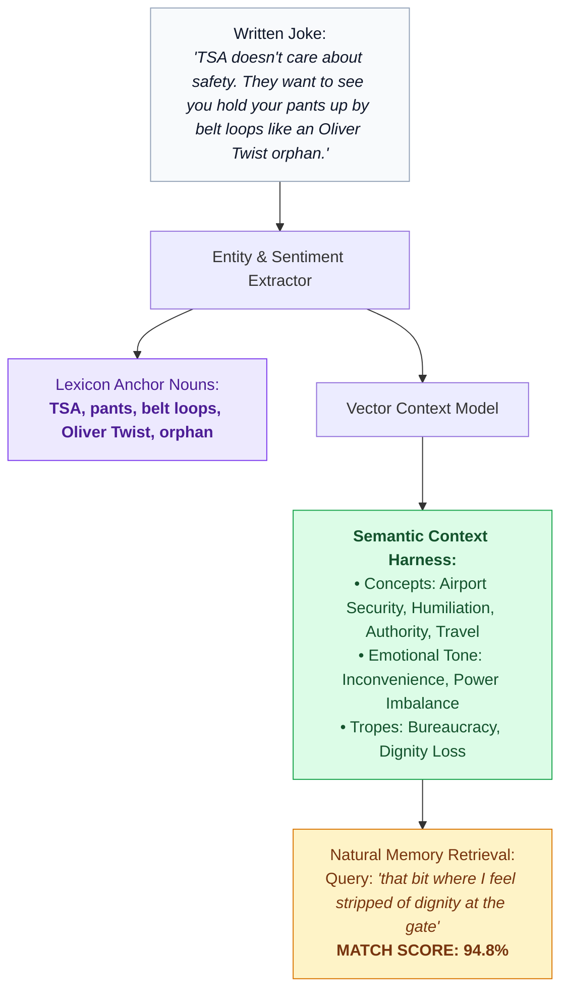
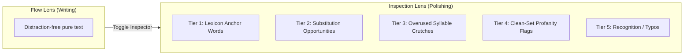

# 🧠 Lexicon Context Harness & Multi-Tier Word Highlighting

> **The Writer's Problem:** Stand-up comics rarely search their vaults by exact keyword. A comic remembers: *"that bit where I talk about feeling like a child around airport authority"*, but the joke script never contains the word "child" or "authority"—it talks about *belts, socks, and TSA scanners*.  
> Furthermore, reviewing a written bit requires inspecting vocabulary for rhythm, repetitive crutches, and punchiness without turning the editor into an ugly, distracting rainbow.

---

## 1. The Lexicon & Semantic Context Harness

The **Lexicon** is a local vocabulary knowledge graph tailored to each comedian's specific comedic vernacular, entities, and recurring premise motifs.

### How the Context Harness Works:
1. **Automated Semantic Envelope:** When a joke is saved, Comedy OS generates a multi-dimensional "harness" of associated entities, synonyms, and subtextual concepts.
2. **Context-Free Retrieval:** The comic can describe the *vibe*, the *situation*, or the *feeling* of the bit. The system traverses the harness graph to locate the joke instantly.
3. **Lexicon Cross-Linking:** If the comic reuses distinct anchor concepts across multiple bits (e.g. recurring jokes about *airports* or *dad's text messages*), the Lexicon automatically suggests linking them as a potential **callback run**.

---

## 2. Multi-Tier Word Highlighting: The Visual Architecture

### The Visual Dilemma: Avoiding "Border-Soup" and Highlight Fatigue
Traditional grammar and editing tools cover text in bright red, green, blue, and yellow underlines and boxes, causing severe cognitive overload. In stand-up writing, **visual calm is paramount**.

### The Solution: "Editor Lenses" & Soft Typographic Hierarchy
Instead of blasting all highlights simultaneously, Comedy OS uses **Focused Lenses**:
* **Flow Lens (Default / Writing Mode):** Zero highlights. Plain, elegant typography on off-white canvas.
* **Inspection Lens (Polishing & Review Mode):** Activated via a single toggle or hotkey, revealing subtle typographic shifts.

---

## 3. Visual Language Specification (Design System)

Following modern minimalist UI principles (Linear, Stripe, Raycast), all word states rely on **contrast, background surface tints, and spacing rather than heavy outlines**:

| Highlighting Tier | Purpose & Trigger | Visual Treatment (CSS Spec) | User Interaction |
| :--- | :--- | :--- | :--- |
| **Tier 1: Lexicon Anchor** | Word is registered in the context harness. | Subtle font-weight boost (`font-weight: 550`), faint dotted baseline. | Hover reveals the semantic harness tags. |
| **Tier 2: Substitution Candidate** | Word could be replaced by a punchier, shorter, or more vernacular synonym. | Soft purple surface tint (`rgba(168, 85, 247, 0.09)`), no border, rounded 3px. | Clicking opens a 3-word punch-up suggestion popover. |
| **Tier 3: Overused Filler Crutch** | Repetitive filler words (`"like"`, `"you know"`, `"basically"`). | Muted typographic contrast (`opacity: 0.55`) or soft warm amber tint (`rgba(245, 158, 11, 0.12)`). | Shows frequency tally (*"Used 14 times in set"*). |
| **Tier 4: Clean-Set Profanity** | Flagged swear words when preparing a corporate/clean club set. | Soft coral/rose tint (`rgba(244, 63, 94, 0.1)`), discreet corner dot. | One-tap swap to clean alternative. |
| **Tier 5: Recognition / Typo** | OCR scan error or unknown slang. | Subtle dotted crimson baseline (`rgba(239, 68, 68, 0.6)`). | Quick inline correction. |

### Example In-Editor Render:
> "TSA doesn't actually care about safety. They want to see you walk around in socks like an Oliver Twist orphan."

*Hovering over "walk" suggests punchier, more evocative verbs: `shuffle`, `scurry`, `parade`.*
