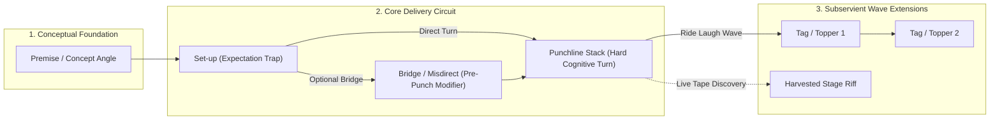

# ✍️ Jimmy Carr Joke Writing Screen & Interaction Architecture

> **"A joke is a very specific piece of engineering. The set-up creates an expectation; the punchline shatters that expectation and replaces it with another."**  
> — *Jimmy Carr, "On Jokes"*

---

## 1. Structural Philosophy: The Jimmy Carr Anatomy

Traditional writing apps treat jokes as unstructured paragraphs or isolated notes. In Comedy OS, every joke is engineered as an **Atomic Delivery Circuit** based on Jimmy Carr's mechanics:



### Component Roles & Invariants
1. **Premise (`premise`)**: The raw comic thesis or observation (e.g., *"Airport security is pure theatre"*). Kept in metadata; never spoken aloud on stage.
2. **Set-up (`setup`)**: Primes the audience's mental model down path A. Must be stripped of excess words—every unnecessary syllable dilutes momentum.
3. **Pre-Punch Bridge / Misdirect (`bridge`)**: An optional connective phrase or misdirect inserted between the setup and the punchline to heighten tension or sharpen the turn.
4. **Punchline (`punchline`)**: The sudden paradigm shift to path B. Comedy OS supports **stacked variants**, where each variant records its delivery notes, hit-rate tier (`A`/`B`/`C`), and average laugh duration.
5. **Tags / Toppers (`tag`)**: Subsidiary punchlines riding the residual laughter of the primary punchline without re-establishing a full setup.
6. **Ad-Lib Riffs (`ad_lib_riff`)**: Spontaneous onstage tags harvested by the audio engine and Whisper ASR.

---

## 2. The 5 Validated UX Pillars

### 2.1 Contextual Block Insertion
- **Tags & Toppers:** Appended at the bottom via an explicit `+ Tag` button or keyboard shortcut (`Cmd/Ctrl + Shift + T`).
- **Bridge Lines & Misdirects:** Inserted inline between Set-up and Punchline via a subtle hover/tap `+ Bridge` divider affordance. This prevents comics from having to rewrite the setup just to insert a connective clause.

### 2.2 Hybrid Stream & Atom Model
- Comics write naturally in a continuous **Distraction-Free Markdown Pad** (the "Digital Legal Pad").
- The editor automatically recognizes structural prefix tokens or delivery cues (`[p: 1.5s]`, `**WORD**`, `+tag`) and maps blocks directly to the **Atomic Bit Ledger**.
- Changes in either the legal pad stream or the structured ledger sync bi-directionally in real-time.

### 2.3 Stacked Ledger Cards with `[STAGE ACTIVE]` Toggle
- Rather than hiding alternative punchlines in sub-menus or dropdowns, all punchline variants remain visible in the ledger.
- A single tap on the `[STAGE ACTIVE]` pill switches which punchline is exported to tonight's live setlist.
- Visual hit-rate badges (`TIER A` in Surgical Sage `#9FAF9A`, `TIER B` in Brass `#B4A28A`, `UNTESTED` in Charcoal Meta `#5C5A55`) provide instant feedback on proven vs. experimental versions.

### 2.4 Mobile First-Tap Experience
- Tapping `+ New Joke` immediately sets cursor focus inside the **Set-up** field (bypassing slow title or category prompts).
- The mobile keyboard is crowned with a tactile **Accessory Bar**:
  ```
  [ + Punch ]  [ + Tag ]  [ ⏳ Pause ]  [ 🎭 Act ]  [ 🎤 Voice ]
  ```
- Fast thumb workflows enable entering a complete Carr joke circuit in under 10 seconds.

### 2.5 AI Auto-Proposal Review Drawer
- Ingesting raw audio voice memos or pasted brain-dumps opens an interactive **Proposal Review Drawer**.
- The AI proposes the segmentation:
  - *Premise*: Extracted underlying concept
  - *Set-up*: Proposed expectation line
  - *Punchline*: Proposed hard turn
  - *Tags*: Proposed toppers
- The comic accepts with one tap (`Enter` / `Accept Specimen`) or drags boundaries before committing to SQLite.

---

## 3. Typographic Ledger Visual Specifications

Adhering strictly to [`design-system/DESIGN.md`](file:///e:/-&#32;CODE/ComedyOS-2026/design-system/DESIGN.md):
- **Canvas:** Matte warm charcoal `#1A1918` across 100% of the viewport. Zero opaque white/gray boxed card backgrounds.
- **Hierarchy:** Established purely through typography, line-height, contrast, and whitespace.
- **Script Typography:** `Crimson Pro Light (300)` at `20px–24px` with `1.55` line-height for verbatim spoken material.
- **Metadata Labels:** `Inter Medium (500)` in `all-small-caps`, `10px–11px`, `letter-spacing: 0.15em`, color `#5C5A55`.
- **Telemetry & Timecodes:** `JetBrains Mono (300)` at `11px`, tabular numerals.
- **Divider & Baseline Rules:** `1px solid #33312E` hairline baselines with `:focus-within` transitions to Surgical Sage `#9FAF9A`.
- **Zero Scrollbars:** Overflow containers use CSS `-ms-overflow-style: none`, `scrollbar-width: none`, and vertical gradient fade masks (`linear-gradient(to bottom, #1A1918 0%, transparent 24px)`).

---

## 4. Mobile Screen Layout Specimen

```
┌────────────────────────────────────────────────────────┐
│  09:41                             5G        [ 98% ]   │
│                                                        │
│  ← JOKES ARCHIVE          B-104       [STAGE ACTIVE]   │
│  ────────────────────────────────────────────────────  │
│                                                        │
│  PREMISE (INTERNAL CONTEXT)                            │
│  Airports treat everyone like amateur bomb makers      │
│  ────────────────────────────────────────────────────  │
│                                                        │
│  SET-UP                                                │
│  My dad doesn't text. He sends telegrams               │
│  disguised as iMessage.                                │
│  ────────────────────────────────────────────────────  │
│                                                        │
│  + INSERT BRIDGE / MISDIRECT                           │
│  · · · · · · · · · · · · · · · · · · · · · · · · · · · │
│                                                        │
│  PUNCHLINE (ACTIVE)                      TIER A • 4.8s │
│  [p: 1.5s] **ALL CAPS**.                               │
│  "ARRIVING AIRPORT. STOP. DISAPPOINTED IN YOU. STOP."   │
│  ────────────────────────────────────────────────────  │
│                                                        │
│  SUBSERVIENT TAGS                                      │
│  ┌──────────────────────────────────────────────────┐  │
│  │ Tag 1 · Stage Active                     + 2.1s  │  │
│  │ "Didn't know you could buy punctuation on iOS."   │  │
│  └──────────────────────────────────────────────────┘  │
│                                                        │
│  + ADD TAG / TOPPER                                    │
│                                                        │
│  ====================================================  │
│  [ + Punch ] [ + Tag ] [ ⏳ Pause ] [ 🎭 Act ] [ 🎤 ] │
│  ====================================================  │
│  [ Q ] [ W ] [ E ] [ R ] [ T ] [ Y ] [ U ] [ I ] [ O ] │
└────────────────────────────────────────────────────────┘
```

---

## 5. Desktop Dual-Pane Layout Specimen

On desktop screens (`>= 1024px`), Comedy OS leverages an asymmetric 12-column layout:
- **Left Column (5 Cols) — The Scratchpad Stream:** Continuous chronological legal pad notes for rapid drafting, uninhibited association, and rehearsal transcripts.
- **Right Column (7 Cols) — The Typographic Ledger:** The structured Jimmy Carr delivery circuit for the currently selected or active bit.

```
┌─────────────────────────────────────────────────────────────────────────────────────────────┐
│ COMEDYOS ARCHIVE  /  BITS  /  B-104                                       [SET: THE COMEDY STORE] │
├────────────────────────────────────────┬────────────────────────────────────────────────────┤
│ 01. SCRATCHPAD STREAM                  │ 02. JIMMY CARR ATOMIC LEDGER                       │
│                                        │                                                    │
│ 2:15 AM • Basement Hotel               │ BIT B-104  ·  AIRPORT SECURITY THEATRE             │
│                                        │                                                    │
│ Talking about dads texting. Why do     │ PREMISE                                            │
│ older guys type with one pointer       │ TSA and older parents both communicate in threats  │
│ finger like they're defusing a         │                                                    │
│ WWII explosive?                        │ SET-UP                                             │
│                                        │ My dad doesn't text. He sends telegrams disguised  │
│ My dad doesn't text. He sends          │ as iMessage.                                       │
│ telegrams.                             │                                                    │
│ [p: 1.5s]                              │ ─── + INSERT BRIDGE / MISDIRECT ────────────────── │
│ ARRIVING AIRPORT. STOP.                │                                                    │
│ DISAPPOINTED IN YOU. STOP.             │ PUNCHLINE STACK (2 VARIANTS)                       │
│                                        │ ● [STAGE ACTIVE]  TIER A  4.8s LAUGH               │
│ +tag Didn't know you could buy         │   [p: 1.5s] **ALL CAPS**.                          │
│ punctuation on an iPhone.              │   "ARRIVING AIRPORT. STOP. DISAPPOINTED IN YOU."   │
│                                        │                                                    │
│                                        │ ○ VARIANT B       TIER B  2.4s LAUGH               │
│                                        │   "He types with one finger like he's dialing a    │
│                                        │    rotary phone from the 1970s."                   │
│                                        │                                                    │
│                                        │ SUBSERVIENT TAGS                                   │
│                                        │ 01. Tag: "Didn't know you could buy punctuation"   │
│                                        │ 02. Tag: "He ends every greeting like a summons"   │
│                                        │                                                    │
│                                        │ + APPEND TAG           [CMD + SHIFT + T]           │
└────────────────────────────────────────┴────────────────────────────────────────────────────┘
```

---

## 6. Interaction & Keyboard Accelerators

| Shortcut (Desktop) | Accessory Bar (Mobile) | Action Performed |
| :--- | :--- | :--- |
| `Enter` (at end of Set-up) | Next field | Moves focus immediately to active Punchline |
| `Cmd/Ctrl + Shift + B` | `+ Bridge` | Inserts pre-punch bridge line between Set-up & Punchline |
| `Cmd/Ctrl + Shift + P` | `+ Punch` | Adds an alternative punchline variant to the stack |
| `Cmd/Ctrl + Shift + T` | `+ Tag` | Appends a subservient tag/topper below the active punchline |
| `Cmd/Ctrl + Shift + Space` | `⏳ Pause` | Inserts `[p: 1.5s]` beat pause token at cursor position |
| `Cmd/Ctrl + B` | `**Bold**` | Wraps selected word in `**` for vocal stress emphasis |
| `Cmd/Ctrl + Shift + A` | `🎭 Act` | Opens stage act-out inline notation prompt |
| `Cmd/Ctrl + Shift + V` | `🎤 Voice` | Triggers immediate Whisper audio capture & review drawer |

---

## 7. Downstream Consumers
- [[40_Atomic_Bit_Database|Atomic Bit Vault]]: Stores the structured JSON-LD/SQLite object.
- [[30_The_Comparator_Bridge|The Comparator Bridge]]: Uses the active punchline and subservient tags to analyze performance audio and flag dropped tags.
- [[42_Drag_And_Drop_Modular_Setlist_Timeline|Setlist Timeline]]: Pulls the `[STAGE ACTIVE]` punchline and tags into the live gig setlist.
