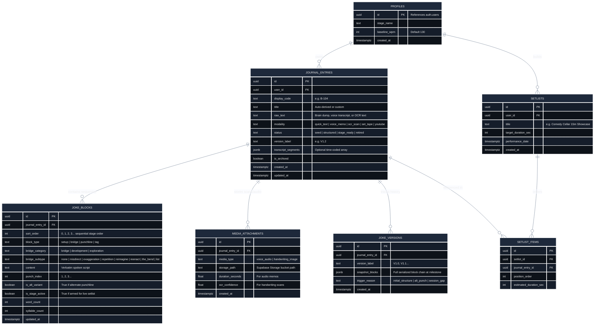

# 🏛️ Desktop Workbench, Mobile Keep Capture & Supabase Cloud Architecture

> **Core Product Decision (Oct 2026):** Decouple **Mobile Ingestion** from **Desktop Structural Editing**.
> - **Mobile (`viktorenns.de/comedyos` on phone):** A zero-friction **"Google Keep for Jokes"** dedicated strictly to capturing raw text thoughts, dictating voice memos, and OCR/OXR scanning handwritten notebook pages into the Journal/Vault.
> - **Desktop (`viktorenns.de/comedyos` on desktop):** The full **Variant Typographic Workbench** for turning raw captures into sequential **Set-up $\rightarrow$ Bridge $\rightarrow$ Punchline $\rightarrow$ Tag** circuits, comparing versions side-by-side, and building setlists.

---

## 1. Design Rationale: Why Split Mobile Ingestion from Desktop Editing?

| Architectural Decision | Why It Was Made (Design Rationale) |
| :--- | :--- |
| **1. Mobile = Pure Capture ("Google Keep for Jokes")** | Comedians capture ideas while walking, driving, or standing in the back of a dark club. Attempting to manipulate multi-block joke trees (`Set-up`, `7 Bridge subtypes`, `Multiple Punchlines`, `Tags`) on a 6-inch mobile screen above a virtual keyboard creates cognitive friction and UI clutter. Stripping mobile down to **Text + Voice Memo + Camera OCR** guarantees `<400ms` capture speed. |
| **2. Desktop = Two-Stage Sequential Workbench** | Structural joke engineering (trimming syllables in a `Set-up`, testing a `Misdirect` vs. `The Bend` bridge, comparing versions side-by-side, and sequencing a 15-minute setlist) benefits from horizontal screen real estate and keyboard shortcuts (`Alt+S`, `Alt+P`, `Alt+B`, `Alt+T`). |
| **3. Greyed-Out "Suggested" `Set-up` & `Punchline` Ghost State** | Even on desktop, forcing a blank structured form during initial brainstorming constricts creativity. Starting in the **Raw Brain Dump** while showing `Set-up` and `Punchline` as recessed, greyed-out suggestions (`opacity: 0.36`) separates *divergent ideation* from *convergent joke editing*. |
| **4. Sequential `blocks[]` Array Instead of Fixed Slots** | A finished joke is only fixed in having a `Set-up` and a `Punchline`; everything between or after is variable (`Set-up` $\rightarrow$ `Bridge [Development: Exaggeration]` $\rightarrow$ `Punchline 1` $\rightarrow$ `Bridge [The Bend]` $\rightarrow$ `Punchline 2` $\rightarrow$ `Tag`). Storing blocks as an ordered sequential array (`sort_order`) allows infinite structural flexibility while preserving exact stage reading order. |
| **5. Obsidian / Antigravity Split-View Journal** | Opening a full-screen database table hides the joke the comic is actively writing, breaking flow state and preventing easy callbacks. Keeping the **Active Joke pinned on the right** while the **Journal Ledger opens on the left** allows side-by-side comparison and 1-click line pulling. |
| **6. Dual-Layer Storage (`localStorage` + Supabase Postgres)** | Basement comedy clubs and green rooms frequently have dead cell reception. Writing to a local offline queue (`localStorage` / `IndexedDB`) first and syncing asynchronously to **Supabase** ensures zero lost jokes and instant UI responsiveness. |

---

## 2. High-Level System Architecture Diagram (Cloudflare + Supabase)

```mermaid
%%{init: {
  'theme': 'base',
  'themeVariables': {
    'darkMode': true,
    'background': '#0f172a',
    'mainBkg': '#1e293b',
    'textColor': '#f8fafc',
    'lineColor': '#64748b',
    'edgeLabelBackground': '#0f172a',
    'fontFamily': 'Inter, system-ui, -apple-system, sans-serif',
    'fontSize': '13px',
    'nodeBorder': '#334155',
    'clusterBkg': '#090d16',
    'clusterBorder': '#1e293b'
  }
}}%%
flowchart LR
    classDef hero fill:#1e3a8a,stroke:#3b82f6,stroke-width:2px,color:#eff6ff,rx:6px,ry:6px;
    classDef action fill:#1e293b,stroke:#475569,stroke-width:1.5px,color:#f8fafc,rx:6px,ry:6px;
    classDef success fill:#064e3b,stroke:#10b981,stroke-width:2px,color:#ecfdf5,rx:6px,ry:6px;
    classDef warning fill:#451a03,stroke:#f59e0b,stroke-width:2px,color:#fffbeb,rx:6px,ry:6px;
    classDef muted fill:#0f172a,stroke:#334155,stroke-dasharray: 4 4,color:#94a3b8,rx:4px,ry:4px;

    subgraph MobileClient ["<b>📱 Mobile Keep Client (viktorenns.de/comedyos)</b>"]
        M_TEXT["<b>⌨️ Quick Text Note</b><br/><i>Instant 1-tap seed capture</i>"]:::hero
        M_VOICE["<b>🎙️ Voice Memo Recorder</b><br/><i>MediaRecorder Audio Stream</i>"]:::hero
        M_OCR["<b>📷 Notebook OCR Scanner</b><br/><i>Camera Photo of Handwriting</i>"]:::hero
        M_QUEUE["<b>Local Offline Queue</b><br/><i>localStorage / IndexedDB</i>"]:::muted
    end

    subgraph CloudflareEdge ["<b>☁️ Cloudflare Pages & Functions (viktorenns.de)</b>"]
        CF_PAGES["<b>Cloudflare Pages</b><br/><i>Static Asset & PWA Host</i>"]:::action
        CF_ASR["<b>POST /api/transcribe</b><br/><i>Workers AI Whisper ASR</i>"]:::warning
        CF_VISION["<b>POST /api/ocr</b><br/><i>Gemini Flash Vision OCR</i>"]:::warning
    end

    subgraph SupabaseCloud ["<b>🗄️ Supabase Backend (Postgres + Storage + Realtime)</b>"]
        SB_AUTH["<b>Supabase Auth & RLS</b><br/><i>User Session & Row Security</i>"]:::muted
        SB_STORAGE["<b>Supabase Storage Buckets</b><br/><i>/voice-memos & /notebook-scans</i>"]:::action
        SB_DB[("<b>Supabase PostgreSQL</b><br/><i>journal_entries & joke_blocks</i>")]:::success
        SB_RT["<b>Supabase Realtime</b><br/><i>WebSocket Change Broadcast</i>"]:::action
    end

    subgraph DesktopClient ["<b>🖥️ Desktop Variant Workbench (viktorenns.de/comedyos)</b>"]
        D_JOURNAL["<b>📓 Split-View Journal Ledger</b><br/><i>Obsidian/Antigravity Left Pane</i>"]:::action
        D_DUMP["<b>🌱 Brain Dump & Transcript</b><br/><i>Alt+S / Alt+P / Alt+B Extractor</i>"]:::action
        D_CIRCUIT["<b>⚡ Sequential Joke Circuit</b><br/><i>Setup → Bridge → Punch → Tag</i>"]:::success
        D_SETLIST["<b>🎛️ Setlist Builder</b><br/><i>Stage Timing & Sequencing</i>"]:::hero
    end

    M_TEXT --> M_QUEUE
    M_VOICE -->|Audio Blob| CF_ASR
    M_VOICE -->|Upload Raw Audio| SB_STORAGE
    M_OCR -->|Handwritten Image| CF_VISION
    M_OCR -->|Upload Scan Photo| SB_STORAGE

    CF_ASR -->|Clean Transcript + Timestamps| M_QUEUE
    CF_VISION -->|Extracted Longhand Text| M_QUEUE
    M_QUEUE -->|Upsert Entry| SB_DB

    SB_DB --> SB_RT
    SB_RT -->|Live Sync <200ms| D_JOURNAL
    D_JOURNAL -->|Select or Compare| D_DUMP
    D_DUMP -->|Alt+S / Alt+P / Alt+B| D_CIRCUIT
    D_CIRCUIT -->|Auto-Save Blocks| SB_DB
    D_CIRCUIT --> D_SETLIST
```



---

## 3. Supabase Database Schema (Entity-Relationship & SQL DDL)

### 3.1 Entity-Relationship Diagram (`erDiagram`)



### 3.2 Ready-to-Run Supabase SQL Migration (`schema.sql`)

```sql
create extension if not exists "pgcrypto";

create table public.journal_entries (
  id uuid primary key default gen_random_uuid(),
  user_id uuid references auth.users(id) on delete cascade,
  display_code text not null default 'B-100',
  title text not null default '',
  raw_text text not null default '',
  modality text not null default 'quick_text'
    check (modality in ('quick_text', 'voice_memo', 'ocr_scan', 'set_tape', 'youtube')),
  status text not null default 'seed'
    check (status in ('seed', 'structured', 'stage_ready', 'retired')),
  version_label text not null default 'V1.0',
  transcript_segments jsonb not null default '[]'::jsonb,
  is_archived boolean not null default false,
  created_at timestamptz not null default now(),
  updated_at timestamptz not null default now()
);

create table public.joke_blocks (
  id uuid primary key default gen_random_uuid(),
  journal_entry_id uuid not null references public.journal_entries(id) on delete cascade,
  sort_order int not null default 0,
  block_type text not null
    check (block_type in ('setup', 'bridge', 'punchline', 'tag')),
  bridge_category text default 'bridge'
    check (bridge_category in ('bridge', 'development', 'exploration')),
  bridge_subtype text default 'none'
    check (bridge_subtype in ('none', 'misdirect', 'exaggeration', 'repetition', 'reimagine', 'reenact', 'the_bend', 'list')),
  content text not null default '',
  punch_index int default 1,
  is_alt_variant boolean not null default false,
  is_stage_active boolean not null default true,
  word_count int not null default 0,
  syllable_count int not null default 0,
  updated_at timestamptz not null default now()
);

create index idx_joke_blocks_entry_order on public.joke_blocks(journal_entry_id, sort_order);

create table public.media_attachments (
  id uuid primary key default gen_random_uuid(),
  journal_entry_id uuid not null references public.journal_entries(id) on delete cascade,
  media_type text not null check (media_type in ('voice_audio', 'handwriting_image')),
  storage_path text not null,
  duration_seconds float,
  ocr_confidence float,
  created_at timestamptz not null default now()
);

create table public.joke_versions (
  id uuid primary key default gen_random_uuid(),
  journal_entry_id uuid not null references public.journal_entries(id) on delete cascade,
  version_label text not null,
  snapshot_blocks jsonb not null,
  trigger_reason text not null,
  created_at timestamptz not null default now()
);

alter publication supabase_realtime add table public.journal_entries;
alter publication supabase_realtime add table public.joke_blocks;
```

---

## 4. Related Vault Documents
- [[06_Mobile_Keep_Desktop_Workbench_Supabase_Classes|🏛️ 06: UML Class Diagram — Mobile Keep Capture, Desktop Workbench & Supabase Sync]]
- [[25_Jimmy_Carr_Joke_Writing_Architecture|✍️ 2.5 Jimmy Carr Joke Writing Screen Architecture]]
- [[40_Atomic_Bit_Database|🧱 4.0 Atomic Bit Vault & Object Schema]]
