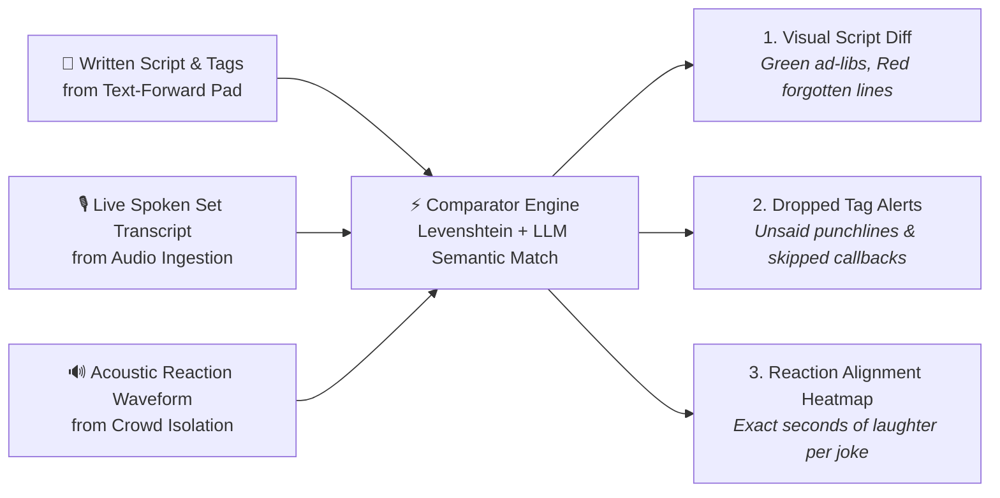

# ⚡ The Comparator Bridge (The Secret Sauce)

> **The Missing Link in Comedy Tech:** Comedians write sets in text apps, record audio on voice memos, and have to manually toggle between the two to learn anything. The Comparator Bridge automatically diffs **what you planned to say** against **what you actually said on stage**.

## 1. Engine Capabilities
1. **Sequence Alignment:** Dynamic programming algorithm aligns transcript phrases with written script notes even if the comic reordered bits on the fly.
2. **Ad-Lib Harvesting:** Automatically flags onstage riffs (green words) so brilliant improvised jokes are never forgotten.
3. **Dropped Premise Recovery:** Marks written jokes that were cut or forgotten under stage pressure (red strikethrough).

## 2. Core Modules
- [[31_Visual_Diff_Report|3.1 Visual Diff Report (Ad-Libs vs Written Script)]]
- [[32_Dropped_Tag_Alerts|3.2 Dropped Tag Alerts & Forgotten Setup Engine]]
- [[33_Reaction_Waveform_Alignment|3.3 Reaction Alignment (Laugh Spikes vs Spoken Words)]]
