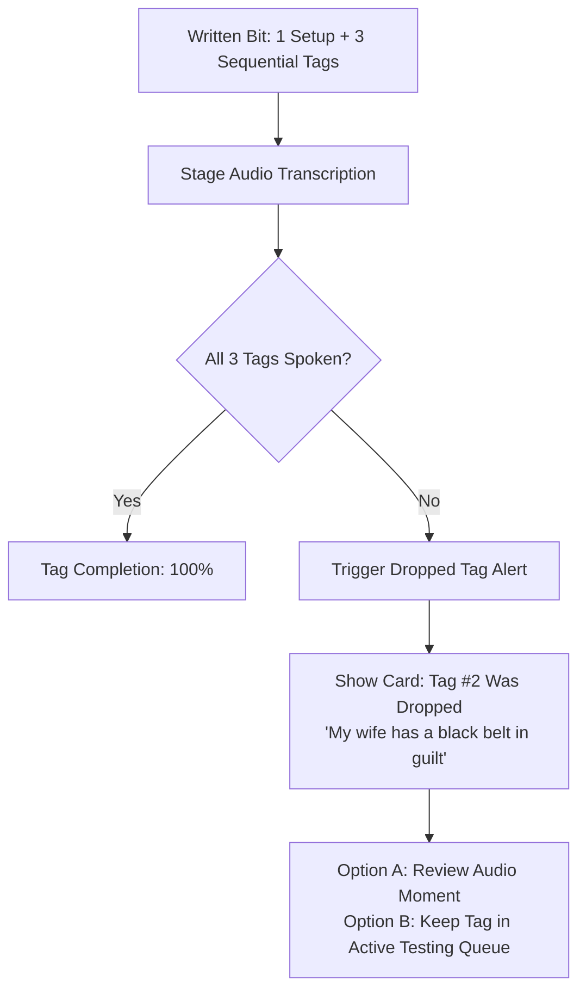

# ⚠️ Dropped Tag Alerts & Missed Callback Detector

> **Comedian Dilemma:** *"I had 3 killer tags written for that marriage bit, but the audience cheered so loudly I got flustered and transitioned too early."*



## 1. Alert Thresholds
- **Time Pressure Drop:** If set running time approached the 15-minute red-light cutoff, Comedy OS annotates: *"Dropped due to time constraint (minute 14:15)."*
- **Momentum Drop:** If a preceding tag scored an A-Tier laugh, the engine notes: *"Crowd over-talked the transition; consider increasing pause to 3.5s before Tag 2."*

## 2. Post-Show Tag Summary Card
```markdown
### ⚠️ 2 Tags Omitted in Tonight's Set
1. **[[Bit-Marriage-Therapy]]**:
   - Missed: *"She cried in cursive."*
   - Impact: Missed estimated 3.0s reaction.
2. **[[Bit-Dog-Park]]**:
   - Missed: *"That golden retriever has an LLC."*
```
