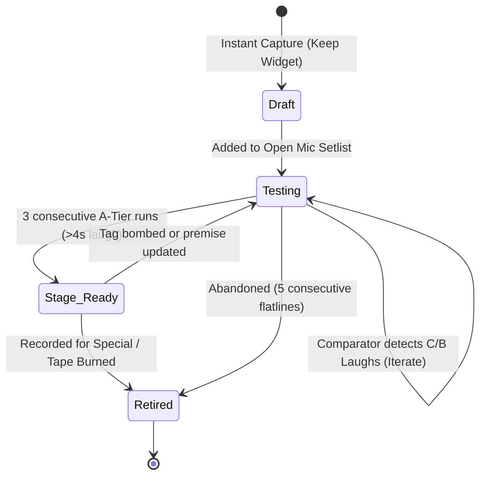

# 🔄 Jokes as Living Objects: Lifecycle State Machine

> **The Joke Lifecycle:** Great bits aren't written; they are forged across dozens of open mics, comedy clubs, and tour dates.

## 1. Lifecycle State Definitions

1. **Draft (Premise Stage):**
   - Raw note from [[20_Text_Forward_Capture_Layer|Text-Forward Capture]].
   - Contains a premise and at least one punchline hypothesis.
2. **Testing (Open Mic / Workout Room):**
   - Active in open mics or low-stakes sets.
   - [[30_The_Comparator_Bridge|Comparator]] actively analyzes punchline-to-laugh ratios and collects ad-libs.
3. **Stage Ready (A-Set Material):**
   - Passed strict quality gate: **$\ge 3$ verified A-Tier laughter events across 2 different venues**.
   - Timing, pauses, and cadence stabilized.
4. **Retired (Special Burn / Vaulted):**
   - Filmed for YouTube/Netflix special, or retired from rotation. Available for callback references or revival.

## 2. Automated State Transitions
- **Auto-Promotion Prompt:** When the Comparator detects a bit hitting $>4.5	ext{s}$ laughter on 3 recordings, app alerts: *"Promote 'Airport TSA' to Stage Ready?"*
