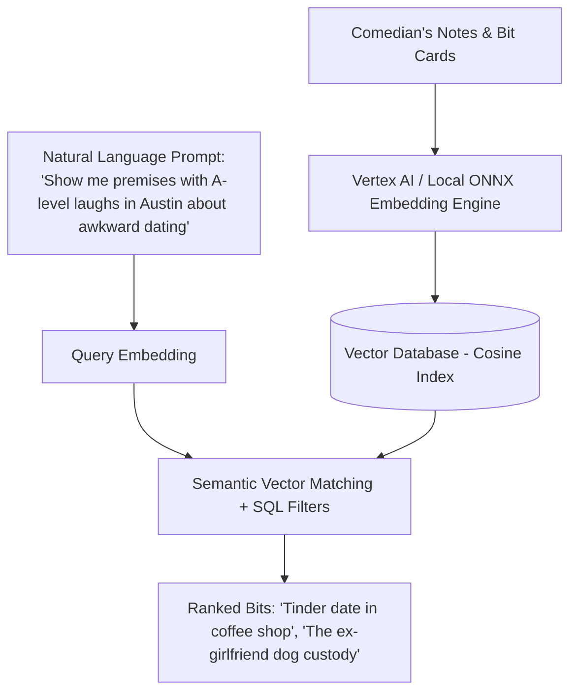

# 🧠 Semantic Vector Search & Contextual Zero-Tag Indexing

> **The Invisible Librarian:** Traditional note tags (`#dating`, `#airports`, `#family`) break down when you have 500 bits. You don't remember how you tagged it 3 years ago. Semantic Vector Search finds ideas by conceptual meaning.

## 1. Natural Language Search Queries Supported

- *"Show me crowd work riffs about dentists."*
- *"Find bits that kill in Austin but struggled in New York."*
- *"What jokes do I have where I talk about feeling like an imposter?"*
- *"Show me bits with untested tags written in the last 30 days."*

## 2. Technical Stack
- **Embedding Model:** Local on-device lightweight text embeddings (e.g. `bge-small-en-v1.5` ONNX) backed by cloud sync with `text-embedding-004` on Google Cloud / Vertex AI.
- **Zero-Tag Philosophy:** Automatically extracts latent comedy concepts (e.g. Self-Deprecation, Observational, Absurdist, Crowdwork, Storytelling) without requiring user tagging.
