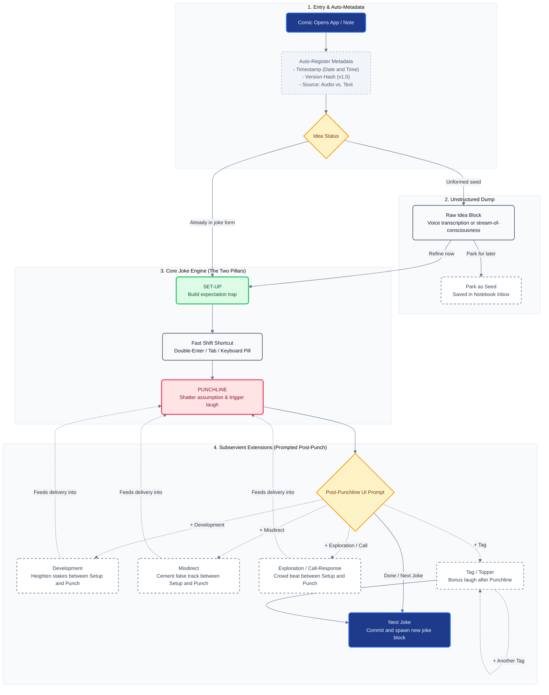
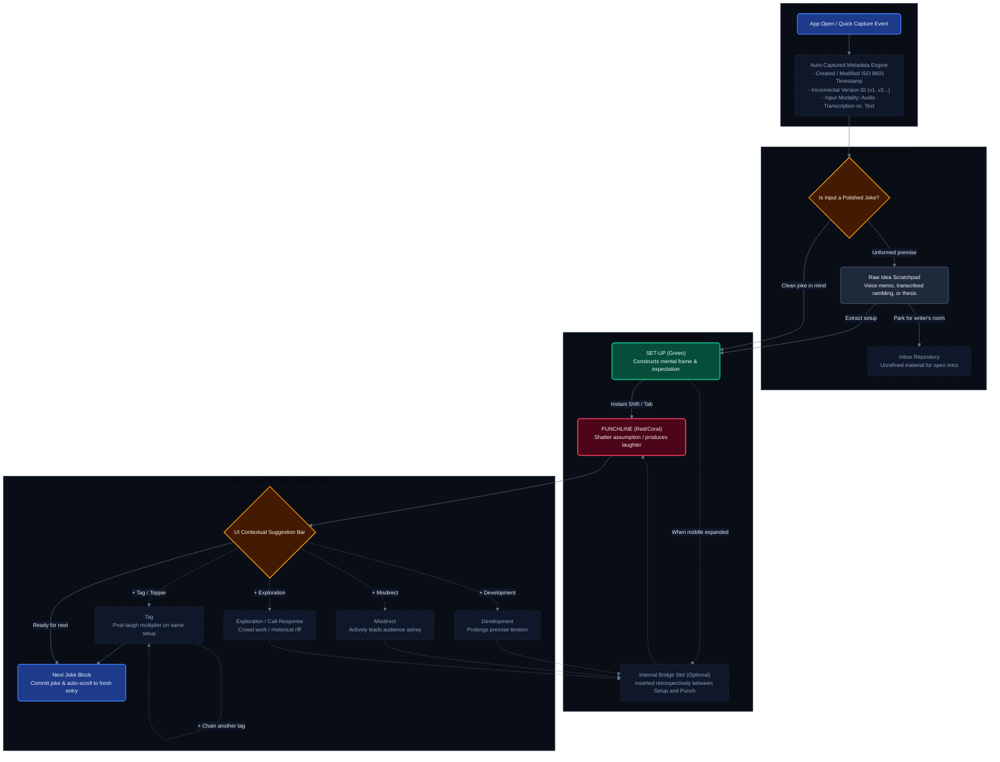

# 🎙️ Joke Writing Screen Architecture & Jimmy Carr Joke Circuit

This document details the architecture, visual flowcharts, and UX system for the **Comedy OS Main Joke Writing Screen**, inspired by the mechanics of joke engineering described in Jimmy Carr's *"On Jokes"* (and *"Before & Laughter"*).

---

## 1. System Philosophy: The Two Inviolable Pillars

In stand-up comedy mechanics, a joke is fundamentally a two-stroke cognitive engine:
$$\text{Joke} = \text{Set-up (Expectation Trap)} \longrightarrow \text{Punchline (Reframing / Shatter)}$$

1. **The Set-up (Primary - Green):** Establishes a scene, statement, or assumption. Its sole evolutionary duty is to lead the listener's brain down a predictable mental corridor.
2. **The Punchline (Primary - Coral/Red):** The sudden reveal of a second, completely unanticipated corridor that also makes sense in retrospect. The cognitive friction between expectation and reality produces the involuntary physical reflex: laughter.
3. **All Other Elements (Subservient - Dashed):** Every other structural node (*Exploration, Misdirect, Development, Call & Response, Tag*) is strictly subservient to this pair. They serve only to heighten the tension, extend the distance between the two meanings, or harvest bonus laughs once the bridge has been crossed.

```
┌──────────┐        Solid Direct Path        ┌───────────┐
│  Set-up  │ ══════════════════════════════> │ Punchline │ ───> [ Tag ]
└────┬─────┘                                 └─────▲─────┘
     │                                             │
     └─ - - - > [ Subservient Bridge Nodes ] - - - ┘
```

---

## 2. Diagram 1: FigJam Flowchart Code (Clean Light Preset)

> [!TIP] **How to Use in FigJam**
> 1. In FigJam, open the **Mermaid to FigJam** plugin (or paste into FigJam's diagram generator).
> 2. Paste the exact block below. It uses the **Editorial Clean Light** palette with pure-text formatting (no HTML tags) so FigJam translates nodes directly into native sticky cards and vector connectors.



---

## 3. Diagram 2: Obsidian Mermaid Code (Obsidian Dark Preset)

> [!NOTE] **Obsidian Native Rendering**
> This diagram renders seamlessly inside Obsidian in both Live Preview and Reading views. It enforces the **Modern Slate Dark** theme, distinct semantic border highlights, and clearly separates the **Background System Layer**, **Capture Stage**, **Structural Core**, and **Extension Pipeline**.



---

## 4. Node-by-Node System Breakdown

### 1. Ingestion & Automated Metadata Engine
- **`Comic Opens App / Note`**: Single-tap launch optimized for zero friction (under 400ms to ready cursor).
- **`Auto-Registered Metadata`**:
  - `Timestamp`: Precise date and time for tracking when an idea was born (vital for copyright and setlist chronology).
  - `Version ID`: Tracks joke evolution (`v1` draft $\to$ `v2` revised punch $\to$ `v3` stage-tested).
  - `Input Modality`: Explicitly records whether the entry was created via **Text Typing** or **Audio Transcription** (e.g., recorded backstage or at an open mic via Whisper).
- **`Raw Idea Block`**: An unformatted scratchpad. For many comics, jokes do not emerge fully formed; they start as a weird observation, an argument, or an audio voice note.

---

### 2. The Core Mechanism: Setup & Punchline
- **`SET-UP` (Green Badge / Accent):**
  - *Function:* Creates an unequivocal expectation. It gives the audience context and sets the target.
  - *Example from UI Mockup:* *"Undisputed heavyweight champion of the world. If it's undisputed..."*
- **`PUNCHLINE` (Coral/Red Badge / Accent):**
  - *Function:* Delivers the twist that shatters the listener's assumption and creates the release of tension.
  - *Example from UI Mockup:* *"...what's all the fighting about?"*
- **`Transition Action` (The "Usability Hack"):**
  - Transitioning between Set-up and Punchline must never require manually finding a mouse or moving fingers away from the keyboard.
  - Supported accelerators:
    1. **Double-Enter** (Desktop & Mobile) $\to$ immediately jumps into Punchline.
    2. **Sticky Keyboard Bar Pill `→ Punchline`** (Mobile) $\to$ single tap directly above the virtual keyboard.
    3. **"Split at Cursor"** $\to$ for pasting a block of text and separating Set-up from Punchline in one keystroke.

---

### 3. Subservient / Optional Nodes
These nodes exist solely to serve the Core Mechanism. They never exist in isolation.

| Node | Structural Position | Delivery Order | Purpose |
| :--- | :--- | :--- | :--- |
| **Exploration** | Subservient Bridge | Between Setup & Punch | Riffs on details or tests alternative angles before dropping the hammer. |
| **Misdirect** | Subservient Bridge | Between Setup & Punch | Deliberately reinforces the false expectation so the punch hits harder. |
| **Development** | Subservient Bridge | Between Setup & Punch | Adds storytelling stakes, pace modulation, or heightened absurdity. |
| **Call & Response**| Subservient Bridge | Between Setup & Punch | Incorporates rhetorical questions, crowd check-ins, or physical timing pauses. |
| **Tag** | Subservient Post-Drop | **After** Punchline | Additional punchlines that piggyback on the same original set-up without needing a new premise. |

---

## 5. Critical UX & Architectural Implications

### A. The "Write Order vs. Performance Order" Resolution
- **The Paradox:** A comedian writes the **Punchline** *before* deciding if a Misdirect or Development is even needed. Writing flow is: $\text{Setup} \to \text{Punchline} \to \text{Enhancements}$. However, when performing on stage, the order is: $\text{Setup} \to \text{Enhancements} \to \text{Punchline} \to \text{Tags}$.
- **UX Rule:** When the comic taps `+ Misdirect` or `+ Development` in the post-punchline toolbar:
  - The UI **must visually expand and auto-focus an accordion block between Setup and Punchline** (pushing the Punchline smoothly downward).
  - Tapping `+ Tag` appends the block **directly below the Punchline**.
  - This ensures that while the writing sequence matches the creative process, the vertical visual layout always matches the **exact reading order on stage**.

### B. Mobile vs. Desktop Viewport Adaptation
- **Desktop (`ui architecture`):** Uses an aligned 2-column typographic ledger format:
  - Left rail: Structural badges (`Raw Idea:`, `[Set-up:]`, `[Punchline:]`, `Tag:`).
  - Right rail: Borderless, high-contrast editable text blocks.
- **Mobile Adaptation:**
  - Screen width does not permit a 30% left column.
  - **Pattern:** Replace the left column with a **3px colored vertical left border accent** (Green for Set-up, Coral for Punchline, Grey Dashed for Subservients) with a compact pill badge above the field.
  - **Collapsible Raw Idea Shelf:** Raw audio dump collapses into an expandable 2-line header bar so the comic can reference raw notes without sacrificing virtual keyboard typing height.

### C. Versioning Rules (Preventing Version Fatigue)
- Auto-saving every keystroke should **not** spawn a new version number.
- A new **Version Stamp (`v1` $\to$ `v2`)** is triggered only by:
  1. Promoting a `Raw Idea` to a structured `Set-up + Punchline`.
  2. Modifying a joke in a separate session ($>30$ minutes apart).
  3. Creating an **alternate punchline variant** for the same set-up.

---

## 6. Next Steps & Implementation Roadmap
1. [ ] Finalize the mobile wireframe conforming to the single-column accent-border pattern.
2. [ ] Integrate SQLite schema backing the `Joke`, `Beat`, and `Tag` entities.
3. [ ] Connect local Whisper transcription output into the `Raw Idea` buffer.
