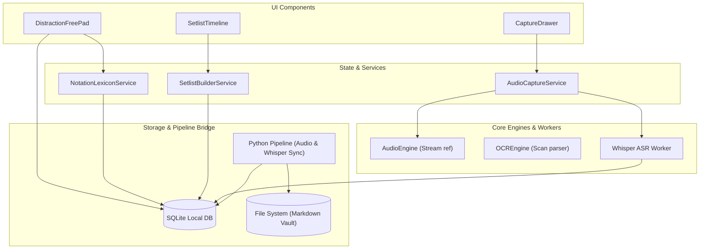
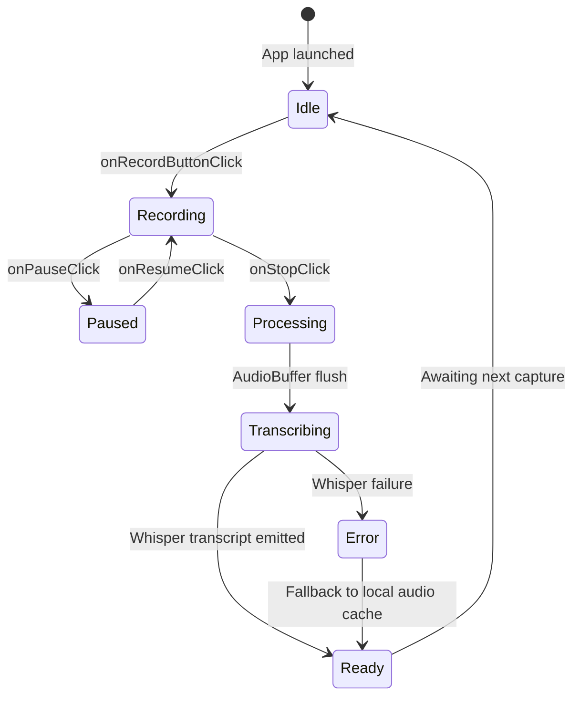
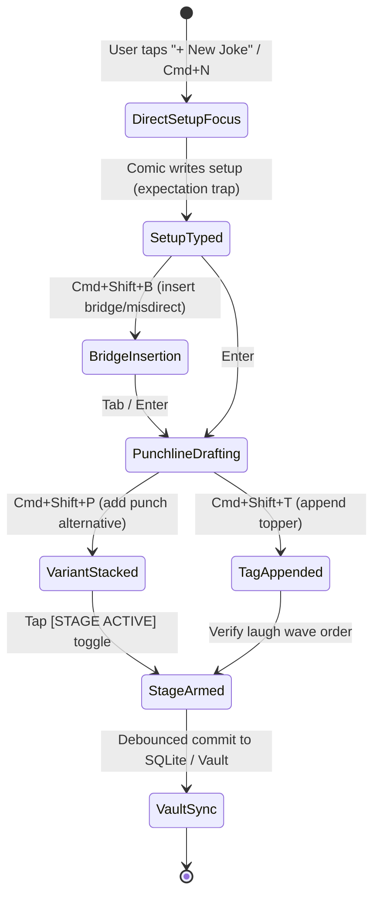

# 🗺️ Comedy OS — System Data Flow & State Map

This document tracks the high-level semantic data flow, boundary layers, and feature state machines across Comedy OS. It complements the automated import scanner in `DEPENDENCY_GRAPH.md`.

## 1. High-Level System Data Flow

## 2. Audio Capture & Transcription State Machine

## 3. Jimmy Carr Joke Circuit State Machine

