# 🗂️ Google Keep Notes — Vault Dashboard & Topic Glossary

> [!ABSTRACT] Executive Overview
> This visual index consolidates **229 original Google Keep notes** into **224 structured vault entries** with **148 embedded visual attachments**. Personal grocery lists and household appointments have been excluded, focusing strictly on Comedy, Business Strategy, Branding/Marketing, and AI/UI Architecture.

## 📊 Vault Intelligence Metrics

| Metric | Count | Description |
| :--- | :---: | :--- |
| **Active Master Notes** | `224` | Deduplicated, high-density knowledge entries |
| **Original Keep Entries Synthesized** | `229` | Raw notes processed and clustered |
| **Embedded Visual Attachments** | `148` | Screenshots, UI mockups, whiteboard sketches in `attachments/` |
| **Core Knowledge Domains** | `4` | Comedy & ComedyOS / Business / Branding / AI & UI Tools |
| **Active Subcategories** | `19` | Specialized functional domains |

## 🗺️ Knowledge Domain Map

```mermaid
graph TD
    ROOT["Google Keep Notes Vault"] --> C1["01. Comedy & ComedyOS"]
    ROOT --> C2["02. Business & Strategy"]
    ROOT --> C3["03. Branding & Marketing"]
    ROOT --> C4["04. AI & UI Tools"]

    C1 --> C1_1["ComedyOS Architecture & Features"]
    C1 --> C1_2["Joke Premises & Bits"]
    C1 --> C1_3["Performance Craft & Delivery"]
    C1 --> C1_4["Roast & Crowd Work"]

    C2 --> C2_1["Pricing & Monetization (LTV/CAC)"]
    C2 --> C2_2["Product Roadmap & Scope"]
    C2 --> C2_3["Strategy & Value Proposition"]

    C3 --> C3_1["Brand Positioning & Pitch"]
    C3 --> C3_2["Visual Identity & Logos"]
    C3 --> C3_3["SEO & Content Growth"]

    C4 --> C4_1["Prompt Engineering & Metaprompts"]
    C4 --> C4_2["Agent Architecture & LLMs"]
    C4 --> C4_3["Note-Taking UI & Ingestion Patterns"]
    C4 --> C4_4["UI Components & Interactions"]
    C4 --> C4_5["Speech & Whisper Models"]
```

## 🗃️ Domain Directories & Categorized Index

### 🎭 01. Comedy & ComedyOS `(87 notes)`

#### 📂 ComedyOS Architecture and Features `(24 entries)`

| Note Title | Attachments | Variants | Architecture Backlink | Preview Snippet |
| :--- | :---: | :---: | :--- | :--- |
| **[[adam investment chat 12.01.2026 marble / comedy os]]** | — | 1 | — | - what is your experience with antler? - how do you go about finding the money? - what hav |
| **[[adding labels, hashtags easier Comedy OS feature]]** | 📎 1 | 1 | — | When adding hashtags or labels use an overlay that stays open and the user can select or i |
| **[[Automatic “Writing”, “Ghost”, “Ultra Ghost” Modes - Suppress all notifications (offline mode light). Comedy OS Feature - MVP]]** | — | 1 | — | #comedyos #feature #mvp  Automatic “Writing”, “Ghost”, “Ultra Ghost” Modes - Suppress all  |
| **[[Comedy Notation System]]** | — | 1 | [[13_Whisper_ASR_Speech_To_Text]], [[23_Inline_Delivery_Notation_Engine]] | Comedy Notation   Pause:  p, short pause p; medium pause p. Long pause  Punch P!  Emphasis |
| **[[Comedy OS]]** | — | 🔄 2 | [[00_Roast_With_Friends_Master]], [[10_Audio_Forward_Ingestion_Layer]], [[Career_Stagnation]] | Comedy OS  Simplified language from long text input. Long story is displayed as X does y w |
| **[[Comedy os]]** | — | 🔄 2 | [[00_Roast_With_Friends_Master]], [[10_Audio_Forward_Ingestion_Layer]], [[13_Whisper_ASR_Speech_To_Text]], [[31_Visual_Diff_Report]], [[Career_Stagnation]] |  Marketing \ branding  Pitch  Imagine standing on stage, telling jokes and getting no reac |
| **[[Comedy OS branding]]** | — | 1 | — | Taglines  Comedy os  where comedy comes to get organized  Organise your comedy Comedy orga |
| **[[Comedy os in app messaging]]** | — | 1 | — |   Encourage the user:   You've been great at openings lately. The time between the greetin |
| **[[Comedy OS interview questions]]** | — | 1 | — | Comedy OS interview questions  Build an interview chat bot that will also comedians questi |
| **[[Comedy OS mascot]]** | — | 1 | — | Ceramic plushy  Funny animals  Rat, pizza rat Cat, orange Dog  Bear, a bear writing jokes  |
| **[[Comedy os mathematical symbols]]** | 📎 1 | 1 | [[23_Inline_Delivery_Notation_Engine]] | could be used or adapted for Comedy notation? |
| **[[comedy os notes]]** | — | 1 | [[10_Audio_Forward_Ingestion_Layer]], [[13_Whisper_ASR_Speech_To_Text]] | 11.06.2016  Overview card \ dashboard  You have 6 new notes not part of a set.  Your curre |
| **[[comedy os pitch workout]]** | — | 1 | [[20_Text_Forward_Capture_Layer]], [[25_Jimmy_Carr_Joke_Writing_Architecture]] | 1. On the Core Problem & Your Solution's "Hook"  write, perform, analyze, innovate  help w |
| **[[Comedy os store]]** | — | 1 | — | Comedy os store   Sell jokes online  Categories:  Silly Dark Political Personal  |
| **[[comedy os topic voting feature]]** | — | 1 | — | the audience suggests topics and themes to write jokes about in real time on stage or asyn |
| **[[Comedy os validation]]** | — | 1 | — | https://www.androidpolice.com/pixel-felt-slow-until-tried-automation-workflow/  "  After a |
| **[[Integrate WhatsApp Comedy OS feature]]** | — | 1 | [[20_Text_Forward_Capture_Layer]] | Comedyos feature  Integrate WhatsApp, iMessage, Telegram, signal & other chat apps   - sen |
| **[[note taking articles list - comedy os]]** | — | 1 | [[20_Text_Forward_Capture_Layer]] | https://www.xda-developers.com/note-taking-app-uses-objects-instead-folders-notes-make-sen |
| **[[Pitch deck]]** | — | 1 | — | Pitch deck Eyes Zim anschauen für her Kuhn   Comedy OS  Marble music match Triathlon flyer |
| **[[Second brain architecture]]** | — | 1 | — | Second brain architecture  Use notebook LM as dump for information Connect notebooks to Ge |
| **[[Tempo - comedy os idea]]** | — | 1 | — | What would the equivalent of tempo in chess look like in comedy?   Tempo in chess: player  |
| **[[To bridge the gap between a 2023]]** | — | 1 | [[23_Inline_Delivery_Notation_Engine]], [[43_Conversational_Semantic_Search_And_Vector_Embeddings]] | To bridge the gap between a 2023 bootcamp and a 2026 "Senior Product Designer" title, we c |
| **[[Tony Hinchcliffe method - Comedy OS]]** | — | 1 | [[10_Audio_Forward_Ingestion_Layer]] | Comedy OS   Tony Hinchcliffe method:   And then what happened?   Comedian talks to an audi |
| **[[Vibe coding design resources]]** | — | 1 | — | 28.10.2026 https://x.com/HoudayfaDesign/status/2115037924320280889?a=LVfh53M1SoKZjAsCv3k&s |

#### 📂 Joke Premises and Bits `(51 entries)`

| Note Title | Attachments | Variants | Architecture Backlink | Preview Snippet |
| :--- | :---: | :---: | :--- | :--- |
| **[[09 03 26]]** | — | 1 | — | 09 03 26  Rotate a Boodle or Line  Ingest How  Line of Text Another live  Nore Text  Mizal |
| **[[36]]** | — | 1 | — | 36 45 57 burn doesn't care,  Of the joke doesn't work he slows down  |
| **[[Analyse this post]]** | — | 1 | — | Analyse this post  Take out the author's motivations and pain points.  What worked?  Based |
| **[[Based on our entire conversation history, describe]]** | — | 1 | [[31_Visual_Diff_Report]] | Based on our entire conversation history, describe my personality, core strengths, and int |
| **[[blocks / topics]]** | — | 1 | — | mother  my expectation for her to become a sane person all of a sudden.   my accepting her |
| **[[Chatbot gebaut, komplett am Markt vorbei. Comedians]]** | — | 1 | — | Chatbot gebaut, komplett am Markt vorbei. Comedians sind absolut nicht bereit mit meinem c |
| **[[cold email jokewrld]]** | — | 1 | — |  Hiya Jake,   I'm doing research for a project on how comedians write and perform jokes. I |
| **[[Comedians cold script]]** | — | 1 | — | Hey bud. I saw you on kill Tony and loved your minute and interview.   I'm doing research  |
| **[[comedians list]]** | — | 1 | — |  |
| **[[Comedy headlines]]** | — | 1 | — | Headlines and other things that trigger  Psychology suggests people who still navigate by  |
| **[[Comedy interview questions]]** | — | 1 | — | How do you deal with hecklers?  How important is data privacy to you?  |
| **[[comedy process survey]]** | — | 1 | — | https://forms.gle/SV6UxhXiBqbszzxJ7 |
| **[[comedy research assistant]]** | — | 1 | — | https://comedy-research-assistant-863711179716.us-west1.run.app/ |
| **[[Comedy research cold email script]]** | — | 1 | — |   Request to pick your brain about comedy.   Comedy is everything to me. I'm doing researc |
| **[[Cooking with Nazis]]** | — | 1 | — | I can only cook when I watch some documentary about the Nazis  When I prepare the shrimp I |
| **[[Dui= driving under islam]]** | — | 1 | — | Dui= driving under islam  Send a clean shaven selfie each week to show that your not growi |
| **[[For sale]]** | — | 1 | [[Career_Stagnation]] | For sale Baby shoes Never worn  Comedian quits  After bombing Too much |
| **[[Funny is just your trying to catch]]** | — | 1 | — |   Funny is just your trying to catch a butterfly. When you have a lot of weight. You don't |
| **[[Funny names \ gamer tags]]** | — | 1 | — | Nepolian Sticky Enns  Budget Hikaru      |
| **[[germans]]** | — | 1 | [[31_Visual_Diff_Report]] | germans  Steffi die zweite hr Assistentin der Zeiterfassung findet es nicht gut, dass ich  |
| **[[Halter modular backpack chest strap]]** | — | 1 | — | Product:   A chest strap you can fit on the straps of your backpack. Universal fit.  Logo: |
| **[[hitrecordjoe message marble]]** | — | 1 | — | Hey Boss, your article on the walled garden hit home. I'm a 2010-era HitRecord regular bui |
| **[[ich bin gerade dabei, unser Frontend-Setup in]]** | — | 1 | — | ich bin gerade dabei, unser Frontend-Setup in Google Antigravity zu planen. Mein Ziel ist  |
| **[[Improvement on comedy logo]]** | — | 1 | — | Improvement on comedy logo  In the round Arena, in the middle there's a microphone. The ar |
| **[[Italians, better than]]** | — | 1 | — | Italians, better than Germans Turks  Bulgarians  Spanish - oooooh! Even worse than Bulgari |
| **[[jimmy carr question]]** | — | 1 | [[25_Jimmy_Carr_Joke_Writing_Architecture]] | you do not talk about "premise" when explaining joke writing in "on jokes" why not? what h |
| **[[John Cena - Joe Rogan experience #2423]]** | — | 1 | [[Audience_Disconnect]] | The interview between Joe Rogan, John Cena, and Tony Hinchcliffe reveals that professional |
| **[[joke - sommelier - how stuff tastes]]** | — | 1 | — | How do Sommeliers know how stuff tastes?  They put everything in their mouth and smell it  |
| **[[Joke premise second is always worse]]** | — | 1 | — | Nobody talks about the second of anything except the second world war |
| **[[jokes]]** | — | 1 | — | #jokes  How hell works:  You do something 'bad'.  You die.  You get judged.  You get sent  |
| **[[Jokes soul mate hard part]]** | — | 1 | — | The hardest thing about saying your soul mate is remembering not to burp or fart at the ta |
| **[[Loneliness and architecture are the same]]** | — | 1 | — | Loneliness and architecture are the same  Location location location  Restaurant abroad is |
| **[[maniscalco problem solving]]** | — | 1 | — | "never say anything" "don't address the problem" they pass away  in your head you have a l |
| **[[Marble achievements, marketing]]** | — | 1 | [[10_Audio_Forward_Ingestion_Layer]] | Marble music match marketing  Join this community if you want to  - make music with other  |
| **[[Minted Founder Story: Mariam Naficy]]** | — | 1 | [[31_Visual_Diff_Report]] | She Raised $2.5 Million From Friends and Family — And Saw Zero Sales. Then She Leaned Into |
| **[[Motion design as a prompt]]** | — | 1 | [[31_Visual_Diff_Report]] | Opus 5.5 is absolutely cracked at motion design  this entire video is code  0 After Effect |
| **[[nachricht an vermieter]]** | — | 1 | — | 24.05.2026 14:40 Uhr  Könntest du bitte die Nachbarn direkt über uns erinnern, dass sie ih |
| **[[Name Viktor - jokes]]** | — | 1 | — | On the name Viktor  My name is Viktor which means the winner, the conqueror. That should t |
| **[[No Second time, happy once]]** | — | 1 | — | Don't go a second time to a place you were happy once   Maria Silva   Jokes to explore  #c |
| **[[Pretend like you don't know the story]]** | — | 1 | — | Pretend like you don't know the story  Highlight overused words  Have you ever punched up  |
| **[[Seinfeld]]** | — | 1 | — | Seinfeld   I saw a guy fall apart over time because he ran out of material.  Material is t |
| **[[Set up]]** | — | 1 | — | Set up  Enter Enter  Punchline  .....  Write in templates with the help of modules like se |
| **[[Skip to content]]** | — | 1 | [[10_Audio_Forward_Ingestion_Layer]], [[31_Visual_Diff_Report]] | Skip to content NordicCopy  What is Market Sophistication? Mats LiljeströmFebruary 5, 2023 |
| **[[Slavery is a remote position]]** | — | 1 | — | Slavery is a remote position  |
| **[[Stalker mod gun runner]]** | — | 1 | [[31_Visual_Diff_Report]] | Stalker mod gun runner  Deliver fun and ammo shipments from suppliers to shops Order and d |
| **[[The Pfand Maschine is like a virgin,]]** | — | 1 | — | The Pfand Maschine is like a virgin, you put it in too far |
| **[[Transcendental meditation is the tech bro version]]** | — | 1 | — | Transcendental meditation is the tech bro version of taking a nap.   Oh I can't lay down.  |
| **[[Vibe coding gallery]]** | — | 1 | — | # Himanshu (@himanshubuildss) Resources  I've tested every vibe coding resource I could fi |
| **[[Work ethic, jokes]]** | — | 1 | — | We have this insane idea about working   Doing something that is incredibly fun for more t |
| **[[your perspective is your product - alex james]]** | — | 1 | — | A mildly evil question I like to ask founders:  Imagine you're about to walk on stage and  |
| **[[💡 Concept + 💎 Value = 💹]]** | — | 1 | — |  💡 Concept + 💎 Value = 💹 Sales  The iPod was not the first, or even the best, MP3 player.  |

#### 📂 Performance Craft and Delivery `(10 entries)`

| Note Title | Attachments | Variants | Architecture Backlink | Preview Snippet |
| :--- | :---: | :---: | :--- | :--- |
| **[[checklist of app bits that need to work]]** | — | 1 | [[23_Inline_Delivery_Notation_Engine]] | Before it touches a paying customer, make sure it includes:  > a schema someone designed,  |
| **[[comedy development]]** | — | 1 | — | Admirable things about good comedians:   The best joke, tag wins  A good joke is worth mor |
| **[[comedy writing questions louis ck process]]** | — | 1 | [[10_Audio_Forward_Ingestion_Layer]], [[Career_Stagnation]] | 1. On Building Material & Premise Workflow  Louis’s Process: “I start with nothing. I writ |
| **[[Couple argument joke Ari Matti]]** | — | 1 | — | I went to the café yesterday sitting there and then I overheard a couple having an argumen |
| **[[Famous Comedian Quotes]]** | — | 1 | [[Audience_Disconnect]], [[Career_Stagnation]] | Famous Quotes --------------  Conan  I may forget my children's names but a riff will neve |
| **[[Hier ist die Zusammenfassung der E-Mail sowie]]** | — | 1 | [[23_Inline_Delivery_Notation_Engine]], [[31_Visual_Diff_Report]] | Hier ist die Zusammenfassung der E-Mail sowie ein strategischer Marketing-Plan, um die Abh |
| **[[I turned Google Docs into a distraction-free]]** | — | 1 | — | I turned Google Docs into a distraction-free writing space — here's how  https://www.andro |
| **[[Interview Questions Inspired by Seinfeld’s Method]]** | — | 1 | [[31_Visual_Diff_Report]] | Interview Questions Inspired by Seinfeld’s Method  A. Deep-Dive Into Writing Habits & Tool |
| **[[this is pure fcking treasure]]** | — | 1 | [[23_Inline_Delivery_Notation_Engine]] | this is pure f*cking treasure  20 AI agent skills that cover the entire build-to-launch lo |
| **[[Writing & Process]]** | — | 1 | — | Writing & Process Tools & Process: What gadgets, apps, or methods do you use to write your |

#### 📂 Roast and Crowd Work `(2 entries)`

| Note Title | Attachments | Variants | Architecture Backlink | Preview Snippet |
| :--- | :---: | :---: | :--- | :--- |
| **[[Learn to roast]]** | — | 1 | [[00_Roast_With_Friends_Master]], [[31_Visual_Diff_Report]] | Learn to roast:   Swipe to see a profile image of a person and write a roast line to progr |
| **[[Roast with friends]]** | — | 1 | [[00_Roast_With_Friends_Master]], [[10_Audio_Forward_Ingestion_Layer]], [[31_Visual_Diff_Report]] | calendar link: https://calendar.app.google/QptBZmr5DSuxHfct9   Premise: roasting is fun. B |

### 💼 02. Business & Strategy `(55 notes)`

#### 📂 Pricing and Monetization `(3 entries)`

| Note Title | Attachments | Variants | Architecture Backlink | Preview Snippet |
| :--- | :---: | :---: | :--- | :--- |
| **[[feetbetter]]** | — | 1 | — |   75 new app 60 return leaflet 20% 10% of each returning 2 follow ups  qr code for booking |
| **[[httpswww.businessinsider.comsolo-business-owner-ai-subscription-no-employees-2026-2]]** | — | 1 | — | https://www.businessinsider.com/solo-business-owner-ai-subscription-no-employees-2026-2  D |
| **[[Things that matter to people to pay more]]** | — | 1 | — |   Being first (in line it group)  Convenience |

#### 📂 Product Roadmap and Scope `(6 entries)`

| Note Title | Attachments | Variants | Architecture Backlink | Preview Snippet |
| :--- | :---: | :---: | :--- | :--- |
| **[[Marble]]** | 📎 10 | 1 | — | Constellation search  - Search field needs to be able to be conversational AI but also a f |
| **[[marble fanduel crossover feature]]** | — | 1 | — | marble feature  the audience can suggest artists to work together and the genre to produce |
| **[[Marble feature]]** | — | 1 | — | Marble feature  Achievements  You've uploaded this many minutes to marble. Achievement unl |
| **[[Marble feature band tasting]]** | — | 1 | [[31_Visual_Diff_Report]] | Come and play with a band to see if it's a good fit A band plays with several different mu |
| **[[marble notizen 15.12.2025]]** | — | 1 | — | basis plan,    premium - reise modus. pin auf karte. in amsterdam nur locals angezeigt. pr |
| **[[split sheet features marble]]** | — | 1 | — | split sheet features  add social media accounts (tiktok, instagram) social accounts of all |

#### 📂 Strategy and Value Proposition `(46 entries)`

| Note Title | Attachments | Variants | Architecture Backlink | Preview Snippet |
| :--- | :---: | :---: | :--- | :--- |
| **[[43Cerce.Pr14m05]]** | — | 1 | — | 43:Cerce.Pr14m05 |
| **[[9 Healthcare AI Startups Used These Pitch Decks to Raise Money in 2025 - Business Insider]]** | — | 1 | — | https://www.businessinsider.com/9-healthcare-ai-startups-pitch-decks-raise-millions-2025-1 |
| **[[Akai sampler fährt hoch und eine Lampe]]** | — | 1 | — | Akai sampler fährt hoch und eine Lampe über ihm geht an. Vignette auf dem Gerät sieht aus  |
| **[[Bier]]** | — | 1 | — | Bier Brot Joghurt  |
| **[[Brain]]** | — | 1 | — | Vorschlag: Zertifikat bei mit erwerben in den ersten 6 Monaten |
| **[[Capturing other people thriving]]** | — | 1 | — | Capturing other people thriving   |
| **[[Carbonara recipe]]** | — | 1 | — | Ingredients  Egg yolk, 2x per person Guanciale Speck (smoked, unsmoked) or Pancetta Pecori |
| **[[Cpu 350]]** | — | 1 | — | Cpu 350 Cpu cooler 100 Ram 250 Mainboard 200 Windows 11 10 Power supply 200   |
| **[[dev project specs]]** | — | 1 | — | project push categories:   - feat - fix - chore - wip - draft - refactor - enhancement - u |
| **[[Elitea]]** | — | 1 | — | Elitea  Aktiv Physio Physio therapy |
| **[[Films to watch]]** | — | 1 | — | The Samurai and the Prisoner |
| **[[First click saves to the same playlist]]** | 📎 1 | 1 | — | First click saves to the same playlist a song has been saved to last   Overlay pop up show |
| **[[fpga]]** | — | 1 | — |  meeting with Ayush Kumar   fpga  |
| **[[Good Design]]** | 📎 1 | 1 | — |  |
| **[[httpswww.xda-developers.commindchuk-turns-text-message-into-note]]** | — | 1 | — | https://www.xda-developers.com/mindchuk-turns-text-message-into-note/  https://x.com/Vulln |
| **[[I apply usability to break assumptions]]** | — | 1 | — | I apply usability to break assumptions |
| **[[I don't like skin cancer so much]]** | — | 1 | — | I don't like skin cancer so much that I want an umbrella to protect me against the sun. Pe |
| **[[Isopropyl]]** | — | 1 | — | Isopropyl  Wheels 11mm 12mm Display port Usb hub Zip ties Werkzeug Kiste 70b x 35h X 35 \  |
| **[[Können wir zusätzliche Einnahmen haben wir Patron,]]** | — | 1 | — | Können wir zusätzliche Einnahmen haben wir Patron, YouTube, Twitch etc? |
| **[[marble 26.11.2025]]** | — | 1 | — | triathlon meeting mit sven haidt  was wollen wir von sven?   gründungsberatung wann sollte |
| **[[Marble affiliate marketing]]** | — | 1 | — | Sae institute Musikschulen Museum Akademien  Eleven labs singer voice AI to help producers |
| **[[Marble funding]]** | — | 1 | — | Inmusic Native Instruments Akai  Numark  |
| **[[Marble gamification]]** | — | 1 | — | Marble gamification  Open packs to earn boosts  Buy packs with real money Buy boosts with  |
| **[[Marble investor marketing]]** | — | 1 | — | Marble investor marketing   We started here Now we're here |
| **[[Marble research questions]]** | — | 1 | — | Marble  How has the music business let you down?  How has social media let you down?   |
| **[[Marble user to talk to]]** | — | 1 | — | French fuse  |
| **[[Notation vertical alignment]]** | — | 1 | [[23_Inline_Delivery_Notation_Engine]] | Notation vertical alignment Lines for words, lines for symbols like musical notes  Make ph |
| **[[Now taking app free analysis]]** | — | 1 | — | Simple note chrome web version   when into overlay is open app functionality is locked unt |
| **[[Playback card - Marble app design]]** | — | 1 | [[10_Audio_Forward_Ingestion_Layer]] | Marble app design   What is needed for each page?   Card  Playback   - playback controls   |
| **[[Portfolio notes]]** | — | 1 | — |   font pairing  Fontshare - Khand for Headlines / important text https://www.fontshare.com |
| **[[Portugal top Check Out]]** | — | 1 | — |  |
| **[[Portugal, Algarve shopping]]** | — | 1 | — |  |
| **[[Projektarbeit]]** | — | 1 | — | Projektarbeit?  An Kunden ausgeliehen?  Was passiert, wenn ich keine Arbeit habe? |
| **[[Sind die Kunden aus verschiedenen Industrien]]** | — | 1 | — | Sind die Kunden aus verschiedenen Industrien?  Je nach Industrie und Kunde kann der Anspru |
| **[[Source X]]** | — | 1 | — | Source: X  https://share.google/YqBChV6gnlIFw1c0L |
| **[[Tech sales resources]]** | — | 1 | — | https://techcrunch.com/2026/10/26/databricks-co-founder-shares-his-secrets-for-winning-big |
| **[[Test]]** | — | 1 | — | First line |
| **[[Test note with title]]** | — | 1 | — | This is a test note with a title    |
| **[[This is a test note]]** | — | 1 | — | This is a test note   |
| **[[Todo]]** | — | 1 | — | Todo   Nils stamer Zigarre mit Gutschein für einen abschneidekurs schicken |
| **[[Todo marble]]** | — | 1 | — | Visualize Relationships:  Spacing between elements in a relationship group Spacing between |
| **[[User research methodology for marble]]** | — | 1 | — |  |
| **[[Visual capitalist infographics]]** | 📎 1 | 1 | — |  |
| **[[What did you make]]** | — | 1 | — | What did you make?  What was your contribution What exactly is the thing that you made?  W |
| **[[Wie war dein Prozess bei der Erstellung]]** | — | 1 | — | Wie war dein Prozess bei der Erstellung der Algorithmen?  Wie können dir neue Ideen?  |
| **[[Wiki Open source]]** | — | 1 | — | https://github.com/Smaug6739/Alexandrie |

### 🎯 03. Branding & Marketing `(6 notes)`

#### 📂 Brand Positioning and Growth `(1 entries)`

| Note Title | Attachments | Variants | Architecture Backlink | Preview Snippet |
| :--- | :---: | :---: | :--- | :--- |
| **[[Shopify Inc (SHOP) Q3 2025 Earnings Call Highlights: Impressive Growth and Strategic AI Integration]]** | — | 1 | — | https://finance.yahoo.com/news/shopify-inc-shop-q3-2025-210747109.html |

#### 📂 Content and Copywriting `(1 entries)`

| Note Title | Attachments | Variants | Architecture Backlink | Preview Snippet |
| :--- | :---: | :---: | :--- | :--- |
| **[[You Don’t Need More Skills. You Need To Name The Ones You’re Already Using.]]** | — | 1 | — | https://www.forbes.com/sites/vibhasratanjee/2026/01/07/you-dont-need-more-skills-you-need- |

#### 📂 SEO and Organic Growth `(1 entries)`

| Note Title | Attachments | Variants | Architecture Backlink | Preview Snippet |
| :--- | :---: | :---: | :--- | :--- |
| **[[SEO Checklist: 41 Tips to Optimize Your Website]]** | 📎 1 | 1 | — | https://www.semrush.com/blog/seo-checklist/   |

#### 📂 Visual Identity and Logos `(3 entries)`

| Note Title | Attachments | Variants | Architecture Backlink | Preview Snippet |
| :--- | :---: | :---: | :--- | :--- |
| **[[Design inspiration]]** | 📎 10 | 1 | — |   https://www.aol.com/articles/102-times-designers-used-creative-031202308.html   The Logo |
| **[[Logos Flickr]]** | — | 1 | — | https://www.flickr.com/photos/mr_carl/albums/72157604144345854/with/2342033813 |
| **[[yasaburo kuwayama trade marks & symbols vol 1 alphabetical designs logo logos]]** | 📎 99 | 1 | — |  |

### ⚡ 04. AI & UI Tools `(76 notes)`

#### 📂 AI Models and Workflows `(9 entries)`

| Note Title | Attachments | Variants | Architecture Backlink | Preview Snippet |
| :--- | :---: | :---: | :--- | :--- |
| **[[arXiv Research Papers Archive - Notebook Links (March 2026)]]** | — | 1 | — | arXiv:2503.03669 - https://arxiv.org/abs/2503.03669  arXiv:2506.05345 - https://arxiv.org/ |
| **[[Gemini UI june 2026]]** | 📎 2 | 1 | — |  |
| **[[Nicolas Cole ghostwriting System]]** | — | 1 | [[31_Visual_Diff_Report]] | In the last 5 years, my little business has trained 12,000+ writers, generated over $19,00 |
| **[[Qwen]]** | — | 1 | — | Qwen Hugging face Chat gpt  Gemini Kimi  |
| **[[SEO gameplan]]** | — | 1 | — | Scan old content for improvement possibilities  Catalogue old content Create an AI tool th |
| **[[Stop Hiring People, article]]** | — | 1 | — | https://substack.gauravvohra.com/p/stop-hiring-people   Growth by Gaurav Growth by Gaurav  |
| **[[Telling an LLM to "act as an expert" is lazy and doesn't work.]]** | — | 1 | [[31_Visual_Diff_Report]] | Here's the complete persona template I use:  "You are a [specific role + seniority] with [ |
| **[[The Dynamic Agency Dispatch | Issue 086, marketing newsletter]]** | — | 1 | [[31_Visual_Diff_Report]] | You’ve been compared to three other agencies this week. ​ All of them are cheaper. All of  |
| **[[Watch Recommendations]]** | — | 1 | — | The watch in your image is a classic pocket watch featuring a "Marine" or "Deck Watch" sty |

#### 📂 Agent Architecture and LLMs `(17 entries)`

| Note Title | Attachments | Variants | Architecture Backlink | Preview Snippet |
| :--- | :---: | :---: | :--- | :--- |
| **[[4 steps to avoid being an underperformer]]** | — | 1 | — | 1.) Workers should make expectations explicit.  "Align with your manager on priorities and |
| **[[Ai music limited]]** | — | 1 | — | Ai music limited Match 3 mechanic as mini game to unlock features How close are you to Bee |
| **[[Arbeitgeberservice -]]** | — | 1 | — | Arbeitgeberservice -  Stellenbeschreibungen Förderung Bewerbertage  Existenzgründung Büro, |
| **[[Building a Custom Harness with Pi and]]** | — | 1 | — | Building a Custom Harness with Pi and Jev  An AI agent is a language model that works in a |
| **[[Claude skill for website animation]]** | — | 1 | — | https://github.com/latent-spaces/brag    |
| **[[Create a daily digest of articles, blog]]** | — | 1 | [[20_Text_Forward_Capture_Layer]] | Create a daily digest of articles, blog posts, social media posts based on these topics:   |
| **[[Definition of tragedy]]** | — | 1 | — | Definition of tragedy is someone who is destroyed by their best qualities  The rest is his |
| **[[Design System Agentic marble]]** | — | 1 | — | https://www.marktechpost.com/2026/07/21/meta-open-sources-astryx-an-agent-ready-react-desi |
| **[[Google Messages Frustrations & Needs]]** | — | 1 | — | Features the Author Needs and Would Find Delightful  Auto-Delete for Old Messages: An opti |
| **[[kkp interview fragen]]** | — | 1 | — | Warum ich, wenn so viele Frauen?  ich bin kein Banker - ist das ein problem? wie hoch ist  |
| **[[Marble marketing]]** | — | 🔄 2 | — | Made in Saarbrücken Stadt anfragen ob wir Unterstützung bekommen können. Gibt es ein offiz |
| **[[marble pitch]]** | — | 1 | — | uraltes problem  Wo finde ich Leute, mit denen ich Musik machen kann?  musiker haben es sc |
| **[[Marble x Dock11 Meeting mit Rainer Hartz]]** | 📎 2 | 1 | — | 28.04.26  MARBLEX Dock M  Personen  Marble   - 1-2 Mo Beta 1 Start    Busilien Angels Scar |
| **[[Rolle & Projektalltag]]** | — | 1 | — | Rolle & Projektalltag „Wie sieht die typische Projektzusammensetzung aus – arbeitet man al |
| **[[Ruhestörung]]** | — | 1 | — | privatanzeige-ordnungswidrigkeit@saarbruecken.de unterlassungverfügung landsgericht  17.05 |
| **[[steven uds triathlon treffen notizen]]** | — | 1 | — | 05.11.2025  shop chef  wenn du 10 minuten zwischen kunden hast, kannst du ein produkt in d |
| **[[Zunge Bürste]]** | — | 1 | — | Zunge Bürste Schwamm Zip lock, Klein Duschgel Magentee Zewa  |

#### 📂 Note Taking UI and Ingestion Patterns `(8 entries)`

| Note Title | Attachments | Variants | Architecture Backlink | Preview Snippet |
| :--- | :---: | :---: | :--- | :--- |
| **[[7% of job candidates get a key question right]]** | — | 1 | — | 'The Diary of a CEO' host Steven Bartlett says 7% of job candidates get a key question rig |
| **[[APPROVED]]** | — | 1 | — | APPROVED https://uiarc.dev/ https://uiarc.dev/components/sankey-flow (gorgeous)  https://c |
| **[[Beginner Yoga Flow]]** | — | 🔄 2 | — | Part 1: Warm-Up & Initial Side Stretch  1.  Easy Pose (Sukhasana): Sit comfortably cross-l |
| **[[I'm a professor doing research on product]]** | 📎 2 | 1 | — | I'm a professor doing research on product ideation, and I need your help     .......   Stu |
| **[[note apps usability]]** | — | 1 | — | Anytype   basic test:  open the app. find the "advertised" object based whiteboard. add mu |
| **[[Test note taking apps]]** | 📎 3 | 1 | [[20_Text_Forward_Capture_Layer]] | Test ab |
| **[[useplanes.co]]** | — | 1 | — | useplanes.co obsidianui.dev paceui.com vantaui.com spaceui.one  |
| **[[user guidelines in community (notebooklm discord)]]** | — | 1 | — | Be mature. No hate speech or trolling. We have zero tolerance for homophobic, racist, sexi |

#### 📂 Prompt Engineering and Metaprompts `(12 entries)`

| Note Title | Attachments | Variants | Architecture Backlink | Preview Snippet |
| :--- | :---: | :---: | :--- | :--- |
| **[[5 questions prompt]]** | — | 1 | — | 1.) Analyze all inputs and generate 5 essential questions that, when answered, capture the |
| **[[Alpha prompt]]** | — | 1 | — | Evaluate the following argument and make it stronger. Identify weak logic, missing evidenc |
| **[[claude prompt structure]]** | 📎 1 | 1 | — |  |
| **[[Frenemy prompt, custom instruction]]** | — | 1 | — | If I begin a prompt with 'Frenemy,' respond with direct, critical analysis. Prioritize cla |
| **[[Gravity prompt für Chat gpt]]** | — | 1 | — | The 'Gravity' prompt is: Act like gravity for my idea. Your job is to pull it back to real |
| **[[Inverted prompt]]** | — | 1 | — | Don’t just provide a solution—tell me how I could fail. Then invert that into advice. |
| **[[LLM Visibility at Semrush]]** | — | 1 | [[31_Visual_Diff_Report]], [[Audience_Disconnect]] | https://www.semrush.com/blog/how-we-are-using-semrush-to-drive-llm-visibility/?utm_source= |
| **[[Marble reach out]]** | — | 1 | — |  Juz Saarbrücken  Marble tiktok prompt:  Musicians, Imagine an app that connects you with  |
| **[[Non obvious insights prompt]]** | — | 1 | — | Read this document carefully. Then do the following:   1. Identify the 3–5 non-obvious ins |
| **[[Prompt Repetition Improves Non-Reasoning LLMs paper]]** | — | 1 | — | https://arxiv.org/pdf/2512.14982 |
| **[[Shop Chef: KI-gestützte E-Commerce-Automatisierung]]** | — | 1 | [[31_Visual_Diff_Report]] | Shop Chef ist eine innovative Webanwendung, die für den Nano Banana Hackathon entwickelt w |
| **[[Stuck AI prompt]]** | — | 1 | — | “I’m stuck in this situation: [briefly describe it]. Give me one clear takeaway I can reme |

#### 📂 Speech and Audio Models `(3 entries)`

| Note Title | Attachments | Variants | Architecture Backlink | Preview Snippet |
| :--- | :---: | :---: | :--- | :--- |
| **[[Audio transcription model]]** | — | 1 | [[10_Audio_Forward_Ingestion_Layer]], [[13_Whisper_ASR_Speech_To_Text]] | https://www.kdnuggets.com/superwhisper-s1-mini-the-600m-parameter-model-built-just-for-tra |
| **[[Best Supermarket Wines]]** | — | 1 | [[13_Whisper_ASR_Speech_To_Text]] | I have summarized the wines from the article and saved the table to a new Google Keep note |
| **[[Marble todo]]** | — | 1 | [[10_Audio_Forward_Ingestion_Layer]] | Research chat apps - Telegram  - WhatsApp - signal - Instagram - Facebook - apple iMessage |

#### 📂 Typography and Visual Systems `(2 entries)`

| Note Title | Attachments | Variants | Architecture Backlink | Preview Snippet |
| :--- | :---: | :---: | :--- | :--- |
| **[[Bodoni condensed typeface for large headings]]** | 📎 1 | 1 | — | Bodoni condensed typeface for large headings  Header image: old yellowed manuscript page w |
| **[[You're a creative director and brand manager]]** | — | 1 | [[31_Visual_Diff_Report]] | You're a creative director and brand manager for feet better LTD. Your task is to create a |

#### 📂 UI Components and Interactions `(1 entries)`

| Note Title | Attachments | Variants | Architecture Backlink | Preview Snippet |
| :--- | :---: | :---: | :--- | :--- |
| **[[Granit]]** | 📎 3 | 1 | — | Granit   Make the waveform look like granite Hover over \ active: Granit \ thin marble sla |

#### 📂 UX Principles and Flows `(24 entries)`

| Note Title | Attachments | Variants | Architecture Backlink | Preview Snippet |
| :--- | :---: | :---: | :--- | :--- |
| **[[21st → 21st.dev https21st.dev]]** | — | 1 | — | 21st → 21st.dev https://21st.dev/  ✦ Beautiful UI → beautifului.dev https://www.beautifulu |
| **[[Branding]]** | — | 1 | — |  Branding:  Sport  Athletics  Resilience  Faces to add to the figjam board Sam Morrill  Ma |
| **[[By round of applause who doesn't believe]]** | — | 1 | — | By round of applause who doesn't believe I'm in my 40ies?  1. Well fuck you. Hey to know m |
| **[[Design is an exploration of mysteries]]** | — | 1 | — | Design is a continuing exploration of mysteries, not a collection of firmly established tr |
| **[[franklin institute]]** | — | 1 | — | war teil von ironhack - erfahrung als sttudent bildungsgutschein viel erfahrung in der ki  |
| **[[GitHub - vibeflowing-inc/vibe_figma: Figma to React Converter · GitHub]]** | — | 1 | — | https://github.com/vibeflowing-inc/vibe_figma |
| **[[Google flow UI June 2026]]** | 📎 4 | 1 | — |  |
| **[[Important UX question]]** | — | 1 | — | From a clarity & onboarding lens: when a user opens the app for the first time, what’s the |
| **[[Lululemon’s stock is down 62%. Nike’s struggling.]]** | 📎 1 | 1 | — |   Lululemon’s stock is down 62%. Nike’s struggling. The brands that owned a generation are |
| **[[Marble chatbot instructions]]** | — | 1 | — |  Introduction  Read the users instruction twice before executing. If there's a misundersta |
| **[[Marble design]]** | — | 🔄 2 | — | Marble design  Dots and lines  Look at design elements on synthesisers Analyse their decis |
| **[[Marble logo exploration]]** | 📎 3 | 1 | — | Marble logo exploration  Lalux, L in L in a block Can an M built that way?  Lisbon metro l |
| **[[Marble Music match]]** | — | 1 | [[31_Visual_Diff_Report]] | Marble Music matchmaker  Match 3 game  Match notes and learn musical theory Match 3 times  |
| **[[Marble music match website]]** | — | 1 | — | Marble music match website  Show how the product works:  Animations show the typical user  |
| **[[marble test]]** | — | 1 | — | https://www.figma.com/make/dMJpeXtgpRAuKsSghF8jct/marble-music-match-prototype?p=f&fullscr |
| **[[marble user test Marysol 04.01.2026]]** | — | 1 | — | https://class-terms-10658357.figma.site  User: Marysol Age: 23 Location: Saarbrücken Occup |
| **[[marble vs vampr]]** | — | 1 | — |  marble vs vampr - vampr = connection (negligible creative output due to a lack of alignme |
| **[[Private equity firms]]** | — | 1 | — | Private equity firms  Tpg Warburg  Investor  Tim draper   |
| **[[Product Design worksheet]]** | 📎 1 | 1 | — | A Simple Product Design Worksheet  Who is it for? What does it solve? How is it used? What |
| **[[sandwich monkey]]** | — | 1 | — |   sandwich monkey (sunday clone)  bezahlen in 2 clicks, in unter 10 sekunden / einfache nu |
| **[[Science - Freeman Dyson quote]]** | — | 1 | — | The public has a distorted view of science, because children are taught in school that sci |
| **[[Ultimate chord and tabs]]** | — | 1 | — |  Ultimate chord and tabs  https://play.google.com/store/apps/details?id=com.ultimateguitar |
| **[[UX problems]]** | — | 1 | — | YouTube music needs to be online to display the UI |
| **[[Vasques de Carvalho Porto Branco 20 Anos]]** | — | 1 | — | Vasques de Carvalho Porto Branco 20 Anos (50 cl) Casa de Santa Eufêmia Porto Tawny 20 Anos |

## 📚 Complete Alphabetical Glossary

| Note Name | Domain | Subcategory | Snippet / Idea |
| :--- | :--- | :--- | :--- |
| **[[09 03 26]]** | `Comedy and ComedyOS` | `Joke Premises and Bits` | 09 03 26  Rotate a Boodle or Line  Ingest How  Line of Text Another live  Nore Text  Mizal |
| **[[21st → 21st.dev https21st.dev]]** | `AI and UI Tools` | `UX Principles and Flows` | 21st → 21st.dev https://21st.dev/  ✦ Beautiful UI → beautifului.dev https://www.beautifulu |
| **[[36]]** | `Comedy and ComedyOS` | `Joke Premises and Bits` | 36 45 57 burn doesn't care,  Of the joke doesn't work he slows down  |
| **[[4 steps to avoid being an underperformer]]** | `AI and UI Tools` | `Agent Architecture and LLMs` | 1.) Workers should make expectations explicit.  "Align with your manager on priorities and |
| **[[43Cerce.Pr14m05]]** | `Business and Strategy` | `Strategy and Value Proposition` | 43:Cerce.Pr14m05 |
| **[[5 questions prompt]]** | `AI and UI Tools` | `Prompt Engineering and Metaprompts` | 1.) Analyze all inputs and generate 5 essential questions that, when answered, capture the |
| **[[7% of job candidates get a key question right]]** | `AI and UI Tools` | `Note Taking UI and Ingestion Patterns` | 'The Diary of a CEO' host Steven Bartlett says 7% of job candidates get a key question rig |
| **[[9 Healthcare AI Startups Used These Pitch Decks to Raise Money in 2025 - Business Insider]]** | `Business and Strategy` | `Strategy and Value Proposition` | https://www.businessinsider.com/9-healthcare-ai-startups-pitch-decks-raise-millions-2025-1 |
| **[[adam investment chat 12.01.2026 marble / comedy os]]** | `Comedy and ComedyOS` | `ComedyOS Architecture and Features` | - what is your experience with antler? - how do you go about finding the money? - what hav |
| **[[adding labels, hashtags easier Comedy OS feature]]** | `Comedy and ComedyOS` | `ComedyOS Architecture and Features` | When adding hashtags or labels use an overlay that stays open and the user can select or i |
| **[[Ai music limited]]** | `AI and UI Tools` | `Agent Architecture and LLMs` | Ai music limited Match 3 mechanic as mini game to unlock features How close are you to Bee |
| **[[Akai sampler fährt hoch und eine Lampe]]** | `Business and Strategy` | `Strategy and Value Proposition` | Akai sampler fährt hoch und eine Lampe über ihm geht an. Vignette auf dem Gerät sieht aus  |
| **[[Alpha prompt]]** | `AI and UI Tools` | `Prompt Engineering and Metaprompts` | Evaluate the following argument and make it stronger. Identify weak logic, missing evidenc |
| **[[Analyse this post]]** | `Comedy and ComedyOS` | `Joke Premises and Bits` | Analyse this post  Take out the author's motivations and pain points.  What worked?  Based |
| **[[APPROVED]]** | `AI and UI Tools` | `Note Taking UI and Ingestion Patterns` | APPROVED https://uiarc.dev/ https://uiarc.dev/components/sankey-flow (gorgeous)  https://c |
| **[[Arbeitgeberservice -]]** | `AI and UI Tools` | `Agent Architecture and LLMs` | Arbeitgeberservice -  Stellenbeschreibungen Förderung Bewerbertage  Existenzgründung Büro, |
| **[[arXiv Research Papers Archive - Notebook Links (March 2026)]]** | `AI and UI Tools` | `AI Models and Workflows` | arXiv:2503.03669 - https://arxiv.org/abs/2503.03669  arXiv:2506.05345 - https://arxiv.org/ |
| **[[Audio transcription model]]** | `AI and UI Tools` | `Speech and Audio Models` | https://www.kdnuggets.com/superwhisper-s1-mini-the-600m-parameter-model-built-just-for-tra |
| **[[Automatic “Writing”, “Ghost”, “Ultra Ghost” Modes - Suppress all notifications (offline mode light). Comedy OS Feature - MVP]]** | `Comedy and ComedyOS` | `ComedyOS Architecture and Features` | #comedyos #feature #mvp  Automatic “Writing”, “Ghost”, “Ultra Ghost” Modes - Suppress all  |
| **[[Based on our entire conversation history, describe]]** | `Comedy and ComedyOS` | `Joke Premises and Bits` | Based on our entire conversation history, describe my personality, core strengths, and int |
| **[[Beginner Yoga Flow]]** | `AI and UI Tools` | `Note Taking UI and Ingestion Patterns` | Part 1: Warm-Up & Initial Side Stretch  1.  Easy Pose (Sukhasana): Sit comfortably cross-l |
| **[[Best Supermarket Wines]]** | `AI and UI Tools` | `Speech and Audio Models` | I have summarized the wines from the article and saved the table to a new Google Keep note |
| **[[Bier]]** | `Business and Strategy` | `Strategy and Value Proposition` | Bier Brot Joghurt  |
| **[[blocks / topics]]** | `Comedy and ComedyOS` | `Joke Premises and Bits` | mother  my expectation for her to become a sane person all of a sudden.   my accepting her |
| **[[Bodoni condensed typeface for large headings]]** | `AI and UI Tools` | `Typography and Visual Systems` | Bodoni condensed typeface for large headings  Header image: old yellowed manuscript page w |
| **[[Brain]]** | `Business and Strategy` | `Strategy and Value Proposition` | Vorschlag: Zertifikat bei mit erwerben in den ersten 6 Monaten |
| **[[Branding]]** | `AI and UI Tools` | `UX Principles and Flows` |  Branding:  Sport  Athletics  Resilience  Faces to add to the figjam board Sam Morrill  Ma |
| **[[Building a Custom Harness with Pi and]]** | `AI and UI Tools` | `Agent Architecture and LLMs` | Building a Custom Harness with Pi and Jev  An AI agent is a language model that works in a |
| **[[By round of applause who doesn't believe]]** | `AI and UI Tools` | `UX Principles and Flows` | By round of applause who doesn't believe I'm in my 40ies?  1. Well fuck you. Hey to know m |
| **[[Capturing other people thriving]]** | `Business and Strategy` | `Strategy and Value Proposition` | Capturing other people thriving   |
| **[[Carbonara recipe]]** | `Business and Strategy` | `Strategy and Value Proposition` | Ingredients  Egg yolk, 2x per person Guanciale Speck (smoked, unsmoked) or Pancetta Pecori |
| **[[Chatbot gebaut, komplett am Markt vorbei. Comedians]]** | `Comedy and ComedyOS` | `Joke Premises and Bits` | Chatbot gebaut, komplett am Markt vorbei. Comedians sind absolut nicht bereit mit meinem c |
| **[[checklist of app bits that need to work]]** | `Comedy and ComedyOS` | `Performance Craft and Delivery` | Before it touches a paying customer, make sure it includes:  > a schema someone designed,  |
| **[[claude prompt structure]]** | `AI and UI Tools` | `Prompt Engineering and Metaprompts` |  |
| **[[Claude skill for website animation]]** | `AI and UI Tools` | `Agent Architecture and LLMs` | https://github.com/latent-spaces/brag    |
| **[[cold email jokewrld]]** | `Comedy and ComedyOS` | `Joke Premises and Bits` |  Hiya Jake,   I'm doing research for a project on how comedians write and perform jokes. I |
| **[[Comedians cold script]]** | `Comedy and ComedyOS` | `Joke Premises and Bits` | Hey bud. I saw you on kill Tony and loved your minute and interview.   I'm doing research  |
| **[[comedians list]]** | `Comedy and ComedyOS` | `Joke Premises and Bits` |  |
| **[[comedy development]]** | `Comedy and ComedyOS` | `Performance Craft and Delivery` | Admirable things about good comedians:   The best joke, tag wins  A good joke is worth mor |
| **[[Comedy headlines]]** | `Comedy and ComedyOS` | `Joke Premises and Bits` | Headlines and other things that trigger  Psychology suggests people who still navigate by  |
| **[[Comedy interview questions]]** | `Comedy and ComedyOS` | `Joke Premises and Bits` | How do you deal with hecklers?  How important is data privacy to you?  |
| **[[Comedy Notation System]]** | `Comedy and ComedyOS` | `ComedyOS Architecture and Features` | Comedy Notation   Pause:  p, short pause p; medium pause p. Long pause  Punch P!  Emphasis |
| **[[Comedy OS]]** | `Comedy and ComedyOS` | `ComedyOS Architecture and Features` | Comedy OS  Simplified language from long text input. Long story is displayed as X does y w |
| **[[Comedy os]]** | `Comedy and ComedyOS` | `ComedyOS Architecture and Features` |  Marketing \ branding  Pitch  Imagine standing on stage, telling jokes and getting no reac |
| **[[Comedy OS branding]]** | `Comedy and ComedyOS` | `ComedyOS Architecture and Features` | Taglines  Comedy os  where comedy comes to get organized  Organise your comedy Comedy orga |
| **[[Comedy os in app messaging]]** | `Comedy and ComedyOS` | `ComedyOS Architecture and Features` |   Encourage the user:   You've been great at openings lately. The time between the greetin |
| **[[Comedy OS interview questions]]** | `Comedy and ComedyOS` | `ComedyOS Architecture and Features` | Comedy OS interview questions  Build an interview chat bot that will also comedians questi |
| **[[Comedy OS mascot]]** | `Comedy and ComedyOS` | `ComedyOS Architecture and Features` | Ceramic plushy  Funny animals  Rat, pizza rat Cat, orange Dog  Bear, a bear writing jokes  |
| **[[Comedy os mathematical symbols]]** | `Comedy and ComedyOS` | `ComedyOS Architecture and Features` | could be used or adapted for Comedy notation? |
| **[[comedy os notes]]** | `Comedy and ComedyOS` | `ComedyOS Architecture and Features` | 11.06.2016  Overview card \ dashboard  You have 6 new notes not part of a set.  Your curre |
| **[[comedy os pitch workout]]** | `Comedy and ComedyOS` | `ComedyOS Architecture and Features` | 1. On the Core Problem & Your Solution's "Hook"  write, perform, analyze, innovate  help w |
| **[[Comedy os store]]** | `Comedy and ComedyOS` | `ComedyOS Architecture and Features` | Comedy os store   Sell jokes online  Categories:  Silly Dark Political Personal  |
| **[[comedy os topic voting feature]]** | `Comedy and ComedyOS` | `ComedyOS Architecture and Features` | the audience suggests topics and themes to write jokes about in real time on stage or asyn |
| **[[Comedy os validation]]** | `Comedy and ComedyOS` | `ComedyOS Architecture and Features` | https://www.androidpolice.com/pixel-felt-slow-until-tried-automation-workflow/  "  After a |
| **[[comedy process survey]]** | `Comedy and ComedyOS` | `Joke Premises and Bits` | https://forms.gle/SV6UxhXiBqbszzxJ7 |
| **[[comedy research assistant]]** | `Comedy and ComedyOS` | `Joke Premises and Bits` | https://comedy-research-assistant-863711179716.us-west1.run.app/ |
| **[[Comedy research cold email script]]** | `Comedy and ComedyOS` | `Joke Premises and Bits` |   Request to pick your brain about comedy.   Comedy is everything to me. I'm doing researc |
| **[[comedy writing questions louis ck process]]** | `Comedy and ComedyOS` | `Performance Craft and Delivery` | 1. On Building Material & Premise Workflow  Louis’s Process: “I start with nothing. I writ |
| **[[Cooking with Nazis]]** | `Comedy and ComedyOS` | `Joke Premises and Bits` | I can only cook when I watch some documentary about the Nazis  When I prepare the shrimp I |
| **[[Couple argument joke Ari Matti]]** | `Comedy and ComedyOS` | `Performance Craft and Delivery` | I went to the café yesterday sitting there and then I overheard a couple having an argumen |
| **[[Cpu 350]]** | `Business and Strategy` | `Strategy and Value Proposition` | Cpu 350 Cpu cooler 100 Ram 250 Mainboard 200 Windows 11 10 Power supply 200   |
| **[[Create a daily digest of articles, blog]]** | `AI and UI Tools` | `Agent Architecture and LLMs` | Create a daily digest of articles, blog posts, social media posts based on these topics:   |
| **[[Definition of tragedy]]** | `AI and UI Tools` | `Agent Architecture and LLMs` | Definition of tragedy is someone who is destroyed by their best qualities  The rest is his |
| **[[Design inspiration]]** | `Branding and Marketing` | `Visual Identity and Logos` |   https://www.aol.com/articles/102-times-designers-used-creative-031202308.html   The Logo |
| **[[Design is an exploration of mysteries]]** | `AI and UI Tools` | `UX Principles and Flows` | Design is a continuing exploration of mysteries, not a collection of firmly established tr |
| **[[Design System Agentic marble]]** | `AI and UI Tools` | `Agent Architecture and LLMs` | https://www.marktechpost.com/2026/07/21/meta-open-sources-astryx-an-agent-ready-react-desi |
| **[[dev project specs]]** | `Business and Strategy` | `Strategy and Value Proposition` | project push categories:   - feat - fix - chore - wip - draft - refactor - enhancement - u |
| **[[Dui= driving under islam]]** | `Comedy and ComedyOS` | `Joke Premises and Bits` | Dui= driving under islam  Send a clean shaven selfie each week to show that your not growi |
| **[[Elitea]]** | `Business and Strategy` | `Strategy and Value Proposition` | Elitea  Aktiv Physio Physio therapy |
| **[[Famous Comedian Quotes]]** | `Comedy and ComedyOS` | `Performance Craft and Delivery` | Famous Quotes --------------  Conan  I may forget my children's names but a riff will neve |
| **[[feetbetter]]** | `Business and Strategy` | `Pricing and Monetization` |   75 new app 60 return leaflet 20% 10% of each returning 2 follow ups  qr code for booking |
| **[[Films to watch]]** | `Business and Strategy` | `Strategy and Value Proposition` | The Samurai and the Prisoner |
| **[[First click saves to the same playlist]]** | `Business and Strategy` | `Strategy and Value Proposition` | First click saves to the same playlist a song has been saved to last   Overlay pop up show |
| **[[For sale]]** | `Comedy and ComedyOS` | `Joke Premises and Bits` | For sale Baby shoes Never worn  Comedian quits  After bombing Too much |
| **[[fpga]]** | `Business and Strategy` | `Strategy and Value Proposition` |  meeting with Ayush Kumar   fpga  |
| **[[franklin institute]]** | `AI and UI Tools` | `UX Principles and Flows` | war teil von ironhack - erfahrung als sttudent bildungsgutschein viel erfahrung in der ki  |
| **[[Frenemy prompt, custom instruction]]** | `AI and UI Tools` | `Prompt Engineering and Metaprompts` | If I begin a prompt with 'Frenemy,' respond with direct, critical analysis. Prioritize cla |
| **[[Funny is just your trying to catch]]** | `Comedy and ComedyOS` | `Joke Premises and Bits` |   Funny is just your trying to catch a butterfly. When you have a lot of weight. You don't |
| **[[Funny names \ gamer tags]]** | `Comedy and ComedyOS` | `Joke Premises and Bits` | Nepolian Sticky Enns  Budget Hikaru      |
| **[[Gemini UI june 2026]]** | `AI and UI Tools` | `AI Models and Workflows` |  |
| **[[germans]]** | `Comedy and ComedyOS` | `Joke Premises and Bits` | germans  Steffi die zweite hr Assistentin der Zeiterfassung findet es nicht gut, dass ich  |
| **[[GitHub - vibeflowing-inc/vibe_figma: Figma to React Converter · GitHub]]** | `AI and UI Tools` | `UX Principles and Flows` | https://github.com/vibeflowing-inc/vibe_figma |
| **[[Good Design]]** | `Business and Strategy` | `Strategy and Value Proposition` |  |
| **[[Google flow UI June 2026]]** | `AI and UI Tools` | `UX Principles and Flows` |  |
| **[[Google Messages Frustrations & Needs]]** | `AI and UI Tools` | `Agent Architecture and LLMs` | Features the Author Needs and Would Find Delightful  Auto-Delete for Old Messages: An opti |
| **[[Granit]]** | `AI and UI Tools` | `UI Components and Interactions` | Granit   Make the waveform look like granite Hover over \ active: Granit \ thin marble sla |
| **[[Gravity prompt für Chat gpt]]** | `AI and UI Tools` | `Prompt Engineering and Metaprompts` | The 'Gravity' prompt is: Act like gravity for my idea. Your job is to pull it back to real |
| **[[Halter modular backpack chest strap]]** | `Comedy and ComedyOS` | `Joke Premises and Bits` | Product:   A chest strap you can fit on the straps of your backpack. Universal fit.  Logo: |
| **[[Hier ist die Zusammenfassung der E-Mail sowie]]** | `Comedy and ComedyOS` | `Performance Craft and Delivery` | Hier ist die Zusammenfassung der E-Mail sowie ein strategischer Marketing-Plan, um die Abh |
| **[[hitrecordjoe message marble]]** | `Comedy and ComedyOS` | `Joke Premises and Bits` | Hey Boss, your article on the walled garden hit home. I'm a 2010-era HitRecord regular bui |
| **[[httpswww.businessinsider.comsolo-business-owner-ai-subscription-no-employees-2026-2]]** | `Business and Strategy` | `Pricing and Monetization` | https://www.businessinsider.com/solo-business-owner-ai-subscription-no-employees-2026-2  D |
| **[[httpswww.xda-developers.commindchuk-turns-text-message-into-note]]** | `Business and Strategy` | `Strategy and Value Proposition` | https://www.xda-developers.com/mindchuk-turns-text-message-into-note/  https://x.com/Vulln |
| **[[I apply usability to break assumptions]]** | `Business and Strategy` | `Strategy and Value Proposition` | I apply usability to break assumptions |
| **[[I don't like skin cancer so much]]** | `Business and Strategy` | `Strategy and Value Proposition` | I don't like skin cancer so much that I want an umbrella to protect me against the sun. Pe |
| **[[I turned Google Docs into a distraction-free]]** | `Comedy and ComedyOS` | `Performance Craft and Delivery` | I turned Google Docs into a distraction-free writing space — here's how  https://www.andro |
| **[[I'm a professor doing research on product]]** | `AI and UI Tools` | `Note Taking UI and Ingestion Patterns` | I'm a professor doing research on product ideation, and I need your help     .......   Stu |
| **[[ich bin gerade dabei, unser Frontend-Setup in]]** | `Comedy and ComedyOS` | `Joke Premises and Bits` | ich bin gerade dabei, unser Frontend-Setup in Google Antigravity zu planen. Mein Ziel ist  |
| **[[Important UX question]]** | `AI and UI Tools` | `UX Principles and Flows` | From a clarity & onboarding lens: when a user opens the app for the first time, what’s the |
| **[[Improvement on comedy logo]]** | `Comedy and ComedyOS` | `Joke Premises and Bits` | Improvement on comedy logo  In the round Arena, in the middle there's a microphone. The ar |
| **[[Integrate WhatsApp Comedy OS feature]]** | `Comedy and ComedyOS` | `ComedyOS Architecture and Features` | Comedyos feature  Integrate WhatsApp, iMessage, Telegram, signal & other chat apps   - sen |
| **[[Interview Questions Inspired by Seinfeld’s Method]]** | `Comedy and ComedyOS` | `Performance Craft and Delivery` | Interview Questions Inspired by Seinfeld’s Method  A. Deep-Dive Into Writing Habits & Tool |
| **[[Inverted prompt]]** | `AI and UI Tools` | `Prompt Engineering and Metaprompts` | Don’t just provide a solution—tell me how I could fail. Then invert that into advice. |
| **[[Isopropyl]]** | `Business and Strategy` | `Strategy and Value Proposition` | Isopropyl  Wheels 11mm 12mm Display port Usb hub Zip ties Werkzeug Kiste 70b x 35h X 35 \  |
| **[[Italians, better than]]** | `Comedy and ComedyOS` | `Joke Premises and Bits` | Italians, better than Germans Turks  Bulgarians  Spanish - oooooh! Even worse than Bulgari |
| **[[jimmy carr question]]** | `Comedy and ComedyOS` | `Joke Premises and Bits` | you do not talk about "premise" when explaining joke writing in "on jokes" why not? what h |
| **[[John Cena - Joe Rogan experience #2423]]** | `Comedy and ComedyOS` | `Joke Premises and Bits` | The interview between Joe Rogan, John Cena, and Tony Hinchcliffe reveals that professional |
| **[[joke - sommelier - how stuff tastes]]** | `Comedy and ComedyOS` | `Joke Premises and Bits` | How do Sommeliers know how stuff tastes?  They put everything in their mouth and smell it  |
| **[[Joke premise second is always worse]]** | `Comedy and ComedyOS` | `Joke Premises and Bits` | Nobody talks about the second of anything except the second world war |
| **[[jokes]]** | `Comedy and ComedyOS` | `Joke Premises and Bits` | #jokes  How hell works:  You do something 'bad'.  You die.  You get judged.  You get sent  |
| **[[Jokes soul mate hard part]]** | `Comedy and ComedyOS` | `Joke Premises and Bits` | The hardest thing about saying your soul mate is remembering not to burp or fart at the ta |
| **[[kkp interview fragen]]** | `AI and UI Tools` | `Agent Architecture and LLMs` | Warum ich, wenn so viele Frauen?  ich bin kein Banker - ist das ein problem? wie hoch ist  |
| **[[Können wir zusätzliche Einnahmen haben wir Patron,]]** | `Business and Strategy` | `Strategy and Value Proposition` | Können wir zusätzliche Einnahmen haben wir Patron, YouTube, Twitch etc? |
| **[[Learn to roast]]** | `Comedy and ComedyOS` | `Roast and Crowd Work` | Learn to roast:   Swipe to see a profile image of a person and write a roast line to progr |
| **[[LLM Visibility at Semrush]]** | `AI and UI Tools` | `Prompt Engineering and Metaprompts` | https://www.semrush.com/blog/how-we-are-using-semrush-to-drive-llm-visibility/?utm_source= |
| **[[Logos Flickr]]** | `Branding and Marketing` | `Visual Identity and Logos` | https://www.flickr.com/photos/mr_carl/albums/72157604144345854/with/2342033813 |
| **[[Loneliness and architecture are the same]]** | `Comedy and ComedyOS` | `Joke Premises and Bits` | Loneliness and architecture are the same  Location location location  Restaurant abroad is |
| **[[Lululemon’s stock is down 62%. Nike’s struggling.]]** | `AI and UI Tools` | `UX Principles and Flows` |   Lululemon’s stock is down 62%. Nike’s struggling. The brands that owned a generation are |
| **[[maniscalco problem solving]]** | `Comedy and ComedyOS` | `Joke Premises and Bits` | "never say anything" "don't address the problem" they pass away  in your head you have a l |
| **[[Marble]]** | `Business and Strategy` | `Product Roadmap and Scope` | Constellation search  - Search field needs to be able to be conversational AI but also a f |
| **[[marble 26.11.2025]]** | `Business and Strategy` | `Strategy and Value Proposition` | triathlon meeting mit sven haidt  was wollen wir von sven?   gründungsberatung wann sollte |
| **[[Marble achievements, marketing]]** | `Comedy and ComedyOS` | `Joke Premises and Bits` | Marble music match marketing  Join this community if you want to  - make music with other  |
| **[[Marble affiliate marketing]]** | `Business and Strategy` | `Strategy and Value Proposition` | Sae institute Musikschulen Museum Akademien  Eleven labs singer voice AI to help producers |
| **[[Marble chatbot instructions]]** | `AI and UI Tools` | `UX Principles and Flows` |  Introduction  Read the users instruction twice before executing. If there's a misundersta |
| **[[Marble design]]** | `AI and UI Tools` | `UX Principles and Flows` | Marble design  Dots and lines  Look at design elements on synthesisers Analyse their decis |
| **[[marble fanduel crossover feature]]** | `Business and Strategy` | `Product Roadmap and Scope` | marble feature  the audience can suggest artists to work together and the genre to produce |
| **[[Marble feature]]** | `Business and Strategy` | `Product Roadmap and Scope` | Marble feature  Achievements  You've uploaded this many minutes to marble. Achievement unl |
| **[[Marble feature band tasting]]** | `Business and Strategy` | `Product Roadmap and Scope` | Come and play with a band to see if it's a good fit A band plays with several different mu |
| **[[Marble funding]]** | `Business and Strategy` | `Strategy and Value Proposition` | Inmusic Native Instruments Akai  Numark  |
| **[[Marble gamification]]** | `Business and Strategy` | `Strategy and Value Proposition` | Marble gamification  Open packs to earn boosts  Buy packs with real money Buy boosts with  |
| **[[Marble investor marketing]]** | `Business and Strategy` | `Strategy and Value Proposition` | Marble investor marketing   We started here Now we're here |
| **[[Marble logo exploration]]** | `AI and UI Tools` | `UX Principles and Flows` | Marble logo exploration  Lalux, L in L in a block Can an M built that way?  Lisbon metro l |
| **[[Marble marketing]]** | `AI and UI Tools` | `Agent Architecture and LLMs` | Made in Saarbrücken Stadt anfragen ob wir Unterstützung bekommen können. Gibt es ein offiz |
| **[[Marble Music match]]** | `AI and UI Tools` | `UX Principles and Flows` | Marble Music matchmaker  Match 3 game  Match notes and learn musical theory Match 3 times  |
| **[[Marble music match website]]** | `AI and UI Tools` | `UX Principles and Flows` | Marble music match website  Show how the product works:  Animations show the typical user  |
| **[[marble notizen 15.12.2025]]** | `Business and Strategy` | `Product Roadmap and Scope` | basis plan,    premium - reise modus. pin auf karte. in amsterdam nur locals angezeigt. pr |
| **[[marble pitch]]** | `AI and UI Tools` | `Agent Architecture and LLMs` | uraltes problem  Wo finde ich Leute, mit denen ich Musik machen kann?  musiker haben es sc |
| **[[Marble reach out]]** | `AI and UI Tools` | `Prompt Engineering and Metaprompts` |  Juz Saarbrücken  Marble tiktok prompt:  Musicians, Imagine an app that connects you with  |
| **[[Marble research questions]]** | `Business and Strategy` | `Strategy and Value Proposition` | Marble  How has the music business let you down?  How has social media let you down?   |
| **[[marble test]]** | `AI and UI Tools` | `UX Principles and Flows` | https://www.figma.com/make/dMJpeXtgpRAuKsSghF8jct/marble-music-match-prototype?p=f&fullscr |
| **[[Marble todo]]** | `AI and UI Tools` | `Speech and Audio Models` | Research chat apps - Telegram  - WhatsApp - signal - Instagram - Facebook - apple iMessage |
| **[[marble user test Marysol 04.01.2026]]** | `AI and UI Tools` | `UX Principles and Flows` | https://class-terms-10658357.figma.site  User: Marysol Age: 23 Location: Saarbrücken Occup |
| **[[Marble user to talk to]]** | `Business and Strategy` | `Strategy and Value Proposition` | French fuse  |
| **[[marble vs vampr]]** | `AI and UI Tools` | `UX Principles and Flows` |  marble vs vampr - vampr = connection (negligible creative output due to a lack of alignme |
| **[[Marble x Dock11 Meeting mit Rainer Hartz]]** | `AI and UI Tools` | `Agent Architecture and LLMs` | 28.04.26  MARBLEX Dock M  Personen  Marble   - 1-2 Mo Beta 1 Start    Busilien Angels Scar |
| **[[Minted Founder Story: Mariam Naficy]]** | `Comedy and ComedyOS` | `Joke Premises and Bits` | She Raised $2.5 Million From Friends and Family — And Saw Zero Sales. Then She Leaned Into |
| **[[Motion design as a prompt]]** | `Comedy and ComedyOS` | `Joke Premises and Bits` | Opus 5.5 is absolutely cracked at motion design  this entire video is code  0 After Effect |
| **[[nachricht an vermieter]]** | `Comedy and ComedyOS` | `Joke Premises and Bits` | 24.05.2026 14:40 Uhr  Könntest du bitte die Nachbarn direkt über uns erinnern, dass sie ih |
| **[[Name Viktor - jokes]]** | `Comedy and ComedyOS` | `Joke Premises and Bits` | On the name Viktor  My name is Viktor which means the winner, the conqueror. That should t |
| **[[Nicolas Cole ghostwriting System]]** | `AI and UI Tools` | `AI Models and Workflows` | In the last 5 years, my little business has trained 12,000+ writers, generated over $19,00 |
| **[[No Second time, happy once]]** | `Comedy and ComedyOS` | `Joke Premises and Bits` | Don't go a second time to a place you were happy once   Maria Silva   Jokes to explore  #c |
| **[[Non obvious insights prompt]]** | `AI and UI Tools` | `Prompt Engineering and Metaprompts` | Read this document carefully. Then do the following:   1. Identify the 3–5 non-obvious ins |
| **[[Notation vertical alignment]]** | `Business and Strategy` | `Strategy and Value Proposition` | Notation vertical alignment Lines for words, lines for symbols like musical notes  Make ph |
| **[[note apps usability]]** | `AI and UI Tools` | `Note Taking UI and Ingestion Patterns` | Anytype   basic test:  open the app. find the "advertised" object based whiteboard. add mu |
| **[[note taking articles list - comedy os]]** | `Comedy and ComedyOS` | `ComedyOS Architecture and Features` | https://www.xda-developers.com/note-taking-app-uses-objects-instead-folders-notes-make-sen |
| **[[Now taking app free analysis]]** | `Business and Strategy` | `Strategy and Value Proposition` | Simple note chrome web version   when into overlay is open app functionality is locked unt |
| **[[Pitch deck]]** | `Comedy and ComedyOS` | `ComedyOS Architecture and Features` | Pitch deck Eyes Zim anschauen für her Kuhn   Comedy OS  Marble music match Triathlon flyer |
| **[[Playback card - Marble app design]]** | `Business and Strategy` | `Strategy and Value Proposition` | Marble app design   What is needed for each page?   Card  Playback   - playback controls   |
| **[[Portfolio notes]]** | `Business and Strategy` | `Strategy and Value Proposition` |   font pairing  Fontshare - Khand for Headlines / important text https://www.fontshare.com |
| **[[Portugal top Check Out]]** | `Business and Strategy` | `Strategy and Value Proposition` |  |
| **[[Portugal, Algarve shopping]]** | `Business and Strategy` | `Strategy and Value Proposition` |  |
| **[[Pretend like you don't know the story]]** | `Comedy and ComedyOS` | `Joke Premises and Bits` | Pretend like you don't know the story  Highlight overused words  Have you ever punched up  |
| **[[Private equity firms]]** | `AI and UI Tools` | `UX Principles and Flows` | Private equity firms  Tpg Warburg  Investor  Tim draper   |
| **[[Product Design worksheet]]** | `AI and UI Tools` | `UX Principles and Flows` | A Simple Product Design Worksheet  Who is it for? What does it solve? How is it used? What |
| **[[Projektarbeit]]** | `Business and Strategy` | `Strategy and Value Proposition` | Projektarbeit?  An Kunden ausgeliehen?  Was passiert, wenn ich keine Arbeit habe? |
| **[[Prompt Repetition Improves Non-Reasoning LLMs paper]]** | `AI and UI Tools` | `Prompt Engineering and Metaprompts` | https://arxiv.org/pdf/2512.14982 |
| **[[Qwen]]** | `AI and UI Tools` | `AI Models and Workflows` | Qwen Hugging face Chat gpt  Gemini Kimi  |
| **[[Roast with friends]]** | `Comedy and ComedyOS` | `Roast and Crowd Work` | calendar link: https://calendar.app.google/QptBZmr5DSuxHfct9   Premise: roasting is fun. B |
| **[[Rolle & Projektalltag]]** | `AI and UI Tools` | `Agent Architecture and LLMs` | Rolle & Projektalltag „Wie sieht die typische Projektzusammensetzung aus – arbeitet man al |
| **[[Ruhestörung]]** | `AI and UI Tools` | `Agent Architecture and LLMs` | privatanzeige-ordnungswidrigkeit@saarbruecken.de unterlassungverfügung landsgericht  17.05 |
| **[[sandwich monkey]]** | `AI and UI Tools` | `UX Principles and Flows` |   sandwich monkey (sunday clone)  bezahlen in 2 clicks, in unter 10 sekunden / einfache nu |
| **[[Science - Freeman Dyson quote]]** | `AI and UI Tools` | `UX Principles and Flows` | The public has a distorted view of science, because children are taught in school that sci |
| **[[Second brain architecture]]** | `Comedy and ComedyOS` | `ComedyOS Architecture and Features` | Second brain architecture  Use notebook LM as dump for information Connect notebooks to Ge |
| **[[Seinfeld]]** | `Comedy and ComedyOS` | `Joke Premises and Bits` | Seinfeld   I saw a guy fall apart over time because he ran out of material.  Material is t |
| **[[SEO Checklist: 41 Tips to Optimize Your Website]]** | `Branding and Marketing` | `SEO and Organic Growth` | https://www.semrush.com/blog/seo-checklist/   |
| **[[SEO gameplan]]** | `AI and UI Tools` | `AI Models and Workflows` | Scan old content for improvement possibilities  Catalogue old content Create an AI tool th |
| **[[Set up]]** | `Comedy and ComedyOS` | `Joke Premises and Bits` | Set up  Enter Enter  Punchline  .....  Write in templates with the help of modules like se |
| **[[Shop Chef: KI-gestützte E-Commerce-Automatisierung]]** | `AI and UI Tools` | `Prompt Engineering and Metaprompts` | Shop Chef ist eine innovative Webanwendung, die für den Nano Banana Hackathon entwickelt w |
| **[[Shopify Inc (SHOP) Q3 2025 Earnings Call Highlights: Impressive Growth and Strategic AI Integration]]** | `Branding and Marketing` | `Brand Positioning and Growth` | https://finance.yahoo.com/news/shopify-inc-shop-q3-2025-210747109.html |
| **[[Sind die Kunden aus verschiedenen Industrien]]** | `Business and Strategy` | `Strategy and Value Proposition` | Sind die Kunden aus verschiedenen Industrien?  Je nach Industrie und Kunde kann der Anspru |
| **[[Skip to content]]** | `Comedy and ComedyOS` | `Joke Premises and Bits` | Skip to content NordicCopy  What is Market Sophistication? Mats LiljeströmFebruary 5, 2023 |
| **[[Slavery is a remote position]]** | `Comedy and ComedyOS` | `Joke Premises and Bits` | Slavery is a remote position  |
| **[[Source X]]** | `Business and Strategy` | `Strategy and Value Proposition` | Source: X  https://share.google/YqBChV6gnlIFw1c0L |
| **[[split sheet features marble]]** | `Business and Strategy` | `Product Roadmap and Scope` | split sheet features  add social media accounts (tiktok, instagram) social accounts of all |
| **[[Stalker mod gun runner]]** | `Comedy and ComedyOS` | `Joke Premises and Bits` | Stalker mod gun runner  Deliver fun and ammo shipments from suppliers to shops Order and d |
| **[[steven uds triathlon treffen notizen]]** | `AI and UI Tools` | `Agent Architecture and LLMs` | 05.11.2025  shop chef  wenn du 10 minuten zwischen kunden hast, kannst du ein produkt in d |
| **[[Stop Hiring People, article]]** | `AI and UI Tools` | `AI Models and Workflows` | https://substack.gauravvohra.com/p/stop-hiring-people   Growth by Gaurav Growth by Gaurav  |
| **[[Stuck AI prompt]]** | `AI and UI Tools` | `Prompt Engineering and Metaprompts` | “I’m stuck in this situation: [briefly describe it]. Give me one clear takeaway I can reme |
| **[[Tech sales resources]]** | `Business and Strategy` | `Strategy and Value Proposition` | https://techcrunch.com/2026/10/26/databricks-co-founder-shares-his-secrets-for-winning-big |
| **[[Telling an LLM to "act as an expert" is lazy and doesn't work.]]** | `AI and UI Tools` | `AI Models and Workflows` | Here's the complete persona template I use:  "You are a [specific role + seniority] with [ |
| **[[Tempo - comedy os idea]]** | `Comedy and ComedyOS` | `ComedyOS Architecture and Features` | What would the equivalent of tempo in chess look like in comedy?   Tempo in chess: player  |
| **[[Test]]** | `Business and Strategy` | `Strategy and Value Proposition` | First line |
| **[[Test note taking apps]]** | `AI and UI Tools` | `Note Taking UI and Ingestion Patterns` | Test ab |
| **[[Test note with title]]** | `Business and Strategy` | `Strategy and Value Proposition` | This is a test note with a title    |
| **[[The Dynamic Agency Dispatch | Issue 086, marketing newsletter]]** | `AI and UI Tools` | `AI Models and Workflows` | You’ve been compared to three other agencies this week. ​ All of them are cheaper. All of  |
| **[[The Pfand Maschine is like a virgin,]]** | `Comedy and ComedyOS` | `Joke Premises and Bits` | The Pfand Maschine is like a virgin, you put it in too far |
| **[[Things that matter to people to pay more]]** | `Business and Strategy` | `Pricing and Monetization` |   Being first (in line it group)  Convenience |
| **[[This is a test note]]** | `Business and Strategy` | `Strategy and Value Proposition` | This is a test note   |
| **[[this is pure fcking treasure]]** | `Comedy and ComedyOS` | `Performance Craft and Delivery` | this is pure f*cking treasure  20 AI agent skills that cover the entire build-to-launch lo |
| **[[To bridge the gap between a 2023]]** | `Comedy and ComedyOS` | `ComedyOS Architecture and Features` | To bridge the gap between a 2023 bootcamp and a 2026 "Senior Product Designer" title, we c |
| **[[Todo]]** | `Business and Strategy` | `Strategy and Value Proposition` | Todo   Nils stamer Zigarre mit Gutschein für einen abschneidekurs schicken |
| **[[Todo marble]]** | `Business and Strategy` | `Strategy and Value Proposition` | Visualize Relationships:  Spacing between elements in a relationship group Spacing between |
| **[[Tony Hinchcliffe method - Comedy OS]]** | `Comedy and ComedyOS` | `ComedyOS Architecture and Features` | Comedy OS   Tony Hinchcliffe method:   And then what happened?   Comedian talks to an audi |
| **[[Transcendental meditation is the tech bro version]]** | `Comedy and ComedyOS` | `Joke Premises and Bits` | Transcendental meditation is the tech bro version of taking a nap.   Oh I can't lay down.  |
| **[[Ultimate chord and tabs]]** | `AI and UI Tools` | `UX Principles and Flows` |  Ultimate chord and tabs  https://play.google.com/store/apps/details?id=com.ultimateguitar |
| **[[useplanes.co]]** | `AI and UI Tools` | `Note Taking UI and Ingestion Patterns` | useplanes.co obsidianui.dev paceui.com vantaui.com spaceui.one  |
| **[[user guidelines in community (notebooklm discord)]]** | `AI and UI Tools` | `Note Taking UI and Ingestion Patterns` | Be mature. No hate speech or trolling. We have zero tolerance for homophobic, racist, sexi |
| **[[User research methodology for marble]]** | `Business and Strategy` | `Strategy and Value Proposition` |  |
| **[[UX problems]]** | `AI and UI Tools` | `UX Principles and Flows` | YouTube music needs to be online to display the UI |
| **[[Vasques de Carvalho Porto Branco 20 Anos]]** | `AI and UI Tools` | `UX Principles and Flows` | Vasques de Carvalho Porto Branco 20 Anos (50 cl) Casa de Santa Eufêmia Porto Tawny 20 Anos |
| **[[Vibe coding design resources]]** | `Comedy and ComedyOS` | `ComedyOS Architecture and Features` | 28.10.2026 https://x.com/HoudayfaDesign/status/2115037924320280889?a=LVfh53M1SoKZjAsCv3k&s |
| **[[Vibe coding gallery]]** | `Comedy and ComedyOS` | `Joke Premises and Bits` | # Himanshu (@himanshubuildss) Resources  I've tested every vibe coding resource I could fi |
| **[[Visual capitalist infographics]]** | `Business and Strategy` | `Strategy and Value Proposition` |  |
| **[[Watch Recommendations]]** | `AI and UI Tools` | `AI Models and Workflows` | The watch in your image is a classic pocket watch featuring a "Marine" or "Deck Watch" sty |
| **[[What did you make]]** | `Business and Strategy` | `Strategy and Value Proposition` | What did you make?  What was your contribution What exactly is the thing that you made?  W |
| **[[Wie war dein Prozess bei der Erstellung]]** | `Business and Strategy` | `Strategy and Value Proposition` | Wie war dein Prozess bei der Erstellung der Algorithmen?  Wie können dir neue Ideen?  |
| **[[Wiki Open source]]** | `Business and Strategy` | `Strategy and Value Proposition` | https://github.com/Smaug6739/Alexandrie |
| **[[Work ethic, jokes]]** | `Comedy and ComedyOS` | `Joke Premises and Bits` | We have this insane idea about working   Doing something that is incredibly fun for more t |
| **[[Writing & Process]]** | `Comedy and ComedyOS` | `Performance Craft and Delivery` | Writing & Process Tools & Process: What gadgets, apps, or methods do you use to write your |
| **[[yasaburo kuwayama trade marks & symbols vol 1 alphabetical designs logo logos]]** | `Branding and Marketing` | `Visual Identity and Logos` |  |
| **[[You Don’t Need More Skills. You Need To Name The Ones You’re Already Using.]]** | `Branding and Marketing` | `Content and Copywriting` | https://www.forbes.com/sites/vibhasratanjee/2026/01/07/you-dont-need-more-skills-you-need- |
| **[[You're a creative director and brand manager]]** | `AI and UI Tools` | `Typography and Visual Systems` | You're a creative director and brand manager for feet better LTD. Your task is to create a |
| **[[your perspective is your product - alex james]]** | `Comedy and ComedyOS` | `Joke Premises and Bits` | A mildly evil question I like to ask founders:  Imagine you're about to walk on stage and  |
| **[[Zunge Bürste]]** | `AI and UI Tools` | `Agent Architecture and LLMs` | Zunge Bürste Schwamm Zip lock, Klein Duschgel Magentee Zewa  |
| **[[💡 Concept + 💎 Value = 💹]]** | `Comedy and ComedyOS` | `Joke Premises and Bits` |  💡 Concept + 💎 Value = 💹 Sales  The iPod was not the first, or even the best, MP3 player.  |

---
*Dashboard generated automatically on 2026-10-28 14:49:01*