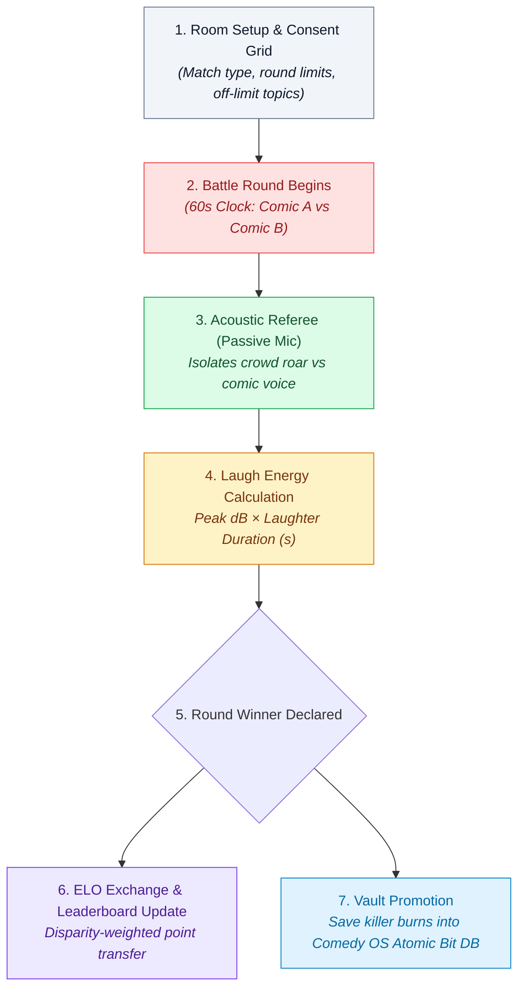

# 🥊 Roast with Friends: Stand-Up Social Battle Engine

> **System Separation Notice:** This section is an independent product extension. It leverages the underlying **Comedy OS Atomic Bit Database** and **DSP Acoustic Reaction Isolation**, but is architecturally decoupled from the core Comedy OS solo stand-up workflow.
> 
> *Core Comedy OS Vault Link:* [[Comedy_OS_Note_Taker_Vault/00_Comedy_OS_Note_Taker_Architecture|Comedy OS Master Architecture]]

---

## 🎯 Executive Summary & Concept

**Roast with Friends** transforms joke writing and insult comedy into a structured, real-time social game for comedians, writers, and friend groups.

While solo stand-up is non-adversarial, **roasting is fundamentally competitive (PvP)**: two or more participants trade targeted jokes, and the room decides who delivered the sharper, heavier punchlines.

By placing a smartphone on the table running Comedy OS's acoustic isolation model, the app acts as an **impartial, automated referee**—measuring audience laughter volume and duration without requiring manual judging or awkward debates.

---

## 🏛️ How It Relies on Core Comedy OS Infrastructure

Roast with Friends does not reinvent audio engineering; it plugs directly into Comedy OS modules:

1. **Acoustic Laughter Isolation ([[Comedy_OS_Note_Taker_Vault/11_Audience_Laughter_and_Silence_Isolation|11_Audience_Laughter_and_Silence_Isolation]]):**
   Uses dual-band DSP filtering (200Hz–3.5kHz comic speech vs 500Hz–8kHz crowd roar) to detect laughter explosions without being tricked by the speaker yelling into the mic.
2. **Atomic Bit Vault ([[Comedy_OS_Note_Taker_Vault/40_Atomic_Bit_Database|40_Atomic_Bit_Database]]):**
   Comics pull written roasts from their private bit vault or immediately promote successful improvised comebacks into their personal library.
3. **Delivery Notation & Timing ([[Comedy_OS_Note_Taker_Vault/23_Inline_Delivery_Notation_Engine|23_Inline_Delivery_Notation_Engine]]):**
   Logs setup economy, pause control (`💤`), and cadence.

---

## 📚 Section Modules

* [[01_Game_Modes_and_Battles|01: Game Modes & Battle Formats (1v1, Cypher, Topic Sprint)]]
* [[02_Acoustic_Referee_and_Scoring|02: Acoustic Referee & Objective Scoring Algorithm]]
* [[03_ELO_and_Social_Ladder|03: Competitive ELO Rating, Matchmaking & Leaderboards]]
* [[04_Safety_and_Consent_Borders|04: Safety, Sportsmanship & The Consent Boundary Matrix]]
