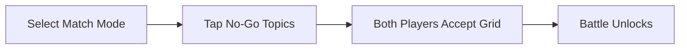

# 🛡️ Safety, Sportsmanship & The Consent Boundary Matrix

Roasting walks a razor's edge between brilliant comedic audacity and genuine interpersonal harm. As veteran roastmasters (Jeff Ross, Tony Hinchcliffe) emphasize: **roasting without mutual consent is just bullying.**

To keep Roast with Friends fun, safe, and sustainable among friends, the system enforces pre-battle **Consent Boundaries**.

---

## 🚫 Pre-Match "No-Go" Topic Checklist

Before a match initializes, both players tap their device to establish agreed boundaries:

### Boundary Categories:
* 👨‍👩‍👧 **Family & Children:** Strictly off-limits unless explicitly un-checked by both parties.
* 🏥 **Medical / Health / Sobriety:** Protects personal battles, recovery, and illness.
* 💔 **Recent Traumas / Breakups:** Prevents exploiting fresh real-life heartbreak.
* 💸 **Finances & Living Situations:** Respects personal economic dignity.
* ⚠️ **Custom Safe-Word / Foul Button:** If a joke crosses an unwritten line, either player or the referee can tap the **"Foul" button**, pausing the round for 30s to recalibrate.

---

## 🤝 The Roast Contract (Post-Match Handshake)

* Immediately following the battle, both comics are prompted to tap a mutual **"GG / Respect" button**.
* If both confirm, the ELO exchange processes.
* If a player feels violated, the match is flagged for review or discarded, protecting friendships over competitive scores.
