# 🟢 Productive ("Good") Beliefs That Drive Mastery

> **The Stand-Up Laboratory Mindset:** Mastery in comedy is not an innate genetic gift or a mystical lottery. It is an iterative, empirical discipline where stage reps serve as experiments, laughter serves as acoustic confirmation, and dead silence serves as neutral diagnostic telemetry.

This document synthesizes the operational beliefs of elite joke architects and touring headliners (Louis C.K., Sarah Silverman, George Carlin, Jay Leno, Neal Brennan, Sam Morril, Jimmy Carr, Mike Birbiglia) identified during user research, mapping each belief directly to the **Comedy OS** architecture.

---

## 🗺️ Visual Beliefs Architecture

```mermaid
flowchart TD
    Root["🟢 Productive ('Good') Beliefs That Drive Mastery"]
    
    Root --> B1["1. Bombing is painful but necessary<br/><i>(The Stage is a Laboratory)</i>"]
    Root --> B2["2. Working out a set is necessary<br/><i>(Atomic Iteration & Testing)</i>"]
    Root --> B3["3. Explaining context matters<br/><i>(Bringing audience on a trip)</i>"]
    Root --> B4["4. Brevity & precision of thought win<br/><i>(Economy of Syllables)</i>"]
    Root --> B5["5. Gimmicks need clear purpose<br/><i>(Authentic Voice over Props)</i>"]
    Root --> B6["6. Punching up jokes is vital<br/><i>(Tag Expansion & Angles)</i>"]
    Root --> B7["7. Asking peers for punch-ups<br/><i>(Low-Ego Feedback Loop)</i>"]
    Root --> B8["8. Listening to own sets is the way<br/><i>(Killing the Cringe Barrier)</i>"]
    Root --> B9["9. Reusing old bits is a problem<br/><i>(Preventing Artistic Stagnation)</i>"]

    style Root fill:#dcfce7,stroke:#16a34a,stroke-width:3px,color:#14532d
    style B1 fill:#f0fdf4,stroke:#22c55e,color:#166534
    style B2 fill:#f0fdf4,stroke:#22c55e,color:#166534
    style B3 fill:#f0fdf4,stroke:#22c55e,color:#166534
    style B4 fill:#f0fdf4,stroke:#22c55e,color:#166534
    style B5 fill:#f0fdf4,stroke:#22c55e,color:#166534
    style B6 fill:#f0fdf4,stroke:#22c55e,color:#166534
    style B7 fill:#f0fdf4,stroke:#22c55e,color:#166534
    style B8 fill:#f0fdf4,stroke:#22c55e,color:#166534
    style B9 fill:#f0fdf4,stroke:#22c55e,color:#166534
```

---

## Part I: The 9 Practical Craft Beliefs (FigJam Canvas Tree)

### 1. Bombing is painful but necessary
* **Comedian Framing:** Bombing is an unavoidable rite of passage and the sharpest diagnostic tool available. If you don't bomb, you aren't testing the boundaries of your material.
* **Impact on Craft:** Eliminates paralysis and shame. Transforms dead air from a personal indictment into calibration data.
* **Addressed by Features:**
  * [[Comedy_OS_Note_Taker_Vault/11_Audience_Laughter_and_Silence_Isolation|11_Audience_Laughter_and_Silence_Isolation]]: Isolates dead air valleys (< -38dB) and logs length of silence.
  * [[Comedy_OS_Note_Taker_Vault/33_Reaction_Waveform_Alignment|33_Reaction_Waveform_Alignment]]: Identifies Pacing Flares (WPM spikes >25%) and Rushed Recoveries (<0.8s) when bombing.
  * [[Comedy_OS_Note_Taker_Vault/31_Visual_Diff_Report|31_Visual_Diff_Report]]: Highlights automated "Skid Recovery" riffing after a missed punchline.

### 2. Working out a set is necessary
* **Comedian Framing:** A set is not a random collection of thoughts blurted out on stage; it is an engineered sequence with structural transitions, momentum ramps, and callback threads.
* **Impact on Craft:** Disciplines the writer to organize setlists deliberately and run focused workshops on open-mic nights rather than rambling.
* **Addressed by Features:**
  * [[Comedy_OS_Note_Taker_Vault/42_Drag_And_Drop_Modular_Setlist_Timeline|42_Drag_And_Drop_Modular_Setlist_Timeline]]: Modular drag-and-drop setlist builder with time targets and balance gauges.
  * [[Comedy_OS_Note_Taker_Vault/41_Jokes_As_Living_Objects_State_Machine|41_Jokes_As_Living_Objects_State_Machine]]: Manages jokes through a formal lifecycle: `Draft` ➔ `Testing` ➔ `Stage Ready` ➔ `Retired`.

### 3. Explaining the context matters (bringing the audience with you on a trip)
* **Comedian Framing:** If the audience doesn't understand the world, the premise, or your internal logic within the first 10 seconds, the punchline will never land. You cannot expect them to read your mind.
* **Impact on Craft:** Forces crisp world-building, clear setup economy, and intentional tonal anchoring.
* **Addressed by Features:**
  * [[Comedy_OS_Note_Taker_Vault/23_Inline_Delivery_Notation_Engine|23_Inline_Delivery_Notation_Engine]]: Notates setup world-building, premise context, and stage act-outs (`🤸`).
  * [[Comedy_OS_Note_Taker_Vault/31_Visual_Diff_Report|31_Visual_Diff_Report]]: Detects when crucial setup premises were rushed or omitted.

### 4. Brevity & precision of thought win
* **Comedian Framing:** Stand-up is poetry written with syllables of tension and release. Every unnecessary filler word, throat-clearing stammer, or repetitive qualifier dilutes the punch.
* **Impact on Craft:** Tightens joke cadence; maximizes Laughs-Per-Minute (LPM) and clarity.
* **Addressed by Features:**
  * [[Comedy_OS_Note_Taker_Vault/21_Distraction_Free_Markdown_Pad|21_Distraction_Free_Markdown_Pad]]: Minimalist writing environment focused purely on syntax and cadence.
  * [[Comedy_OS_Note_Taker_Vault/31_Visual_Diff_Report|31_Visual_Diff_Report]]: Word-level comparison flagging fluff words added onstage versus the tight written script.
  * Words-Per-Minute (WPM) & Syllable Density telemetry.

### 5. Using tools and gimmicks needs a very clear purpose
* **Comedian Framing:** A prop, costume, guitar, or strange voice cannot substitute for premise substance. If a prop is used, it must be the core engine of the joke, not a crutch hiding weak writing.
* **Impact on Craft:** Prevents comics from becoming cheap novelty acts; forces reliance on authentic joke architecture.
* **Addressed by Features:**
  * *(Discussion Point)*: Tagging bits with execution mechanics (e.g. `[Physical]`, `[Voice]`, `[Prop]`) in [[Comedy_OS_Note_Taker_Vault/40_Atomic_Bit_Database|40_Atomic_Bit_Database]] to evaluate whether the bit lands on verbal merit alone.

### 6. Punching up jokes is vital
* **Comedian Framing:** A single punchline is only the entry ticket. The real mileage and career longevity come from writing 3 to 5 layered tags, alternate punchlines, and callbacks.
* **Impact on Craft:** Multiplies joke yield; turns a 15-second chuckle bit into a 90-second showstopper run.
* **Addressed by Features:**
  * [[Comedy_OS_Note_Taker_Vault/40_Atomic_Bit_Database|40_Atomic_Bit_Database]]: Hierarchical parent bit with child tags (`Tag A`, `Tag B`, `Tag C`).
  * [[Comedy_OS_Note_Taker_Vault/32_Dropped_Tag_Alerts|32_Dropped_Tag_Alerts]]: Flags written tags that the comic accidentally dropped onstage due to adrenaline or early transitions.

### 7. Asking other people for punch ups is a good way to improve and learn
* **Comedian Framing:** Comedy is written in solitude but polished in the back of the room with peers. Pitching tags in the green room reveals blindspots and alternate angles.
* **Impact on Craft:** Overcomes ego, broadens perspective, and accelerates punchline iteration.
* **Addressed by Features:**
  * [[Comedy_OS_Note_Taker_Vault/14_Conversational_Chat_With_Set_Tape|14_Conversational_Chat_With_Set_Tape]]: Contextual AI co-writer / sounding board querying past bits and pitching punchline angles.
  * *(Future Feature Consideration)*: Peer punch-up export / green-room collaboration links.

### 8. Listening to own sets is the way to improve
* **Comedian Framing:** As Nikki Glaser, Jay Leno, and Marc Maron admit: the tape never lies. Listening to your set is where B-material becomes A-material.
* **Impact on Craft:** Bridges the gap between subjective onstage sensation and objective reality.
* **Addressed by Features:**
  * [[Comedy_OS_Note_Taker_Vault/13_Whisper_ASR_Speech_To_Text|13_Whisper_ASR_Speech_To_Text]]: Automated speech-to-text with millisecond timestamps so comics can read their set instead of enduring cringe audio.
  * [[Comedy_OS_Note_Taker_Vault/14_Conversational_Chat_With_Set_Tape|14_Conversational_Chat_With_Set_Tape]]: "Chat with your tape" allows asking questions without reliving the bomb.
  * [[Comedy_OS_Note_Taker_Vault/31_Visual_Diff_Report|31_Visual_Diff_Report]]: Highlights ad-libs in green and skips in red within 60 seconds post-show.

### 9. Reusing old bits is a problem. What is causing it?
* **Comedian Framing:** Relying on 5-year-old "banker bits" that are guaranteed to kill is a comfort trap. It creates an illusion of mastery while creative development atrophies.
* **Impact on Craft:** Identifies fear of bombing as the root cause; forces the writer to constantly inject fresh workshop material.
* **Addressed by Features:**
  * [[Comedy_OS_Note_Taker_Vault/41_Jokes_As_Living_Objects_State_Machine|41_Jokes_As_Living_Objects_State_Machine]]: Flags "Stale" bits that have exceeded healthy stage cycles without iteration and suggests moving them to `Retired`.
  * **Set Freshness Index**: Displays percentage of new/workshop material vs. tested material in the setlist timeline.

---

## Part II: The 5 Deep Psychological Pillars (Research CSV)

### Pillar 1: "The stage is a laboratory, not a referendum on my worth."
* **Source & Context:** Formulated by Louis C.K. and Sarah Silverman. Joke delivery is treated like mixing two chemical compounds in a beaker to see if they produce ammonia.
* **Impact on Craft & Stage Presence:** Completely eliminates the "Cringe Barrier" when reviewing tape and allows the comic to detach their ego during a bomb.
* **Telemetry & Features:**
  * Post-Set Composure Telemetry: Tracks Words-Per-Minute (WPM) drift and post-joke recovery latency.
  * Visual flags for **Pacing Flare** (tempo spikes >25%) and **Rushed Recovery** (jumping into the next setup in <0.8s).
  * Automated Skid Recovery Logging: Extracts improvised comebacks and queues them into the [[Comedy_OS_Note_Taker_Vault/40_Atomic_Bit_Database|Atomic Bit Database]] as reusable Escape Tags.

### Pillar 2: "I am the king of the room; never give the audience the upper hand."
* **Source & Context:** George Carlin's mandate to Carrot Top and Helen Mirren's advice to Neal Brennan (*"I don't have to convince them I'm the king, I am the king"*).
* **Impact on Craft & Stage Presence:** Projects immediate authority. Crowds tense up when a comic begs for approval; when status is effortlessly held, the audience relaxes into laughter.
* **Telemetry & Features:**
  * Room Context Tagging: Marking cold, hostile, or echo-heavy rooms to weight acoustic laugh scores accurately.
  * Composure recovery metrics measuring silence control and unhurried delivery cadence.

### Pillar 3: "Protective Delusion" (Early Career) + "Low Self-Esteem Listening" (Late Career)
* **Source & Context:** Sam Morril notes that early delusion protects young comics from realizing how impossibly hard the craft is. Conversely, Jay Leno credits "low self-esteem" for keeping him humble enough to listen when strangers or venue staff say a joke sucks.
* **Impact on Craft & Stage Presence:** Balances the audacity required to step up to an open mic with the ruthless, ego-free self-editing required to cut weak material.
* **Telemetry & Features:**
  * Pre-Show Mental Mapping vs Post-Show Diff Engine.
  * Ladder Progression Mechanics (inspired by Chess.com rating ladders) to track personal craft consistency rather than toxic peer competition.

### Pillar 4: "Silence and discomfort are where growth happens."
* **Source & Context:** Louis C.K. believes that coasting on old jokes that "kill" puts your growth to sleep, whereas standing in 60–90 seconds of silence breaks through the panic barrier and unlocks new comedic power.
* **Impact on Craft & Stage Presence:** Prevents comics from becoming hacky crowd-pleasers; teaches comics to use pauses as tension-building mechanisms rather than panic voids.
* **Telemetry & Features:**
  * **Breathe Counter / Pause Metric**: Measures deliberate pauses (>1.5s) between setup and punchline vs panicked dead-air rushes.
  * **Set Freshness Index**: Balances 80% polished material with 20% raw workshop testing.

### Pillar 5: "Comparison is the thief of joy—privilege the work."
* **Source & Context:** Jimmy Carr, Neal Brennan, and Mike Birbiglia emphasize that fixating on peer milestones (Netflix specials, viral clips, follower counts) causes toxic "career dysmorphia." The only variable within control is joke output and stage reps.
* **Impact on Craft & Stage Presence:** Insulates the performer from industry bitterness, maintaining sharp daily focus on writing habits.
* **Telemetry & Features:**
  * **Stage Reps & Stage Hours Counter**: Tracks cumulative time on mic and joke volume over vanity metrics.
  * Private Vault Sandbox in [[Comedy_OS_Note_Taker_Vault/01_Ghost_Mode_Distraction_Shield|01_Ghost_Mode_Distraction_Shield]]: Zero distraction, offline-friendly joke workbench.

---

## 🔗 Related Vault Connections
* **Canvas:** [[Beliefs.canvas|Beliefs Canvas Architecture]]
* **Counterpart Note:** [[Destructive_Beliefs|Destructive Beliefs That Stall Careers]]
* **Parent Pain Spectrum:** [[?? Persona 1 Pain Spectrum - Bombing]]
* **Mermaid Flowchart:** [[UX/Visual_Architecture_Flowchart|Visual Architecture Flowchart]]
