# 🛑 Destructive ("Bad") Beliefs That Stall Careers

> **The Amateur Trap:** Stand-up comedy has an exceptionally high attrition rate not because joke writing is mathematically impossible, but because comedians succumb to cognitive distortions, ego defenses, and the emotional trauma of public silence.

This note outlines the destructive assumptions identified across 200+ veteran interviews, Kill Tony performance breakdowns, and comedy club research (Nikki Glaser, Neal Brennan, Tony Hinchcliffe, Jay Leno, Roseanne Barr, Marc Maron, John Mulaney, Mike Lawrence). It cross-references how **Comedy OS** systematically dismantles these traps.

---

## 🗺️ Visual Architecture of Destructive Beliefs

```mermaid
flowchart TD
    Root["🛑 Destructive ('Bad') Beliefs That Stall Careers"]

    Root --> B1["1. 'If I heal my trauma, I won't be funny'<br/><i>(The Tortured Artist Fallacy)</i>"]
    Root --> B2["2. 'It's the room's fault when my bit bombs'<br/><i>(The External Blame Trap)</i>"]
    Root --> B3["3. 'I don't need to prepare or memorize; I'll just wing it'<br/><i>(The Wing-It Delusion)</i>"]
    Root --> B4["4. 'Vulnerability is weakness; I need an aggressive mask'<br/><i>(The Persona Shield)</i>"]
    Root --> B5["5. 'Listening to myself bomb is too humiliating to endure'<br/><i>(The Cringe Barrier)</i>"]
    Root --> B6["6. 'Every laugh means the material is making me better'<br/><i>(The Clapter & Cheap Laugh Rut)</i>"]
    Root --> B7["7. 'Bombing is avoidable'<br/><i>(The Avoidance Paralysis)</i>"]
    Root --> B8["8. 'The audience knows the reference'<br/><i>(The Missing Context Blindspot)</i>"]
    Root --> B9["9. 'Gimmick or prop is the act'<br/><i>(The Crutch Trap)</i>"]
    Root --> B10["10. 'Stealing jokes is fine / Asking for help makes me weak'<br/><i>(The Isolation Distortion)</i>"]
    Root --> B11["11. 'Editing is optional / Never drop old working bits'<br/><i>(The Stagnant Set Trap)</i>"]

    style Root fill:#fee2e2,stroke:#ef4444,stroke-width:3px,color:#991b1b
    style B1 fill:#fff1f2,stroke:#f43f5e,color:#881337
    style B2 fill:#fff1f2,stroke:#f43f5e,color:#881337
    style B3 fill:#fff1f2,stroke:#f43f5e,color:#881337
    style B4 fill:#fff1f2,stroke:#f43f5e,color:#881337
    style B5 fill:#fff1f2,stroke:#f43f5e,color:#881337
    style B6 fill:#fff1f2,stroke:#f43f5e,color:#881337
    style B7 fill:#fff1f2,stroke:#f43f5e,color:#881337
    style B8 fill:#fff1f2,stroke:#f43f5e,color:#881337
    style B9 fill:#fff1f2,stroke:#f43f5e,color:#881337
    style B10 fill:#fff1f2,stroke:#f43f5e,color:#881337
    style B11 fill:#fff1f2,stroke:#f43f5e,color:#881337
```

---

## Detailed Breakdown of Destructive Beliefs

### 1. "If I heal my trauma or become happy, I won't be funny anymore."
* **Manifestation:** Nikki Glaser and Neal Brennan point out that comics often actively avoid emotional stability, therapy, or healthy routines out of superstitious terror that their comedy comes exclusively from suffering.
* **Impact on Craft:** Leads to chronic burnout, depression-induced creative paralysis, and substance abuse.
* **Reality:** Millions of depressed or traumatized people are not funny at all. Comedy comes from keen observation, cognitive pattern recognition, and ruthless editing—not misery.
* **Comedy OS Solution / Feature Mapping:**
  * [[Comedy_OS_Note_Taker_Vault/01_Ghost_Mode_Distraction_Shield|01_Ghost_Mode_Distraction_Shield]]: Creates an insulated, peaceful environment that frames joke writing as deliberate craft rather than tortured chaos.
  * ⚠️ *User Input Needed:* Does Comedy OS want a specific habit/wellness/writing-streak telemetry feature here?

### 2. "It's the room's fault when my joke bombs; the audience is dumb."
* **Manifestation:** Blaming a "stiff corporate crowd," "dumb tourists," or a "dead room" whenever a bit falls flat.
* **Impact on Craft:** Completely blinds the performer to weak setups, over-explaining, bad acoustic timing, or faulty internal logic.
* **Reality:** As Jay Leno and Tony Hinchcliffe emphasize, the audience is an objective acoustic mirror. If they aren't laughing, the premise or the delivery is broken.
* **Comedy OS Solution / Feature Mapping:**
  * [[Comedy_OS_Note_Taker_Vault/11_Audience_Laughter_and_Silence_Isolation|11_Audience_Laughter_and_Silence_Isolation]]: Objective DSP decibel logging of crowd reactions that strips away subjective perception.
  * [[Comedy_OS_Note_Taker_Vault/33_Reaction_Waveform_Alignment|33_Reaction_Waveform_Alignment]]: Shows exact silence durations and flags rushed punchlines so the comic sees the real diagnostic cause of the miss.

### 3. "I don't need to prepare or memorize; I'll just wing it or read off my notes on stage."
* **Manifestation:** Beginners show up to open mics expecting to purely riff in the moment or stand on stage staring down at cell phones and crumbled paper notes.
* **Impact on Craft:** Destroys eye contact, cadence, room authority, and stage presence.
* **Reality:** On *Kill Tony*, veterans like Roseanne Barr and Tony Hinchcliffe ruthlessly dismantle open-micers who don't prepare. Stand-up is like a musical production: effortless spontaneity is the result of relentless rehearsal and memorization.
* **Comedy OS Solution / Feature Mapping:**
  * [[Comedy_OS_Note_Taker_Vault/42_Drag_And_Drop_Modular_Setlist_Timeline|42_Drag_And_Drop_Modular_Setlist_Timeline]]: Pre-show mental mapping and rehearsal pacing timelines.
  * [[Comedy_OS_Note_Taker_Vault/31_Visual_Diff_Report|31_Visual_Diff_Report]]: Highlights where winging it caused forgotten tags or ramble bloat.
  * [[Comedy_OS_Note_Taker_Vault/32_Dropped_Tag_Alerts|32_Dropped_Tag_Alerts]]: Instantly reveals dropped punchlines resulting from lack of rehearsal.

### 4. "Vulnerability is weakness; I have to put on an aggressive shield or 'comedian' mask."
* **Manifestation:** Beginners adopt loud, shock-jock personas, excessive cursing, or ironic detachment to mask stage fright.
* **Impact on Craft:** Creates immediate barrier between performer and audience; causes crowds to recoil or turn hostile.
* **Reality:** Mike Lawrence, Roseanne Barr, and Marc Maron emphasize that audiences turn against fake posturing, whereas raw honesty about actual flaws makes crowds root for the comic.
* **Comedy OS Solution / Feature Mapping:**
  * [[Comedy_OS_Note_Taker_Vault/23_Inline_Delivery_Notation_Engine|23_Inline_Delivery_Notation_Engine]]: Encourages authentic stage delivery, personal vocal inflection (`🗣️`), and act-outs (`🤸`) over hollow yelling.

### 5. "Listening to myself bomb on tape is too humiliating to endure." (The Cringe Barrier)
* **Manifestation:** Storing hundreds of hours of voice memos on a smartphone that are never opened because hearing one's own voice during dead air triggers visceral nausea.
* **Impact on Craft:** **The single greatest bottleneck in stand-up comedy.** Stalls career progression entirely; prevents B-grade material from maturing into tight A-grade bits.
* **Reality:** Nikki Glaser admits avoiding her tapes stalled her for years. The fastest-improving comics review their tape immediately.
* **Comedy OS Solution / Feature Mapping:**
  * [[Comedy_OS_Note_Taker_Vault/13_Whisper_ASR_Speech_To_Text|13_Whisper_ASR_Speech_To_Text]]: Transcribes stage audio automatically so comics can **read** their set instead of enduring cringe audio.
  * [[Comedy_OS_Note_Taker_Vault/31_Visual_Diff_Report|31_Visual_Diff_Report]]: Converts 15 minutes of emotional dread into a neutral, color-coded diff report in 60 seconds.
  * [[Comedy_OS_Note_Taker_Vault/14_Conversational_Chat_With_Set_Tape|14_Conversational_Chat_With_Set_Tape]]: Enables querying performance questions directly (*"Where did my cadence spike?"*) without listening to dead air.

### 6. "Every laugh or applause break means the material is making me better."
* **Manifestation:** Addiction to easy crowd pandering, cheap shocks, local references, or political "clapter" (applause of agreement rather than spontaneous laughter).
* **Impact on Craft:** Traps the comic in an artistic dead-end. Louis C.K. warns that relying on guaranteed cheap tricks puts creative growth to sleep.
* **Reality:** Clapter and polite chuckles do not equal repeatable, tour-worthy joke architecture.
* **Comedy OS Solution / Feature Mapping:**
  * [[Comedy_OS_Note_Taker_Vault/11_Audience_Laughter_and_Silence_Isolation|11_Audience_Laughter_and_Silence_Isolation]]: Distinguishes acoustic laugh profiles: High-energy belly roar (Tier A: > -6dB, >3.5s) vs. polite chuckles or polite clapping.
  * [[Comedy_OS_Note_Taker_Vault/41_Jokes_As_Living_Objects_State_Machine|41_Jokes_As_Living_Objects_State_Machine]]: Requires verified cross-room performance data before graduating a joke from `Testing` to `Stage Ready`.

### 7. "Bombing is avoidable."
* **Manifestation:** Believing that talented comics never eat dirt; avoiding new premises out of terror of having a cold set.
* **Impact on Craft:** Stagnation and fear of experimentation.
* **Reality:** Bombing is an essential calibration step. Even 30-year masters bomb regularly when developing new hours.
* **Comedy OS Solution / Feature Mapping:**
  * [[Comedy_OS_Note_Taker_Vault/33_Reaction_Waveform_Alignment|33_Reaction_Waveform_Alignment]]: Post-Set Composure Telemetry frames flatlines as data points, logging automated Skid Recovery tags.

### 8. "The audience knows the reference."
* **Manifestation:** Assuming esoteric, hyper-niche, or local concepts will be instantly understood by a general audience without context.
* **Impact on Craft:** Premise falls flat because the setup failed to establish shared reality.
* **Comedy OS Solution / Feature Mapping:**
  * Context & Premise Setup tagging in [[Comedy_OS_Note_Taker_Vault/23_Inline_Delivery_Notation_Engine|23_Inline_Delivery_Notation_Engine]].

### 9. "Gimmick / prop is the act."
* **Manifestation:** Bringing props, costumes, or dogs on stage to distract from the lack of written jokes.
* **Impact on Craft:** Prevents development of core writing and stage authority.
* **Comedy OS Policy:** Comedy OS is explicitly designed for purist stand-up craft and joke architecture, not novelty prop routines.

### 10. "Stealing jokes is fine if I do it" / "I don't need help from others."
* **Manifestation:** Plagiarizing bits or refusing peer feedback in green rooms out of arrogance or insecurity.
* **Impact on Craft:** Industry blacklisting, reputational ruin, and narrow creative horizons.
* **Comedy OS Solution / Feature Mapping:**
  * [[Comedy_OS_Note_Taker_Vault/40_Atomic_Bit_Database|40_Atomic_Bit_Database]] & Version History: Immutable cryptographic/timestamped joke provenance.
  * ⚠️ *User Input Needed:* Does Comedy OS plan to introduce peer feedback or punch-up collaboration features?

### 11. "Editing is optional / Bits that work, work for a reason; no need to remove them."
* **Manifestation:** Refusing to cut words or clinging to 5-year-old bits because they are safe.
* **Impact on Craft:** Set stagnation; comic never builds a second or third hour of original material.
* **Comedy OS Solution / Feature Mapping:**
  * [[Comedy_OS_Note_Taker_Vault/41_Jokes_As_Living_Objects_State_Machine|41_Jokes_As_Living_Objects_State_Machine]]: Automates the lifecycle of jokes, flagging stale bits for retirement.

---

## ⚠️ Unassigned Beliefs / Open Design Questions for Discussion

| Destructive Belief | Current Status | Proposed Comedy OS Solution | Needs User Decision? |
| :--- | :--- | :--- | :--- |
| **"If I heal my trauma, I'll lose my edge"** | Mindset context | Wellness / habit tracker or streak counter | ❓ Yes — should Comedy OS address comic mental health or stay strictly craft-focused? |
| **"Gimmick / prop is the act"** | System boundary | Out of scope for Comedy OS (craft-first policy) | ❓ Confirm scope exclusion |
| **"Stealing jokes is fine"** | Intellectual Property | Timestamped bit creation proof & semantic similarity checker | ❓ Is plagiarism checking in scope? |
| **"Asking for help makes you look weak"** | Collaboration | Peer feedback / shared writer's room module | ❓ How should external peer review work? |
| **"Successful comics are just lucky"** | Data analytics | ELO / Stage-reps ladder showing direct correlation between reps and laugh yield | ❓ How should progression ladders be visualized? |

---

## 🔗 Related Vault Connections
* **Canvas:** [[Beliefs.canvas|Beliefs Canvas Architecture]]
* **Counterpart Note:** [[Constructive 'Good' Beliefs|Productive Beliefs That Drive Mastery]]
* **Parent Pain Spectrum:** [[?? Persona 1 Pain Spectrum - Bombing]]
* **Mermaid Flowchart:** [[UX/Visual_Architecture_Flowchart|Visual Architecture Flowchart]]
